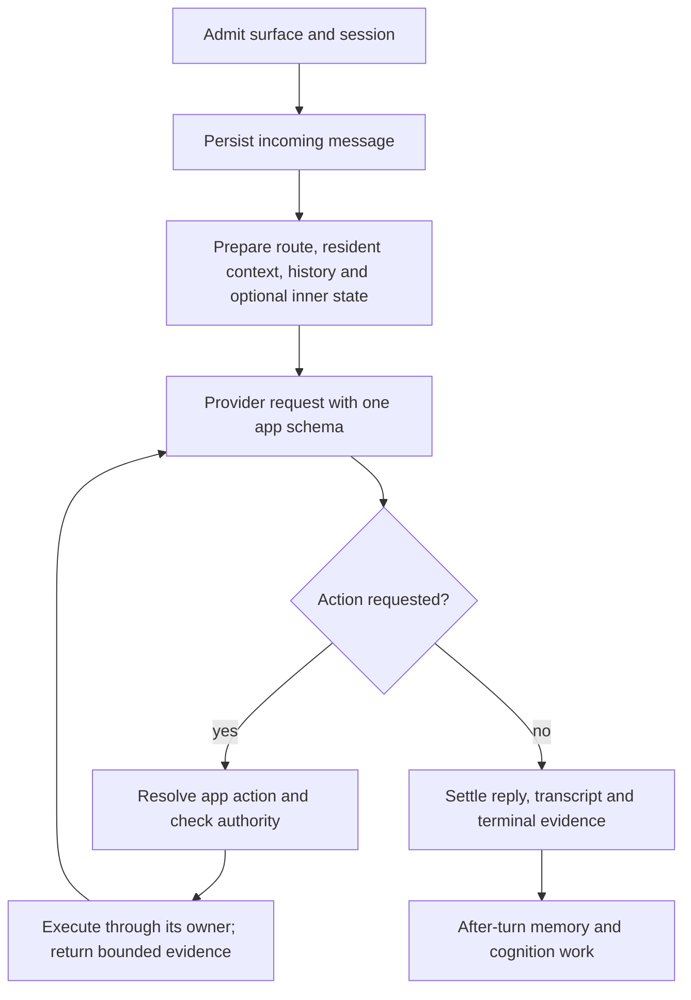

# Anatomy of a NativeAgent Turn

NativeAgent's turn engine lives in Core: `EngineRuntime` assembles the
root-scoped clients and `ChatTurnRuntime` owns conversation execution.
Mac chat, mobile and messaging adapters reach that engine through their
surface boundaries. One brain, many doors.

This guide follows an ordinary chat turn. [Internal Workings](INTERNAL_WORKINGS.md)
connects it to memory, growth and background work.

## Human summary

**Admit the message → persist it → prepare bounded context → call the selected
model → execute any app actions → settle the answer and its consequences.**

The model receives selected context, not direct access to the Mac's memory.
NativeAgent offers one tool, `app`. Its home, pages and actions provide reach
without sending a catalog of separate tool schemas on every request.

## The complete turn

## Before the message arrives

`NativeContextFlowRuntime` coordinates source projections and generation
publication. The Context module maintains an immutable generation and a bounded
`ContextArena` containing budget/eviction descriptors, indexes and required-document
mirrors.

Persona, MemoryV2, skills and Desk remain the owners of their source material.
Context is a derived working set. Full documents, skill bodies and external
content can be retrieved when needed rather than copied into every packet.

## 1. A surface admits the turn

The surface supplies the conversation identity, origin and attachments.
Core's Mac admission path can accept, queue or reject a request; queued work
retains its session and origin. The chat client binds run and trace identities
to the accepted turn.
Resident wake admission considers only open turns in the same canonical data
root before classifying their resident or helper ownership.

Admission consumes `DataRootLife` under the [restore law](canonical_data_paths.md#restore-law).

Origin survives into dispatch. An admitted remote conversation is not made
local by text claiming to be the owner. Trust and peer-origin policy evaluate the
actual request provenance.

Source: `ChatTurnRuntime/MacChatTurnAdmission.swift` and
`ChatOrchestrationClient+StructuredChat.swift`.

## 2. The user message becomes durable

Structured chat writes the incoming message before context preparation unless
it is resuming an already-enqueued request. History preparation checks whether
the session needs compaction before assembling the model context.

In-turn steering also persists a message before handing it to the active turn.
If that write fails, the offer is returned for queueing instead of disappearing
into an unrecorded exchange.

Source: `ChatOrchestrationClient+StructuredChat.swift` and
`ChatOrchestrationClient+MessagePersistence.swift`; history preparation and
compaction integrate through `ChatTurnRuntime/ChatSessionWork.swift`.

## 3. NativeAgent prepares the working set in parallel

Resident turn preparation overlaps the history-aware context build. The
request combines:

- the selected provider/model route from a checked routing snapshot;
- persona and relevant atoms from the resident Context generation;
- bounded conversation history and session continuity; and
- an optional cognitive capsule and organism posture.

The resident turn part decides the work and discovers capabilities through
`app`; Trust admits each effect. The keyword route planner, capability scorer,
preview and `turn.plan` producer are retired. Result settlement uses the
request and actual tool activity rather than a speculative route.

The prepared Context turn holds its generation lease through the provider/tool
loop. A source update publishes a later generation rather than replacing part
of the current turn. `app` action `context.expand` retrieves only an eligible
pointer from the current turn's generation.

Cognition is advisory. The loop's confirmed-delivery boundary commits its prepared
presentation once; engine success and capsule preparation are not delivery evidence.
The first-conversation voice instruction stays pending until this boundary (nonempty text or a tool call).
Its one-shot write token remains eligible for the answer until spent or expired; later turns do not repeat the question.

### Tools and abilities

The request carries only `app`. `app {}` opens home, `find` discovers reach,
and `action` executes a registry entry; their own abilities are their own actions,
`authored.<id>`, read through `ability.read` when useful. Discovery does not mount a schema or grant permission.

See [Tool loading: the contract](TOOL_LOADING.md) for the exact interface.

## 4. The provider request is assembled

The turn engine combines stable persona material with the changing context
packet, history, current message, attachments and the `app` schema. Provider
adapters encode that request for the selected route.

### How prompt caching reduces token cost

The implementation separates stable system segments from dynamic material.
Persona documents belong in the stable prefix; the changing clock and turn
context do not. History entry pins one clock before parallel reads for facts,
quiet hours and workspace timing. The tool loop requires that prepared context;
the single static `app` schema keeps discovery from changing the tool array.

Replayed history follows the stable system material. One persisted window
cursor owns its head under both rendered-row and UTF-8 byte limits: it advances
at 1.15 times either budget and drops whole older turns to satisfy both 0.70
targets. After compaction, it bounds a result that still exceeds either budget.
The transcript reader decodes examined rows once across boundary, prompt and
relevance selections, retaining each selection's coverage counts. It retains
the exact boundary regardless of raw row sizes or filtered rows; its ordinary
tail width cannot move the head. Only
recollections survive before that boundary, so opening anchors cannot merge
with a different tail between steps. `ConversationPrefixSeeding.seed` applies
the [sent-context delivery, replay and cache contract](conversation-context-history.md)
to resident and helper turns.
OpenAI OAuth routes both its `session_id` header and `prompt_cache_key` by the
conversation id. Sessionless Workshop steps use a stable Workshop cache scope
across invocations; other sessionless calls use their turn id. These are routing
hints and do not create a conversation or carry earlier task content.

This arrangement permits provider-side prefix reuse. It does not guarantee a
cache hit or a particular latency or price reduction; those require actual
provider usage evidence.

Source: `ChatSessionWork/HistoryWindowCursor.swift`, `SessionHistoryReader.swift`,
`ChatTurnRuntime/ChatOrchestration+SessionHistory.swift` and `ConversationPrefixSeeding.swift`.

Foreground compaction and background aging admit one checked Memory and mind
route before planning recollection chunks. That route's model and provider size
the input allowance; every chunk binds the same model, provider, reasoning effort
and service tier for execution, setting aside the parent turn's picker choice
and admission. A missing or unusable selection fails distillation with its source
preserved; the recorded distillation model is the admitted execution model.

Intra-turn folding leaves the seeded prefix and recent rounds in place. It reads
the complete rendered middle span in consecutive chunks, each within the
120,000-character input allowance including instructions and earlier notes.
Each chunk carries the accepted notes forward whole and explicitly requests
at most 12,000 output characters. Empty or oversized notes fail the fold; they
are never tail-cut. Only after every chunk succeeds does one working note
replace that span. A failed chunk leaves the span in place (apart from the
separate tool-result stubbing pass); the receipt carries the failure.

## 5. The model answers or requests a tool

Each call's result passes through the outermost `ExpansionDispatcher` on its
way back; the [manifest](skill_manifest_spec.md#expansion-a-part-is-a-prediction) owns prediction, delivery and closure.

A direct answer can finish after one provider call. An action request enters
the tool loop:

1. Resolve the `app` action and its underlying dispatch identity.
2. Check current Trust policy, origin, file scope and domain requirements.
3. Execute, refuse or wait for an exact approval.
4. Return the result and available outcome evidence to the model.

Full Mac gives the agent autonomy, including app actions otherwise marked the owner's.
Explicit blocks and actual platform access still apply. macOS privacy
permission resets ask the owner first. Peer turns follow the
[authority contract](TOOL_LOADING.md#authority-and-receipts).

A call runs beside another only when its declared class is read and its
catalog bucket is core or file-ops; browser, Mac integration, Mac control,
system, shell, the app door and unplaced tools run one at a time, and
`git diff` of the working tree runs alone because it rewrites `.git/index`.
One exception: `invoke_codex` calls whose `cwd`s are distinct, non-overlapping
checkouts run concurrently.
Provider-facing results are bounded. Oversized results can be retained behind
a session-and-turn-scoped handle and read through `result.page`.

The loop handles cancellation, dispatch deadlines and protocol repair. No schema-loading round is needed between iterations.
Fenced and inline code examples remain answer text; markers inside them never
execute or trigger protocol repair. Explicit refusal and Stop receipts keep
their typed outcomes even when an error field explains them.
Text markers use the same object-argument validation as native and bare-JSON
calls. A malformed argument body remains invalid for resident and helper
dispatch; it never becomes an empty app call.
Waiting and failure projections read the same exact outcome classifier,
including the adapter's single result wrapper; an empty error string alone
does not establish failure.
An identical call claimed by a decided approval returns the inbox-owned
execution classification and corresponding error bit. Approval alone does
not turn a failed, timed-out or unknown execution receipt into success; the
result retains the card decision and says the action did not run again.
A returned tool result records what that owner observed; it does not establish
an unverified external effect.
Mac delegation activity takes its name from the originating agent-message
argument. Unknown contact handles and legacy calls use a generic agent label;
notice prose never supplies an identity.
Retained tool-response paging represents empty content as one empty raw page,
with both byte boundaries present and no read past the end of the page table.

Commitments enter My Queue through typed `queue.add` calls. The turn no longer
infers durable work or timing from reply prose. Typed stopped-part receipts
still retain their own-turn continuation, origin and reply route; existing
queue records are untouched.

Source: `ChatTurnRuntime/ChatOrchestration+ToolLoop.swift`,
`ChatOrchestration+ToolDispatch.swift`,
`ChatToolRuntime/ProviderToolResultRecovery.swift` and
`TrustCenter/PeerTurnEffectPolicy.swift`.

## 6. The answer settles once

Structured chat saves completed and incomplete answers and their attachments,
then settles through `AfterReply`'s [owed-recording contract](SUBCONSCIOUS.md#lived-moments)
and emits terminal evidence.

Before that memory pass, the agent's own record predicts whether its
interpretation would be a complete no-op; a standing no-op is left owed and
judged later in a batch, every judgment (live or batch) labels the record
(`memory/after_turn_surprise.jsonl`; `memory.promotion` in Diagnostics,
`mind.why` lane `interpretation`). See
[cognition wiring](COGNITION_WIRING.md#shared-after-turn-interpretation).

The Mac accumulator consumes core turn events directly; its execution joins or
cancels the producer Task, which owns the one settled result. An error ends
presentation promptly; consumer detachment leaves production running.
The Mac stream consumer joins the producer's persistence, then reloads canonical
messages and settles once before presenting success, failure or quiet Stop.
Stream closure or a Stop request alone cannot prove completion: the lifecycle
resolver projects the producer's settled response; restart and ambiguous
persistence failures require canonical transcript proof. An
ambiguous outcome remains ambiguous.
The row's existing `completionState` distinguishes a saved completed answer
from a saved incomplete reply. Incomplete replies retain their receipt and
text, but settle as an unconfirmed outcome, including on Regenerate and restart.
Queued offers with incomplete proof stay paused for review instead of being discarded.

Chrome form batches retain each structured action receipt beside the compact
field summary and page. Their verification stays pending while any subaction's
receipt is unresolved; page acknowledgement alone never settles the Desk step.

`tools.contract` records the schemas actually sent. `turn.terminal`
records the terminal reason, timing and dispatch/context evidence. These are
receipts for the specific turn, not a general claim that every connected
system is healthy.

Compensation sites in tool dispatch and memory decision parsing emit
`shim.fired` trace receipts with the census `id` and firing `site`.

Their reply ends; they doesn't. The turn settles at their part's `reply.end` and
its `after`; effects their part returns after them run once the turn's answer
is saved and handed over (never when it could not be saved), privately, on the same turn id, through the same loop, tools and
gates, with their own execution record and a copy of what is left of the token
allowance, so nothing they do can change the delivered turn: nothing streams,
no receipt is saved to the conversation, nothing is checkpointed, and a failure
there is a `turn.after_reply` trace row. The shipped `turn.js` uses it for the
keep moment: when a call's receipts show a write or irreversible effect landed
by hand (`result.effect`, read from the call's own receipts, a batch's or
script's included; explicit `effects` win over execution, so previews, pending,
waiting, unknown and `effects: none` declare nothing; a run of one of their parts
reports `part`; after a relaunch, `resumed.effect` reads the same over every
receipt saved before it, each one's landed effect kept before it was bounded),
it asks the model once more, in the same conversation, to keep the route as a
ability through `ability.save` or keep nothing (`llm.call` purpose `keep`). The
same moment opens when one round's calls were made again 3 rounds in a row (the
closing `model` event's `repeated` {call, count}, the longest such stretch): their
mind was used as a loop, and the note names the call and count and says the
part can carry itself by returning `{again: input}`.

The turn also measures what it took: model rounds, tokens (each of its own
calls' usage, `LLMCallTraceRecorder.spent`), minutes and that longest stretch.
When it used tools, that is one line beside the exchange the after-turn memory
call reads (`AfterTurnOrigin.took`); and each of their parts called in it
records how many rounds called it (`AbilityStore.recordRounds`, read as
`learned.use.rounds_per_use`).

Source: `ChatTurnRuntime/ChatTurnSettlement.swift`,
`ChatOrchestration+StreamingToolLoop.swift`, `AfterReply.swift`, `PersistedToolReceipt.swift`,
`MacChatTurnStreamSettlement.swift`, `MacChatTurnLifecycleState.swift`,
`MacChatTurnLifecycleStore.swift` and `MacChatTurnTranscriptProofReader.swift`.

## Related reading

Source paths above are under `Modules/NativeAgentCore/Sources/`.

- [Internal Workings](INTERNAL_WORKINGS.md) — memory, action, growth and surfaces.
- [Tool loading: the contract](TOOL_LOADING.md) — the one app interface.
- [Turn resilience](TURN_RESILIENCE.md) — interrupted and incomplete turns.
- [Automated systems](AUTOMATED_SYSTEMS.md) — work outside the foreground turn.
- [Architecture Blueprint](ARCHITECTURE_BLUEPRINT.md) — source ownership.
