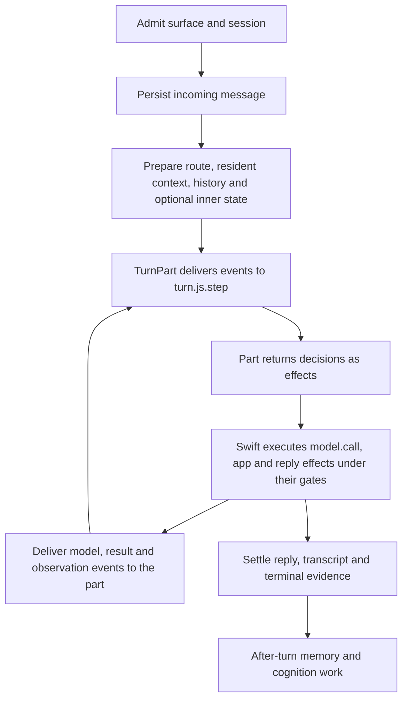

# Anatomy of a NativeAgent Turn

NativeAgent's turn engine lives in Core: `EngineRuntime` assembles the
root-scoped clients and `ChatTurnRuntime` owns conversation execution.
Mac chat, mobile and messaging adapters reach that engine through their
surface boundaries. One brain, many doors.

This guide follows an ordinary chat turn. [Internal Workings](INTERNAL_WORKINGS.md)
connects it to memory, growth and background work.

## Human summary

**Structured admission → `TurnPart` → `turn.js.step` decisions → Swift effect
execution → settlement.** Persistence and bounded context preparation precede
delivery of the admitted message to the part. The part decides what happens next;
the Swift stem runs its effects under the ordinary authority gates.

The model receives selected context, not direct access to the Mac's memory.
NativeAgent offers one tool, `app`. Its home, pages and actions provide reach
without sending a catalog of separate tool schemas on every request.

## The complete turn

## Before the message arrives

`NativeContextFlowRuntime` coordinates source projections and generation
publication. The Context module maintains an immutable generation and a bounded
`ContextArena` containing budget/eviction descriptors, indexes and required-document
mirrors.

Persona, MemoryV2, skills and Desk remain the owners of their source material.
Context is a derived working set. Full documents, skill bodies and external
content can be retrieved when needed rather than copied into every packet.

## 1. A surface admits the turn

The surface supplies the conversation identity, origin and attachments.
Every door admits through `TurnAdmission.run` with its arrival as a typed value
(`TurnArrival`: words, attachments, surface, and a row that is shown, hidden or
already saved); envelope, origin, run and taint come from the door's own turn.
An arrival that waits for a busy conversation is also offered to their open turn
there (`ChatTurnSteering`). Read at a step, admission returns `.steered`: that
turn's reply answers it, so the door that sent it posts nothing and only settles
its own record. If its own place in line comes first, it runs as its door's
normal turn. The person's and their own untainted words join any turn of theirs;
peer-steered arrivals join only a turn that same sender started under the same steering, so
nothing rides past the floor its own turn would meet. Their own arrival's narrower
file-access ceiling must also be held by the reading turn; otherwise it waits
for its own place. A door accepts an arrival
only once it is durable in its own intake record (Mac: its saved row and turn
checkpoint; Telegram: its inbox claim; Slack: its journal record; phone: its
CloudKit record), and launch re-admits what is still unanswered. There is no
queued-turn store and no successor turn. Work that
never joins another turn (a regenerate, a restored run, their unaddressed wake, a helper's
loop) uses `runAlone`. The chat client binds run and trace identities to the
accepted turn.
Resident wake admission considers only open turns in the same canonical data
root before classifying their resident or helper ownership.
News with a recorded conversation enters that conversation as a hidden arrival
through the same admission. If read by their open turn, it sends nothing else;
otherwise its reply returns through that conversation's recorded door. In an agent
conversation with no open turn, its answer row becomes the contact's send row
and the conversation store holds its exchange for the contact's next door call.
The `agent-held` reply route keeps this settlement out of person-result notices;
completion records `completed` / `held_for_contact` after that handoff, while
the held exchange alone owns actual delivery. Chosen silence holds nothing.
The resident ledger still owns the claim and thread hop/rest limits.
Missing conversations or routes owe repair,
never a reply through another line. Helper sessions are not targets: their minds
remain their own. News without a conversation keeps their resident-wake line.
A line of them (`agent.job` with `agent: "self"`) is admitted the same way:
`OwnLineDoor` opens its own-work conversation, named by the job, and runs the
brief as its arriving message through `TurnAdmission.run` on their own surface,
carrying the commissioning turn's limits: its peer steering and its file access,
which the line's request can only narrow further. It runs on their conversational
gate with the chat approval filer, so an act that needs the person raises the
same card their turn would, naming the line's conversation; answering the card
continues the line there. Its `lineInstructions` turn
part, when they wrote instructions, becomes the persona text their turn part reads;
everything else in §3 and §4 is the same for the line.

Admission consumes `DataRootLife` under the [restore law](canonical_data_paths.md#restore-law).

Origin survives into dispatch. An admitted remote conversation is not made
local by text claiming to be the owner. Trust and peer-origin policy evaluate the
actual request provenance.

**A turn is held, never inherited.** The turn is one value, `Turn`
(NativeAgentCore): its act id, its run and session, and each owner's part of
it (envelope, rows, admission, steering, the turn's sinks and ledgers), every
part declared by its owner beside its own type. `TurnRequest.turn(parent:)`
makes it once at ingress from the request's explicit verified fields; a
nested turn derives from its parent and changes only what it states. It is
handed by value to everything that serves the turn: the orchestration, each
tool dispatch (`ToolDispatchClient.dispatch(…turn:invocation:)`), each model call
(`LLMCall.turn`), persistence and settlement. Work that runs later (settle, a
callback, a detached task) holds the same value, so it cannot lose the turn.
Every dispatcher has that same required call shape: tool, input, surface, turn
and `ChatToolInvocation`. The invocation is a Core value whose owners declare
operation parts beside their types; a profile forwards it without needing to
know those parts. Studio wander, desktop courier and part thoughts carry it through their gates and host calls. The courier binds its held Mac
operation and keeps the tighter call deadline. There is no smaller dispatch
overload, separate operation-aware protocol or runtime capability adapter.
Operation ceilings belong to the held `ChatToolInvocation`: `ChatTurnWork`
and `AppActionExecution` expose views of that same chain. Refining either
view or receiving a nested invocation changes the ceilings that human waits
pause and part progress renews. Dispatch carries those live ceilings without
freezing their remaining time into an absolute Mac, sense or program wait budget.
Bridge tool ingress hands its newly bounded chain to dispatch; ability management
takes the caller's whole `Parts.Invocation`.
The [deadline contract](TURN_RESILIENCE.md#3-tool-dispatch-deadline) distinguishes
active-work, wall-clock and response-only ceilings.
Each boundary still sets the values it owns on what it passes down. Stream
admission sets a supplied Mac takeover on the turn read by native actions;
without a supplied reply row and session it clears the mounted reply row.
Neither value is left for callers to reconstruct from another projection.
Task-locals carry only what belongs to the call stack itself: trace
correlation (`TurnTraceContext`'s id, bus and route) and the locks the stack
holds (`FileLockScope`, the capped-append permit). No decision or write reads
turn identity from them. Mac UI owners (including Send, Regenerate, Research
Lab and local card decisions) construct the person's local envelope through
`TurnEnvelope.personOnMac`; it never names the agent's `self`. Native part
and helper owners name their own native origin through `native`.
Mac commands invoked by an existing turn retain that caller's provenance;
the same command name cannot turn a remote caller into a local person.
A card answer continues the card's recorded request, not the answering door's
turn. Inline continuations stamp `originTurnId` once at filing; only that act
in that session can receive the hand-back, and the open-turn owner checks the
same act. Every replay, including a waiting host's, uses the card's recorded
envelope and its verified signature witness. Missing identity or origin leaves
the continuation unresolved with a visible repair instruction. A standalone
card continuation that arrives while another request is answering is a hidden
arrival: their turn reads it at its next step and writes no row for it, as a hidden
bubble writes none; if its own place comes first it runs as its own hidden turn
with the card's origin. Domain approvals without a
request envelope execute their bounded approved effect as a local approval
act; the resolving door records who decided, never the effect's authority.
Chat approval replay likewise installs the verified card's exact origin on
the held host turn before dispatch.
turn identity from them. Trace events read the held turn's reply route through
the envelope owner's bound reader, including in detached settlement. An event
without a held turn captures trace correlation at construction; reconstruction
supplies the recorded route fields, including their absence. A held turn with
no route never borrows another task's destination or thread.
The native Mac Send owner declares its
local origin in the envelope; native part, helper and Research Lab owners name
their native origin; approval replay builds the verified card's exact origin.
`TurnEnvelope.current(turn:surface:)` reads only the turn's envelope; with none it
returns unauthenticated, remote-marked provenance, and a tool's surface
spelling cannot grant local authority.
Session/helper ownership is checked before turn registration or resident facts;
an unreadable index does not select the resident path.

Boundaries still set the values their nested work requires. Each structured
execution creates a fresh sense-read ledger and carries it through dispatch and
after-turn memory; an enclosing execution's served versions do not enter it.
A part thought hands its tool host the originating request's words, including
an absent request, rather than its generated prompt.
Tool dispatch sets the enclosing tool act on the same `Turn`; terminal ability
accounting keeps that exact act as its repair cause, and keeps absence empty.
The root turn ID cannot stand in for an absent or nested tool act.

Source: `ChatTurnRuntime/MacChatTurnAdmission.swift` and
`ChatOrchestrationClient+StructuredChat.swift`.

## 2. The user message becomes durable

Structured chat writes the incoming message before context preparation unless
it is resuming an already-enqueued request. History preparation reads its verbatim transcript once before fitting the tail at whole-turn checkpoints.

Receipt indexing reads one checked action catalog per batch of at most 64 new
rows and hands it through argument and result redaction, including nested app
calls. Lookup misses stay in that snapshot; they never rediscover the live
catalog. A failed catalog read leaves indexing unavailable, rather than
substituting an empty catalog. A correlated indexing batch records
`history.projection.catalog` with only its row and binding counts.

Canonical history requires valid UTF-8 and whole JSONL row coverage. Resident
and helper turns refuse preparation with the transcript owner's failure when
history cannot be read or validated. Resident history failures carry
`transcript_unavailable`, an exact transcript repair pointer and repair owed;
they stop before provider execution.
Helper shared-contact-history failure also
ends preparation rather than becoming an ordinary empty history. Completion
deduplication and index counts require checked transcript reads before deciding
that a run is absent or publishing a message count.

Quiet hours use a checked `user_prefs.json` window. A missing file or absent
window is unset; present unreadable or malformed preferences stop context
preparation and hold dependent resident wakes and delivery with repair owed.
Deadline readers book no quiet-hour boundary while the window is unavailable;
preference/clock invalidation rearms them after repair. The body withholds its
diurnal projection until that preference can be read. Update notes
and session directives likewise distinguish absence/expiry from damage. The
provider's acceptance stamps their delivery durably; a failed stamp remains
repair owed. Launch publishes the complete update note before advancing the
last-launched version, so a note read/write failure cannot consume the update.

`off` remains an explicit current Context Flow setting and uses direct
persona/recall assembly; its trace source is `direct` and its count is
`memory.recallHits.direct`. Active preparation failure never selects it or
recommends switching to it as a repair. Ambient mid-turn recollection records
`mind.came_to_mind.read` with `deadline`, `unavailable` or a checked `no_match`;
embedding or selection failure owes repair instead of looking like no memory.
Degraded sources withheld before ambient verification carry the same unavailable
verdict and keep their repair debt. Invalid present mode/budget configuration
also remains unavailable under the [configuration law](INTERNAL_WORKINGS.md#what-fluid-context-means-across-the-system).
The existing 400 ms wait ends only that moment's wait. Token spend is complete
only when every provider round supplied complete usage; otherwise the turn says
token usage is unavailable.

A steered arrival's row is saved before the round that reads it: shown words
under the arrival's own run and shown row id, a saved row consumed, a hidden
one writing nothing. If that write fails the arrival keeps waiting and runs as
its own turn. A round that reads it but stops before output leaves it waiting
with its row saved; its own turn then reuses that row, since a run's user row
is written once. Only an arrival their open turn can read cuts the round; a
peer's words ride only into a turn from that same door.

Source: `ChatOrchestrationClient+StructuredChat.swift` and
`ChatOrchestrationClient+MessagePersistence.swift`; history preparation and
tail fitting integrates through `ChatTurnRuntime/ChatSessionWork.swift`.

## 3. NativeAgent prepares the working set in parallel

Resident turn preparation overlaps the history-aware context build. The
request combines:

- the selected provider/model route from a checked routing snapshot;
- persona and relevant atoms from the resident Context generation;
- up to six open intentions read directly from MY QUEUE for this turn;
- bounded conversation history and session continuity; and
- an optional cognitive capsule and organism posture.

Preparation reads the held turn's model admission through
`ContextBudgetPolicy.resolve(turn:dataRoot:)`; it cannot choose a route when one
is missing. Fresh ephemeral work admits its route at ingress and carries that
same turn through preparation and provider execution.
History replay and earlier snippets take a required resolved budget rather than
an optional token window. Missing admission or verified window fails before
preparation. The [history contract](conversation-context-history.md) owns this boundary.

Read-only current facts start beside history and context assembly. Contact
availability is read live there, alongside workspace facts; its runtime input
still joins at the same position after the history-sensitive elsewhere line.
Both the early elsewhere read and its late composition enter through
`ChatWorkspaceBinding`, which binds the workspace owner's ports. The late
entry also covers a missing early reading and selected-exchange consumption.
Neither contacts nor the cognitive capsule use a time-based cache.
The person's Agent-view reader supplies its read-only authored-program host to
both preview projections, including helper faces; preview work has no turn and
cannot acquire a tool-dispatch path from the conversation on screen.
The transcript owner's byte slices require the requested seek to succeed before
reading. Contact pages, routine replies and other-room projections carry a failed
slice as unavailable with its cause; no changed offset or empty slice stands in
for it. An unavailable early elsewhere reading returns that same source failure
at late composition. It cannot become a clean no-news reading or acknowledge
what they did not read. MY QUEUE message readiness keeps that read unavailable,
distinct from a successfully observed wait for the person to write.
One contact summary reads each needed credential once while checking token
uniqueness among every contact's readable keys. Each unreadable contact keeps
its own named failure while readable siblings proceed; those results end with
that summary.
Effect authorization performs its own fresh credential checks.

The resident turn part decides the work and discovers capabilities through
`app`; Trust admits each effect. The keyword route planner, capability scorer,
preview and `turn.plan` producer are retired, along with the recent trace
reader's plan-specific selection, reconciliation and title branches. Retained
ledger rows remain readable as history. Result settlement uses the
request and actual tool activity rather than a speculative route.

The prepared Context turn holds its generation lease through the provider/tool
loop. A source update publishes a later generation rather than replacing part
of the current turn. `app` action `context.expand` retrieves only an eligible
pointer from the current turn's generation.

Cognition is advisory. The loop's confirmed-delivery boundary commits its prepared
presentation once; engine success and capsule preparation are not delivery evidence.
The first-conversation voice instruction stays pending until this boundary (nonempty text or a tool call).
Its one-shot write token remains eligible for the answer until spent or expired; later turns do not repeat the question.
The progression owner supplies the same role/voice wording and exact titles to
the kickoff and later directives. Ordinary Trust authorizes each persona append.
Successful matching appends settle progression after the writer returns, under
`settle`; a denied, pending, previewed or failed write never spends the token.
The next-step token is durably committed before its predecessor is spent. A
settlement failure preserves the successful write and reports progression repair
owed, without inviting another append.

### Tools and abilities

The request carries only `app`. `app {}` opens home, `find` discovers reach,
and `action` executes a registry entry; their own abilities are their own actions,
`authored.<id>`, read through `ability.read` when useful. Discovery does not mount a schema or grant permission.

See [Tool loading: the contract](TOOL_LOADING.md) for the exact interface.

## 4. The provider request is assembled

`ChatOrchestration+StreamingToolLoop.swift` opens `TurnPart` and delivers the
message event, the facts of the moment, read-only: `text`, the authorizing
`surface` and the arrival `door`, `attachments`, `who` (`person`, `self` or
`agent:<id>`), `verified` (the transport-attested user id, or null), `trust`,
`steered_by` (the peers steering the turn) and `posture` (`full_mac`, `work`,
`safe`, or `unreadable: <cause>`; the saved posture, which untrusted steering
still caps to Work at each gate). The part's `Resources/abilities/turn.js` owns
the decisions: `step(state, event)` requests the first `model.call` on every
message, `stable(persona, pins)` assembles persona/guidance/pins, and
`dynamic(context, recall)` orders the changing packet. `TurnPart` retains the
system and tool offering of the first `model.call`, whenever it comes; the Swift
loop composes them into the prepared context and re-seeds the request then. A
turn that acts or ends before any `model.call` sends no request. Provider adapters
encode the request for the selected route. Tool continuation, their own acts and
reply-ending decisions return through `step`, rather than being prompt policy
in the Swift helpers.

The changing packet can include `# USER (pinned)`, `# What I mean to do`,
`# Live sense news`, `# Relevant context (derived from canonical local sources)`
and deeper-context pointers; the optional `[CognitiveSubstrate]` capsule joins
the turn's context separately. The intention section gives one bounded line
per open step: its words, moment and until. Clock moments come soonest first,
then other steps by newest update, with at most six lines and no empty section.
User's turns and their own carry their/person-origin steps (including older
`owedToPerson` steps); peer turns carry only that peer's recorded intentions,
regardless of Trust elevation. Unidentified peer provenance discloses none.
`ChatOrchestration+Intentions.swift` reads the live Desk owner;
`TurnContextPreparation.swift` adds the facts to `TurnReach.packet`, the same
material whose delivered keyframe or delta is retained in the turn owner's
`diagnostics/fed/<session>.json`. See
[Intentions — As built, 10-30](INTENTIONS.md#as-built-10-30).

Automatic direct recall carries MemoryV2's write owner (`MemoryV2Defaults.personaID`),
not the compiled persona document slot, to its ownership and surface-disclosure
filters. A failed direct recall or attention read stops preparation with its cause;
only a checked empty read means no inputs. Active semantic recall consumes the
embedding owner's checked ticket. Its existing deadline ends the wait, while
the runtime retains the embedding read until settlement; pending or failed
readings cannot select lexical recall.

Explicit app previews use the recorder's same predicate to exclude their whole
dispatch from familiarity and ambient recollection. Expansion act proposals under
`ready_to_confirm` are excluded at every depth of result traversal; ordinary sibling
results remain eligible. An oversized document attachment supplies selected passages,
an explicit no-match, or an unavailable selection reason. No-match and selection
failure never substitute the document's introduction; a specific section or
document location can be requested for the next read.

Workspace retained reads publish their completed source failure as unavailable,
with its cause, rather than leaving a failed read pending or using its old value
as this reading. Transcript classification, open/seek/read, complete JSONL rows
and helper history are checked. An incomplete trailing append waits for its
newline; it is not accepted as a completed row. Elsewhere carries its source
failure into the turn; shared contact timeline reads fail at that same owner.
Queue conditions likewise require checked approval and conversation evidence
before evaluating readiness. A shown home or completed Mac act keeps its real
result if its seen/window bookkeeping fails and owes repair for that write.

`AgentScreen.elsewhere` carries what changed in other rooms since their last reply
in this one (the last hour if they have not replied here yet): the person's words
on every other conversation and their answers there (the newest four exchanges, 280
characters per side, older ones counted), the other conversations they are mid-turn
in right now, their own wake, up to five completed bridge exchanges (600 characters
per side), and up to three helpers' newest replies, newest helper first. Every
later step of the turn, after their reply too, carries `AgentScreen.breath`: this same
reading and rendering with the window starting at their last step, so a message they
gets or answers on another door, a post, a wake or a bridge exchange reaches this
line while it is still working. The same window also reads `act` experiences
whose outcomes report `effects: occurred`, resolving their cause to the heard
experience's exact transcript row. It excludes this conversation and helper
sessions, and carries the newest eight as `<door> you <action> <status>`, oldest
first, with `+N more` for the rest. A peer-steered line carries these action names
only from person doors that the word reading admits; bridge and wake actions stay
out. Missing or unreadable record evidence names its failure and leaves the
step's cursor unchanged. Each nonempty step reading records `context.breath` with
its lines and `read` flag in the record's detail grain. A peer-steered line gets
only door, count and time for speech. Each helper
line names its bot-store owner as `name (my helper) since your last reply here`
and quotes only the newest reply's first sentence, at most 200 characters. The
same incremental transcript index reads the word sources and supplies indexed
acts' originating rows; the transcript owner's row resolver reads unindexed
evidence. Helpers' rooms stay out of the
person's door timeline. This replaces reading helpers by tool just
to learn what they last did. What they said first on one of their doors — a post of
theirs, not a reply (a check-in summary, an intention's words) — is kept apart from
the door lines and carried as `You posted to <person> on <door> <age> ago: "<first
sentence>"` (door, count and time only on a turn a peer steers), so they knows what
they already told them (10-30: an open Desk step made their believe a summary they had
posted at 9:02 never went out). "Remember across conversations" off closes the
whole summary. Peer-steered turns carry no helper or bridge words and no words
from the person's other doors; a wake's words also stay out. The per-turn memo
keeps person-started and peer-steered summaries separate.

### How prompt caching reduces token cost

The implementation separates stable system segments from dynamic material.
Persona documents belong in the stable prefix; the changing clock and turn
context do not. History entry pins one clock before parallel reads for facts,
quiet hours and workspace timing. The tool loop requires that prepared context;
the single static `app` schema keeps discovery from changing the tool array.

Replayed history follows the stable system material. The
[conversation context contract](conversation-context-history.md) owns its
verbatim tail and stateless whole-turn checkpoints in half-budget jumps when the
composed request reaches the model's default window. There is no generated summary or
per-turn trimming. The decode memo still keys only exact UTF-8 row bytes, with
at most 2,048 rows and 8 MiB of input keys; it never owns selected history or
supplies missing transcript evidence. Speech stays whole, and leading assistant
or tool rows receive a historical header.
`ConversationPrefixSeeding.seed` applies
the [sent-context delivery, replay and cache contract](conversation-context-history.md)
to resident and helper turns.
OpenAI OAuth routes both its `session_id` header and `prompt_cache_key` by the
conversation id. Sessionless calls on the `workshop` surface (the morning
brief's) share one stable cache scope across runs; other sessionless calls use
their turn id. These are routing
hints and do not create a conversation or carry earlier task content.

This arrangement permits provider-side prefix reuse. It does not guarantee a
cache hit or a particular latency or price reduction; those require actual
provider usage evidence.

Source: `ChatSessionWork/SessionHistoryTail.swift`, `SessionHistoryReader.swift`,
`ChatTurnRuntime/ChatOrchestration+SessionHistory.swift` and `ConversationPrefixSeeding.swift`.

### Measuring the work before the model

`turn.accepted` is emitted after incoming-message persistence, before the acceptance checkpoint. `context.history.summary` carries
the history read, rendering, base-context and current-facts timings;
`context.summary` carries the nested selection, recall, persona and schema work.
These stages overlap or nest, so their medians must not be added.

`turn.preparation.summary` separates checkpoint, history/context, the remaining
cognitive join and capsule append/filter. `turn.dispatch.summary` separates
turn-part opening, codec lookup, prefix seed and the remaining work through
route dispatch. It marks `bookkeepingParallel`; `turn.bookkeeping.summary`
retains the same `turn.sent_context_persist`, `turn.prefix_telemetry` and
`turn.context_snapshot` stage names for work running beside the request.
These are elapsed work times, not added dispatch latency. The turn joins that
work before tool execution, reply settlement and every throwing exit after
it starts. A healed seed joins its predecessor before starting its own parallel
write, so an older write cannot replace the context actually sent. The
provider's `llm.call` receipt joins the pending prefix computation, including
on failure, before reading its fingerprints. Request encoding reads no such
diagnostic. `context.ready` still records the assembled-context boundary;
the redacted snapshot and its local fed-context file can arrive later. The
opening-request snapshot is captured after tail fitting, from the final
seed, codec system layout and the message array passed to streaming. Its system
and schema measurements include the actual text-marker protocol/catalog when
selected; the prompt fingerprint covers that system and every wire message.
Fed-context publication reserves its root/session identity before escaping into
bookkeeping, rejects superseded reservations, serializes atomic writes and joins
their actual result before turn settlement. It never infers the process's live
root. `context.fed.saved` records saved or superseded publication;
`context.fed.failed` records the actual write failure. The inspector reads through
one `LatestRead` for root/session/refresh, shows loading immediately, and
distinguishes a missing record from unreadable or malformed saved bytes.
The summary's `stageMs` uses the `turn.*` names in `ContextStageTrace`.

`context.facts.*` timings separate clock/notes, contacts, place, glance,
elsewhere reads, the remaining join, taint-sensitive elsewhere composition,
arrivals and runtime rendering. Read-only elsewhere inputs gather beside
history; only after history establishes peer taint are words selected and
contacts marked consumed. That read refreshes the existing transcript index
once for door lines, posts and bridge exchanges. It does not keep another
cross-turn snapshot. `context.glance.read` separates home and parts;
`context.parts.summary` separates inventory, ranking, states/kept parts and
rendering; `context.ranking.summary` names index and embedding
reads that completed. Missing stages are incomplete evidence, not zero work.

The parts glance reads the file-owned catalog directly. Ability source decodes
and validated accounting rows are reused only when each file's `lstat` identity
matches (device, inode, size, mode, mtime/ctime nanoseconds); each read checks it,
and successful writes warm the memo. A walk uses one `lstat` per member; redacted
accounting keys on the checked state identity, without serializing it again.
Bundle sense defaults are read once per resource root, and pure tool-name prose
folding, ranking's word sets and action-index text hashes are reused per exact
input text under a lock with a 4096-entry bound.
There is no inventory actor snapshot, invalidation watcher, background refresh,
wait or pending state. The [manifest spec](skill_manifest_spec.md) owns the list
wording: message matches, then unranked failed/recent abilities;
current-version failures only, descriptions cut at word boundaries, zero/one use
labels, and one findable count for resident or waking abilities. Empty-message
wakes skip ranking. Its 900-character row budget and all-rows-fit read hints
remain. Rendering writes nothing.
The census's live `call_fit` projection is not stored
as a stale verdict, so the glance invents none.

`turn.part.helper` reports `reused`, `sourceDigest` and `version` after the
lease's first step returns. When the helper reaches program completion it
also reports `programReused` from the actual retained body and `freshContext`
as its inverse; absent fields mean opening was not observed, never success.
Completed exclusive leases return an idle opened program to a
pool keyed by data root and the exact `OwnedProgram` (source digest, version,
entry and limits included), with at most four idle roots. A mismatch opens a
new helper; failure or Stop drops the failed process; quit retires the pool.
A busy helper belongs to its turn, so another turn opens its own rather than
waiting. A matching lease retains its JavaScript realm and evaluated body;
the source is evaluated only when that body is absent. Its SDK inputs are
unchanged: the turn has no direct action names or part-path bindings. Each
call replaces frozen `input`/`args`, and its journal and host reach belong to
the requesting turn. The stem still supplies that turn's explicit state and
event; program globals last for the retained realm's life. Source/version
changes reopen rather than reuse those globals. Rehearsals still reset their
realm. The cold first turn still opens a helper.
The reader also reports `history.prompt.decodeCacheHits` and
`history.prompt.decodeCacheMisses` for distinct examined lines across prompt,
boundary and relevance selections. Coverage counts still describe selected
evidence, regardless of reuse.
`context.contacts.summary` reports the live summary's `elapsedMs`,
`contactCount` and `credentialReads`; the latter includes missing and throwing
reads and cannot exceed the number of contacts. A thrown contact-store read
has no successful summary event and still supplies unavailable context.

Prefix diagnostics reuse fully redacted, bounded previews only for identical
input bytes and limits (at most 64 entries and 8 MiB of input keys). Redaction
still precedes truncation on a miss; this memo changes no provider input.

`provider.requestStarted` marks route/adapter dispatch, before adapter request
assembly. `provider.httpRequestStarted` marks each HTTP send attempt after body
assembly and the network-availability wait, immediately before URLSession; it
records only `requestBodyBytes`. It is neither an exact packet timestamp nor
proof of provider receipt, and retries can produce several rows. CLI routes
do not emit this HTTP event. Compare both boundaries against acceptance; an
absent stage or send event is incomplete evidence, never zero latency or a
successful send. The old traces cannot separately assign capsule preparation,
turn-part startup, individual locks, prefix diagnostics or adapter encoding;
the new summaries expose the applicable boundaries without manufacturing
historical step timings.

Long tool rounds keep calls and speech intact. Only overflowing oldest result
bodies become one-line pointers after their exact bodies are retained on disk;
resident and helper delivery share this rule and final request admission.

## 5. The model answers or requests a tool

Before a fresh message's opening `model.call`, the stem asks Expansion's
mind-and-authority practice for `start woke:<what woke the turn>`. A predicted
read with measured-cost standing under `Expectation`, unless withheld, runs
through the ordinary gates and reaches that first call as
`already_looked: [{call, result}]`, under the same deadline and inline ceiling
as follow-up delivery. It never prepares or runs an act, and does not chain
another read at start. The actual first call labels the claim by exact read
and argument match, delivered or unshown; no call before turn closure is a
miss. Retries keep the read; resumed turns do not repeat it. Each settled
claim emits the existing `expansion.check` row with situation, outcome and standing.

Each call's result passes through the outermost `ExpansionDispatcher` on its
way back. Follow-up situations use verb, argument names and status word,
plus the wake on the first call; result field lists no longer fragment
practice. Practice persists across model changes, separately for each mind
and authority. Record v3 folds v2 practices on load, unions situations with
the newest bounded examples, and pools counters only for identical historical
claim signatures. The [manifest](skill_manifest_spec.md#expansion-a-part-is-a-prediction)
owns prediction, delivery and closure; [Surprise](SURPRISE.md) records the
starvation evidence and source-only implementation status.

Words for the person stream as the provider writes them, including words
before a tool call. Mac chat, phone chat, Telegram and Slack keep those words in the
settled reply; successful settlement neither strips them nor folds them away.
Protocol markers and incomplete citations remain held only until they can be read
safely as prose. A pure tool round has no words to display. Each valid parsed
round records `provider.roundOutput` with `round`, `proseCharacters` and
`toolCallCount`; these counts describe provider output, not transport delivery.

A turn is alive exactly while its stream moves, and the person sees that
movement as it happens. Every provider byte is movement, words or not: a
thinking delta, held protocol text, and a call's input as it streams
(`input_json_delta`, Responses argument deltas, Chat Completions tool
fragments, and the OAuth text lane's open `<tool_use name=…>` block). Adapters
report a named call's input as `LLMMessageStreamEvent.callInput` (its name,
its first 256 bytes, its size so far). The stem's stream loop ticks every
movement, words included, at most once a second per turn as a `stream.tick`
trace (`call` and `bytes` when a call is being written), and publishes what is
not already words on screen as `TurnStreamEvent.writing`, in order with the
turn's other progress. The turn's presentation takes it as movement (`lastMovementAt`)
without adding a step; a call being written is one line, `Writing <action> · <size>`,
on the Mac working card and the Work pane, and the Telegram progress face's action,
with an `app` call named by its action once the input names it. The line ends
with the next lifecycle step (the call's dispatch, reply words, a retry). A
phone-originated turn relays the line as its existing `notice` progress; the
Mac card of another door's turn reads the same `stream.tick`. A turn begun on
the Mac does not reach the phone's live line: that relay carries words and
terminals only, and an unknown live kind would settle the phone's bubble.
Nothing here stops a stream: the provider guard keeps owning dead sockets and
Stop keeps owning the person's choice. Only when no byte arrives does the card
age: after 20 seconds its meta line says how long nothing has moved, after 90
its title says no movement, an observation and not a verdict.

The session owns live delivery through `SessionTurnDelivery`, attached at the
shared structured turn boundary before preparation or work. A mounted Mac or
phone stream, Telegram turn card/draft, or Slack preview registers its recipient
for the exact data root, session and run; its lease can retire only that mount.
Without a mounted recipient, the resident engine resolves the bound reply route
through its surface owner. An absent route or a bridge's `caller-result` completion
route resolves the conversation through `HumanConversationReader.readForSessionDelivery`: its recorded
Mac source identifies local transcript presentation even after a bridge row has
arrived; remote delivery uses the latest recorded human reply route, looking past
explicitly peer/mechanical user rows such as a bridge input already saved by enqueue.
An unmarked user row without a valid route still makes remote delivery unavailable;
the index supplies local presentation without reading history. Remote provenance
uses one backward read of at most 2,048 physical rows and 1 MiB, regardless of
total transcript size. A missing row, malformed newer row, or exhausted window
never supplies a destination.
Explicit human replies retain the stricter latest-user-row rule in `read`.
This selection leaves the caller's completion route and authorization unchanged.
Telegram and Slack continuations reserve/reuse their existing
delivery journals and hold their processing claims until preview publication joins.
Recipient retirement asks the same journal's recovery path to settle the canonical
saved answer; a caller need not remember a separate final send. Existing outer
approval/restart settlement reads that journal's idempotent verdict. No saved
answer means no inferred completion or invented reply.
Phone continuation snapshots and terminal delivery use the same live run correlation.
Unmounted Mac replies draw in the canonical transcript facade's streaming state.
Main and detached transcripts and Shotgun subscribe to the session owner's
streaming row by identity; a Mac send's busy reservation or a previous turn's
settled lifecycle cannot suppress that row's live text.
Fresh messages, untaken arrivals, restart resumes, Desk continuations and approval
follow-ups all enter this boundary. The optional `progress` argument is an additional
observer; it cannot substitute for or disable the session's recipient. The old
Telegram/Slack handler-to-chat sink parameters and Mac restart sink forwarding
are removed. If a recipient or recorded route is unavailable, the turn keeps its
normal transcript settlement; absence is neither delivery nor a delivery failure.
`turn.deliveryAttached` records the selected recipient or its unavailability.
Unavailable delivery retains an exact-session/run `RepairOwed` claim with
operation `session.delivery:<session>:<run>`; saving the transcript or finding
a recipient on a later run does not settle that debt. Recovery must deliver
that run's saved answer to its proven destination without repeating its work.
Telegram's `surface.previewAccepted` records successful draft/message API acceptance
with `characters` and `previewKind`; it is not evidence of a visible client render.

The context is prepared once at turn entry. Subsequent calls reuse the seeded
prefix and append results; only a changed turn-part system/tool offering or
context pressure rebuilds it. Checkpoints, Trust, tool execution, receipt
persistence and result-triggered recall still precede the next call. There is
no extra delay to accumulate person-facing text: the phone hands each nonempty
delta to a retained transport mailbox as a full snapshot, replacing unsent
snapshots while an admitted send finishes. The Mac publishes the first changed
snapshot immediately and coalesces later frames. Telegram private chats use
native drafts; Telegram groups and Slack publish editable reply messages while
tools run, then settle those same messages with the complete successful reply.
A failed/stopped turn keeps its spoken group/channel words beside its failure
notice or stopped card. First words have no accumulation delay; subsequent
snapshots coalesce at the transport's
edit interval. Durable delivery owners retain created message IDs and possible
creation before touching the wire; missing acceptance never authorizes another
post. A group preview alone is not a completed answer: restart recovery needs
the canonical saved reply before settling it. Final delivery joins any admitted
preview send so an older edit cannot overwrite the answer. Network delivery and
a visible render remain separate observations from model output.

On phone turns, `surface.replyDeliveryStarted.characters` counts the complete
reply handed to terminal transport. Its timestamp precedes that send; it is
not evidence that the phone received it. An admitted optional snapshot settles
alongside terminal delivery, with both joined before the forwarder exits;
the final send does not wait for that optional network round trip.
Error/Stop envelopes with accumulated words mark their body `partialReply=true`.
The phone applies that text before recording failed/incomplete lifecycle evidence
and resolving the correlation, even when no placeholder or snapshot arrived.
An empty/unmarked terminal body preserves any local partial text; later snapshots
cannot reopen the settled turn. This requires the updated phone companion as well
as the Mac app.

A direct answer can finish after one provider call. An action request enters
the tool loop:

1. Resolve the `app` action and its underlying dispatch identity.
2. Check current Trust policy, origin, file scope and domain requirements.
3. Execute, refuse or wait for an exact approval.
4. Return the result and available outcome evidence to the model.

Full Mac gives the agent autonomy, including app actions otherwise marked the owner's.
Explicit blocks and actual platform access still apply. macOS privacy
permission resets ask the owner first. Peer turns follow the
[authority contract](TOOL_LOADING.md#authority-and-receipts).

A call runs beside another only when its declared class is read and its
catalog bucket is core or file-ops; browser, Mac integration, Mac control,
system, shell, the app door and unplaced tools run one at a time, and
`git diff` of the working tree runs alone because it rewrites `.git/index`.
Provider-facing results are bounded. Oversized results can be retained behind
a session-and-turn-scoped handle and read through `result.page`.

The loop handles cancellation, bounded dispatch response waits and malformed-call feedback. The original tool owns its actual receipt and checkpoint settlement after a wait expires. Native routes execute only structured calls, text-marker routes only their offered markers, and text-only routes execute none. Malformed text is refused without salvage, and helpers share the offered-descriptor admission before the gate chain. No schema-loading round is needed between iterations. [Turn resilience](TURN_RESILIENCE.md#3-tool-dispatch-deadline) owns this contract.
Fenced and inline code examples remain answer text; markers inside them never
execute or trigger protocol repair. Explicit refusal and Stop receipts keep
their typed outcomes even when an error field explains them.
Text markers use the same object-argument validation as native and bare-JSON
calls. A malformed argument body remains invalid for resident and helper
dispatch; it never becomes an empty app call.
Waiting and failure projections read the same exact outcome classifier,
including the adapter's single result wrapper; an empty error string alone
does not establish failure.
An identical call claimed by a decided approval returns the inbox-owned
execution classification and corresponding error bit. Approval alone does
not turn a failed, timed-out or unknown execution receipt into success; the
result retains the card decision and says the action did not run again.
A returned tool result records what that owner observed; it does not establish
an unverified external effect.
Mac delegation activity takes its name from the originating agent-message
argument. Unknown contact handles and legacy calls use a generic agent label;
notice prose never supplies an identity.
Retained tool-response paging represents empty content as one empty raw page,
with both byte boundaries present and no read past the end of the page table.

Commitments enter My Queue through typed `queue.add` calls. The turn no longer
infers durable work or timing from reply prose. Typed stopped-part receipts
still retain their own-turn continuation, origin and reply route; existing
queue records are untouched.

Source: `Resources/abilities/turn.js` (`step`, `stable`, `dynamic`),
`ChatTurnRuntime/TurnPart.swift` (event delivery and effect queue),
`ChatTurnRuntime/ChatOrchestration+StreamingToolLoop.swift` (effect execution),
`ChatOrchestration+ToolLoop.swift` (support and settlement),
`ChatOrchestration+ToolDispatch.swift`,
`ChatToolRuntime/ProviderToolResultRecovery.swift` and
`TrustCenter/PeerTurnEffectPolicy.swift`.

## 6. The answer settles once

Structured chat saves completed and incomplete answers and their attachments,
then settles through `AfterReply`'s [owed-recording contract](SUBCONSCIOUS.md#lived-moments)
and emits terminal evidence.

Before that memory pass, the agent's own record predicts whether its
interpretation would be a complete no-op. User's own turns keep live judgment
unless that claim stands; every other recorded turn is left owed for a batch.
Every judgment (live or batch) labels the record
(`memory/after_turn_surprise.jsonl`; `memory.promotion` in Diagnostics,
`mind.why` lane `interpretation`). See
[cognition wiring](COGNITION_WIRING.md#shared-after-turn-interpretation).

The Mac accumulator consumes core turn events directly; its execution joins or
cancels the producer Task, which owns the one settled result. An error ends
presentation promptly; consumer detachment leaves production running.
The Mac stream consumer joins the producer's persistence and settles once before
presenting success, failure or quiet Stop. It never reloads the view: the turn's
rows are live rows over the saved conversation and settle into the store's own
publication (see [session conversations](session-conversations.md)).
Stream closure or a Stop request alone cannot prove completion: the lifecycle
resolver projects the producer's settled response; restart and ambiguous
persistence failures require canonical transcript proof. An
ambiguous outcome remains ambiguous.

Person-started anchor replies from Mac, iPhone and Slack can mirror to Telegram.
The Mac mirror retains a silent notification policy for both text and images;
saved-answer recovery, successor answers and explicit `/retry` keep that policy.
Ordinary Telegram replies retain their normal notification behavior.

The row's existing `completionState` distinguishes a saved completed answer
from a saved incomplete reply. Incomplete replies retain their receipt and
text, but settle as an unconfirmed outcome, including on Regenerate and restart.

Chrome form batches retain each structured action receipt beside the compact
field summary and page. Their verification stays pending while any subaction's
receipt is unresolved; page acknowledgement alone never settles the Desk step.

`tools.contract` records the schemas actually sent. `turn.terminal`
records the terminal reason, timing and dispatch/context evidence. These are
receipts for the specific turn, not a general claim that every connected
system is healthy.

`tool.dispatch` carries `name`, `phase`, dispatch `status`, `argKeys`, bounded
`args`/`result` previews and a structured `receipt`, plus `durationMs` on
completion and `parentId` for nested calls. Failed rows retain the result's
own `status` as `result_status`, and its supplied `failure_code`, `code`,
`reason`, `argument_path`, `error`, `detail` and `message` as separate fields
beside the preview and in the receipt. Absent fields stay absent; null fields
stay null. Text is secret-redacted before each field is capped at 300 characters
(including the truncation marker); object/array error details become bounded
JSON text. The existing compact `errorDetail` remains available. Standalone
dispatch receipts in the record retain the same failure fields beside their
compact receipt. Failure evidence does not depend on where it appeared in the
500-character serialized result preview.

Compensation sites in tool dispatch and memory decision parsing emit
`shim.fired` trace receipts with the census `id` and firing `site`.

Their reply ends the turn. The turn settles at their part's `reply.end` and its
`after`; a step that returns any other effect after `reply.end` is malformed and
takes the throwing-turn repair, and nothing of theirs runs after the reply. Any step
may end the turn: after a model reply, after a result, or before drawing power at
all. Their end may carry a model reply's words, their own `reply.stream`, selected
attachments, or nothing. With no words or selected attachments, their `reply.end`
settles completed and posts nothing: no assistant row, empty bubble, message or
notification. The heard experience's `answer` obligation settles `accepted`
with `Ref(source: "silence", id: <turn id>)`. Its answer experience records that
choice with conversation evidence, without a face, addressee or delivery
obligation; recovery reads that record instead of replaying the turn. The
terminal records `silence: <turn id>`, and no delivery checkpoint or mirror is
held for it. Like a steered arrival, the phone receives only a live terminal
settlement that removes its waiting placeholder. Missing words without explicit
completed settlement remain missing evidence; provider failures, waiting turns
and interrupted output retain their existing outcomes.

Before the first private keep request, the native stem
meets the hand work that triggered it: ordered tool/action ids of landed writes
or irreversible non-ability calls, without arguments or incidental reads, or
the one call repeated 3+ rounds when there is no such hand work. Its
`practice: ` line goes through `FamiliarLines.firstMet` in `mind/familiar.bin`.
The first meeting only records it; the second and later meetings admit the
keep unless an active ability's current learned-use or validation route
contains those ids in order. Declared reach proves no route.
`practice.keep` records `practice`, `met: first|again` and `kept` (keep
admission, not an ability save). Later rounds of an admitted keep finish
normally. This replaces the unfamiliar whole-turn-signature gate
([Habits H3](HABITS.md#h3--keep-what-repeats-not-what-happened-once)).
Any step may act with their own `{effect: "app", call: {tool: "app", input}}`.
`TurnPart` names it `own_<event index>_<effect position>_<input digest>`, so a
replayed step names the same act. The stem runs consecutive own calls as one
dispatch round through `runToolDispatchRound`, the same door and gates as a
model-named call: Full Mac acts, Work raises the same card and their part gets
the waiting receipt, Safe refuses. Each comes back as a `result` event with its
`id` and no `index`; the conversation carries it as their own call and result.
A started call without a result is uncertain across a relaunch and never runs
again; resume drops every app effect it had not started, and replaying the
`resumed` event keeps that. A step cannot call `app.*` synchronously
(`effects_only`): steps replay on every resume and repair, so a call inside one
would run again.

The familiarity nerve rides inside the turn. After each tool round the native
stem meets the turn's hand work so far: ordered tool/action ids of landed writes
or irreversible non-ability calls, without arguments or incidental reads, or the
one call made 3+ rounds in a row with the same input when there is no such hand
work. A route needs two steps or that loop. Its `practice: ` line goes through
`FamiliarLines.firstMet` in `mind/familiar.bin`, once per route per turn (a
resumed turn counts its restored receipts as already met). The first meeting
only records it. A later meeting, unless an active ability's current learned-use
or validation route contains those ids in order, puts
`practice: {route, hand, loop?: {call, count}}` on that round's last `result`,
at most once a turn. Declared reach proves no route. The shipped `turn.js` makes
it the `note` of its next `model.call`: keep the route with `ability.save` as part
of this work, revise the part they worked around, or let a looped part carry
itself by returning `{again: input}`. `practice.keep` records `practice`,
`met: first|again` and `noted` (or `failed` with the read's cause; the turn goes
on without the note). There is no private model call after the reply and no
`keep` purpose ([Habits H3](HABITS.md#h3--keep-what-repeats-not-what-happened-once)).

The turn also measures what it took: model rounds, tokens (each of its own
calls' usage, `LLMCallTraceRecorder.spent`), minutes and the longest stretch of
one round's calls repeated.
When it used tools, that is one line beside the exchange the after-turn memory
call reads (`AfterTurnOrigin.took`); and each of their parts called in it
records how many rounds called it (`AbilityStore.recordRounds`, read as
`learned.use.rounds_per_use`).

Source: `ChatTurnRuntime/ChatTurnSettlement.swift`,
`ChatOrchestration+StreamingToolLoop.swift`, `AfterReply.swift`, `PersistedToolReceipt.swift`,
`MacChatTurnStreamSettlement.swift`, `MacChatTurnLifecycleState.swift`,
`MacChatTurnLifecycleStore.swift` and `MacChatTurnTranscriptProofReader.swift`.

## Related reading

Source paths above are under `Modules/NativeAgentCore/Sources/`.

- [Internal Workings](INTERNAL_WORKINGS.md) — memory, action, growth and surfaces.
- [Tool loading: the contract](TOOL_LOADING.md) — the one app interface.
- [Turn resilience](TURN_RESILIENCE.md) — interrupted and incomplete turns.
- [Automated systems](AUTOMATED_SYSTEMS.md) — work outside the foreground turn.
- [Architecture Blueprint](ARCHITECTURE_BLUEPRINT.md) — source ownership.
