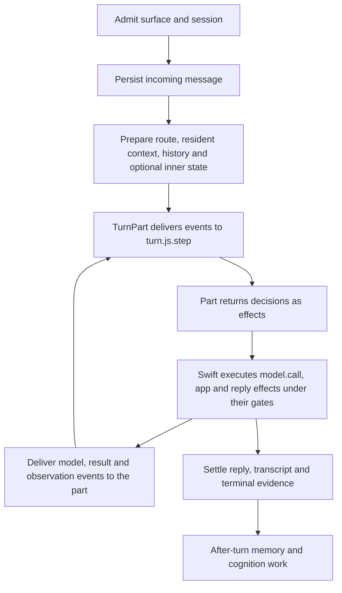

# Anatomy of a NativeAgent Turn

NativeAgent's turn engine lives in Core: `EngineRuntime` assembles the
root-scoped clients and `ChatTurnRuntime` owns conversation execution.
Mac chat, mobile and messaging adapters reach that engine through their
surface boundaries. One brain, many doors.

This guide follows an ordinary chat turn. [Internal Workings](INTERNAL_WORKINGS.md)
connects it to memory, growth and background work.

## Human summary

**Structured admission → `TurnPart` → `turn.js.step` decisions → Swift effect
execution → settlement.** Persistence and bounded context preparation precede
delivery of the admitted message to the part. The part decides what happens next;
the Swift stem runs its effects under the ordinary authority gates.

The model receives selected context, not direct access to the Mac's memory.
NativeAgent offers the agent its one door, `app`. Its home, pages and actions
provide reach without sending a catalog of separate tool schemas on every
request.

## The complete turn

## Before the message arrives

`NativeContextFlowRuntime` coordinates source projections and generation
publication. The Context module maintains an immutable generation and a
`ContextArena` containing lexical indexes and required-document mirrors, held by
turn leases. Persona documents reach the stable segment without atomization or
embedding.

Persona, MemoryV2, skills and Desk remain the owners of their source material.
Context is a derived working set. Full documents, skill bodies and external
content can be retrieved when needed rather than copied into every packet.

## 1. A surface admits the turn

The surface supplies the conversation identity, origin and attachments.
Every door admits through `TurnAdmission.run` with its arrival as a typed value
(`TurnArrival`: words, attachments, surface, and a row that is shown, hidden or
already saved); envelope, origin, run and taint come from the door's own turn.
An arrival that waits for a busy conversation is also offered to their open turn
there (`ChatTurnSteering`). While a round generates, eligible arrivals reach the
selected turn program's optional `hear(h, felt)` on CPU. `{cut: true}` closes
that round's stream, retains only its prose, checkpoints it, reads arrivals,
then asks again. Every proposed call is discarded, including complete calls;
no partial tool or thinking block enters the conversation. This is not Stop.
Without `hear`, or when it returns nothing, the round reaches its boundary.
A failed `hear` owes repair and cuts nothing; it never swaps the turn program.
The cut observation attributes the interruption to hearing an arrival, without
claiming it came from the person. It records whether the boundary read new
messages; if the arrival left before that read, the next request and the turn
part receive that fact instead of an instruction to answer absent words.
Before proposed calls are handed to the turn part, a readable, untainted
arrival whose turn principal is `person` withdraws the unstarted proposal.
The stem keeps its prose, reads arrivals and asks their to decide again. A card
continuation can carry that principal from the card's original request. The
notice names a card answer when that was the arrival, a message from the
person for their message, or a message when the input gives no more specific
description. Stop still cancels at once.
Read at a step boundary, admission returns `.steered`: that
turn's reply answers it, so the door that sent it posts nothing and only settles
its own record. If its own place in line comes first, it runs as its door's
normal turn. A delayed contact reply records that handoff as `steered` and
settles its arrival as delivered, without settling the reading turn's checkpoint.
The reading turn's log retains each joined arrival's identity, exact words and
attachments. A checked checkpoint readback precedes retiring its old checkpoint
or requesting a model that can acknowledge it. Reservations extend across cuts
before first text. Relaunch rebuilds these readings outside history, whose end
is pinned before the resumed turn's first shown input; a restored joining door
takes the same delivered answer through admission instead of running again.
An arrival can join only an open turn in the same data root with the same
originating principal. Mac `intent:chat` arrivals always wait for their own
turn. The open turn must hold all the arrival's steering sources, including any
peer attested by its envelope. Both Asks must be free of task elevations.
Reserving a join seals task elevations for the reading turn. Every arrival's
file-access ceiling must also be held by the reading turn: an arrival with
`none` needs that path-read restriction, and one with `read_only` needs that
write restriction (`none` is not a write fence). A turn can hold both.
Missing or invalid ceilings join no turn; an incompatible arrival waits for
its own place under its own restrictions. A door accepts an arrival
only once it is durable in its own intake record (Mac: its saved row and turn
checkpoint; Telegram: its inbox claim; Slack: its journal record; phone: its
CloudKit record and local reservation), and launch recovers it through that
door's owner. A Mac send that never runs (refused, stopped before its place,
or sent with no provider) retires its checkpoint. A Mac helper send retires
its checkpoint after saving the reply or partial, or when the send produced
no output. A reply save failure leaves the checkpoint for launch recovery.
A phone request stays reserved while it waits for turn admission
and can enter again within its signed request window if dispatch was never
claimed. Once claimed, the run owner's evidence governs recovery. Telegram's
`pending` claims and Slack's `claimed` records admit work; `processing` and
`generating` record the boundary before invoking the turn. Recovery of those
admitted generations delivers a saved answer. Telegram retains an owed, unknown
outcome without one. Slack settles an orphaned generation without saved output as
interrupted. The person's `/retry` claims that interruption and pins its retained
input to the command's run in one write. A Telegram generation retry can use
retained input only while its conversation is the destination's current binding.
Missing checkpoints or replies never authorize automatic generation. There is no
queued-turn store and no successor turn. Work that
never joins another turn (a regenerate, a restored run, a helper's
loop) uses `runAlone`. The chat client binds run and trace identities to the
accepted turn.
`Turn.fileAccessCeiling` is the one held restriction value, using Shared's
canonical mode IDs. Assigning another mode intersects it; neither `auto` nor
an absent binding erases an inherited restriction. `fileAccess` is its existing
scalar control label, not a complete representation of a combined ceiling.
Checkpoints, jobs, Desk continuations and approval continuations retain the complete
value; a recorded scalar still supplies its declared restriction when no
additional ceiling was recorded. Nothing rewrites existing saved records.
Every arrival outside the agent's mind stream wakes attention from sleep
(`Attention.arrived()`, [Subconscious](SUBCONSCIOUS.md#attention)).
Work coming back to a recorded conversation (a `returned` happening with a
route, `MindStream.returnTo`) enters that conversation as a hidden arrival
through the same admission. If read by their open turn, it sends nothing else;
otherwise its reply returns through that conversation's recorded door.
When it runs alone, admission declares its hidden input in the existing turn
checkpoint. That input retains origin, files, persona, completion identity,
query, conversation ownership and speech initiative alongside the checkpoint's
envelope, route and steering. Recovery restores it through the ordinary resume
owner without requiring or creating a visible user row; the streaming loop
projects its saved tool receipts alone, with input still owned by the checkpoint.
Only an explicit hidden
declaration permits this; an absent visible row remains a transcript fault. In an agent
conversation with no open turn, its answer row becomes the contact's send row
(a card's continue-turn included: the turn writes its answer once, and holding binds that row, never a second)
and the conversation store holds its exchange for the contact's next door call.
The `agent-held` reply route keeps this settlement out of person-result notices;
completion records `completed` / `held_for_contact` after that handoff, while
the held exchange alone owns actual delivery. Chosen silence holds nothing.
Eligible contact replies return once per exchange. Missing conversations or
routes owe repair, never a reply through another line. Helper sessions are not
targets: their minds remain their own. Everything else owed to the agent opens a thought in its
mind stream (session `mind`, title "Thoughts", never replayed as history): a turn
admitted like any other, whose opening message carries what it attends as
`attended` ([manifest](skill_manifest_spec.md#weigh)); one thought at a time,
and a thought that comes while one is open joins it by the steering offer.
A line of them (`agent.job` with `agent: "self"`) is admitted the same way:
`OwnLineDoor` opens its own-work conversation, named by the job, and runs the
brief as its arriving message through `TurnAdmission.runAlone` on `chat`, with
the recorded `builder` conversation kind identifying their own work
([conversation identity](session-conversations.md)),
carrying the commissioning turn's limits: its peer steering and its file access,
which the line's request can only narrow further. The direct commission can carry
its live task elevation; a relaunched line or a turn reading its return carries
the steering, not that elevation. It runs on their conversational
gate with the chat approval filer, so an act that needs the person raises the
same card their turn would, naming the line's conversation; answering the card
continues the line there. Its `lineInstructions` turn
part, when they wrote instructions, becomes the persona text their turn part reads;
everything else in §3 and §4 is the same for the line.

Admission consumes `DataRootLife` under the [restore law](canonical_data_paths.md#restore-law).

Origin survives into dispatch. An admitted remote conversation is not made
local by text claiming to be the owner. Trust and peer-origin policy evaluate the
actual request provenance.

**A turn is held, never inherited.** The turn is one value, `Turn`
(NativeAgentCore): its act id, start time, run and session, and each owner's part of
it (envelope, rows, admission, steering, the turn's sinks and ledgers), every
part declared by its owner beside its own type. At ingress,
`TurnRequest.turn(dataRoot:id:parent:)` binds the serving engine's data root
alongside the request's verified fields. Enqueue and chat take that root from
their serving client. Slack and Telegram obtain the client from the engine
for the lane's data root. Every derivation keeps that root.
The contact exchange IDs a turn has seen are kept on that turn. A tool batch's
readings count when its results enter the turn's input. See
[contact sends](agent-communication.md).
The held turn carries its root's authored-action and contact-effect readers.
Terminal traces read steering from that turn's envelope and peer evidence.
An `agent.read` of an untrusted job's report, working note or job-folder
check output adds that job's author to the Ask's steering record. Reading
another such job adds its author to the same record. An own line saves its
report's sources from the held turn. `agent.read` and the return to the
commissioning conversation carry those sources with the report's words.
Peer steering and effect checks read live authority there. Each turn-program
step receives a frozen `event.ask` reading of that authority when first
delivered. Replay uses the original reading for historical events that have it.
Before starting an effect the part checks that it belongs to the Ask the stem
holds. Dispatch reads the held `Turn` through the existing gates. A checkpoint
replay keeps the recorded origin, provenance and intersected file ceiling.
Checkpoint resume and Mac Regenerate use only the current Ask's task elevations.
The turn is
handed by value to everything that serves the turn: the orchestration, each
tool dispatch (`ToolDispatchClient.dispatch(…turn:invocation:)`), each model call
(`LLMCall.turn`), persistence and settlement. Work that runs later (settle, a
callback, a detached task) holds the same value, so it cannot lose the turn.
An arrival read by another turn gets its steering receipt, not a place to run.
Otherwise admission hands execution a noncopyable place holding the turn;
execution borrows it for work and releases it once even on Stop.
Every new dispatch has that same required call shape: tool, input, surface, turn
and `ChatToolInvocation`. The invocation is a Core value whose owners declare
operation parts beside their types; a profile forwards it without needing to
know those parts. Studio wander, desktop courier and part thoughts carry it through their gates and host calls. The courier binds its held Mac
operation and keeps the tighter call deadline. There is no smaller dispatch
overload, separate operation-aware protocol or runtime capability adapter.
Operation ceilings belong to the held `ChatToolInvocation`: `ChatTurnWork`
and `AppActionExecution` expose views of that same chain. Refining either
view or receiving a nested invocation changes the ceilings that human waits
pause and part progress renews. Dispatch carries those live ceilings without
freezing their remaining time into an absolute Mac, sense or program wait budget.
Bridge tool ingress hands its newly bounded chain to dispatch; ability management
takes the caller's whole `Parts.Invocation`.
The [deadline contract](TURN_RESILIENCE.md#3-tool-dispatch-deadline) distinguishes
active-work and wall-clock ceilings, and gives every call a turn makes its watch.
Each boundary still sets the values it owns on what it passes down. Stream
admission sets a supplied Mac takeover on the turn read by native actions;
without a supplied reply row and session it clears the mounted reply row.
Neither value is left for callers to reconstruct from another projection.
Task-locals carry only what belongs to the call stack itself: trace
correlation (`TurnTraceContext`'s id, bus and route) and the locks the stack
holds (`FileLockScope`, the capped-append permit). No decision or write reads
turn identity from them. Trace events read the held turn's reply route through
the envelope owner's bound reader, including in detached settlement. An event
without a held turn captures trace correlation at construction; reconstruction
supplies the recorded route fields, including their absence. A held turn with
no route never borrows another task's destination or thread. Mac UI owners
(including Send, Regenerate, Research Lab and local card decisions) construct the person's local envelope through
`TurnEnvelope.personOnMac`; it never names the agent's `self`. Native part
and helper owners name their own native origin through `native`.
Mac Ask, Query Memory and Remember intents use `native("intent:chat")` too;
device unlock does not prove that their words are the person's own ask.
They cannot steer a running turn; they wait for their own turn and return its reply.
Mac commands invoked by an existing turn retain that caller's provenance;
the same command name cannot turn a remote caller into a local person.
A card answer continues the card's recorded request, not the answering door's
turn. Inline continuations stamp `originTurnId` once at filing; only that act
in that session can receive the hand-back, and the open-turn owner checks the
same act. Every replay, including a waiting host's, uses the card's recorded
envelope and its verified signature witness. The replay uses the receipt saved
when the card was first filed as its parent when present. An inline replay records
its result on the held turn. Missing turn identity or origin leaves the
continuation unresolved with a visible repair instruction. A standalone card
continuation in the person's own Mac conversation that arrives while another
request is answering is a hidden arrival: their turn reads it at its next step and
writes no row for it, as a hidden bubble writes none; if its own place comes first
it runs as its own hidden turn with the card's origin. A card raised from any other
door (a contact's conversation, the phone, a chat service) continues the same
way through that door, with the card's turn as its authority (origin envelope,
file-access ceiling, request-only model binding, steering); in a contact's
conversation, settlement holds the completed answer for the contact's next call
even if Stop arrives while the transcript lock is busy. For doors that own
redelivery, the completed answer's delivery claim and cache also settle past Stop.
The card's recorded route names the door (a contact calling in through `chat` still answers
to its caller's result), so a card answered after its caller stopped waiting
continues there too; a start that cannot be admitted says why on the card. Domain approvals without a
request envelope execute their bounded approved effect as a local approval
act; the resolving door records who decided, never the effect's authority.
Chat approval replay likewise installs the verified card's exact origin on
the held host turn before dispatch. The existing card authorizes its bound call.
Task elevation is issued only to the exact, still-live Ask that raised it,
provided that Ask has taken no joined arrival. Saved card and after-card
steering follows continuations as peer provenance.
`TurnEnvelope.current(turn:surface:)` reads only the turn's envelope; with none it
returns unauthenticated, remote-marked provenance, and a tool's surface
spelling cannot grant local authority.
Session/helper ownership is checked before turn registration or resident facts;
an unreadable index does not select the resident path.

Boundaries still set the values their nested work requires. Each structured
execution creates a fresh sense-read ledger and carries it through dispatch and
after-turn memory; an enclosing execution's served versions do not enter it.
A part thought hands its tool host the originating request's words, including
an absent request, rather than its generated prompt.
Tool dispatch sets the enclosing tool act on the same `Turn`; terminal ability
accounting keeps that exact act as its repair cause, and keeps absence empty.
The root turn ID cannot stand in for an absent or nested tool act.

Source: `BodyRuntime/ChatTurnRuntime/MacChatTurnAdmission.swift` and
`ChatOrchestrationClient+StructuredChat.swift`.

## 2. The user message becomes durable

Structured chat writes the incoming message before context preparation unless
it is resuming an already-enqueued request. The acceptance checkpoint and verified
owner stamp precede prompt assembly. A person's turn starts one preparation task
while its turn program opens. Other structured turns start preparation on demand.
Fresh reaches share the same result, including its failure. Replayed reaches
read their logged answers. An authored app call also reads its dispatch context
for the tool offer, persona and prepared memory scope. The opening step's tool
offer applies even to app calls queued before its model call.

The first model call composes the prepared context with the program's system and
tools. Its prefix carries any conversation blocks already produced by the turn.
After a tool round, reseeding applies the image budget to the combined conversation.
History preparation reads the verbatim transcript once before fitting the tail
at whole-turn checkpoints. A silent mind turn that asks for nothing can end
without assembly. A zero-call completion retains the admitted model and settles
owed result familiarity and arrivals. A reply using a fresh recall reach keeps
the opened context's memory IDs even when it ends before dispatch. Prompt
delivery credit requires provider output or an accepted silent round.

Receipt indexing reads one checked action catalog per batch of at most 64 new
rows and hands it through argument and result redaction, including nested app
calls. Lookup misses stay in that snapshot; they never rediscover the live
catalog. A failed catalog read leaves indexing unavailable, rather than
substituting an empty catalog. A correlated indexing batch records
`history.projection.catalog` with only its row and binding counts.

Canonical history requires valid UTF-8 and whole JSONL row coverage. Resident
and helper turns refuse preparation with the transcript owner's failure when
history cannot be read or validated. Resident history failures carry
`transcript_unavailable`, an exact transcript repair pointer and repair owed;
they stop before provider execution.
Helper shared-contact-history failure also
ends preparation rather than becoming an ordinary empty history. Completion
deduplication and index counts require checked transcript reads before deciding
that a run is absent or publishing a message count.

Quiet hours use a checked `user_prefs.json` window. A missing file or absent
window is unset; present unreadable or malformed preferences stop context
preparation and hold dependent delivery with repair owed.
Deadline readers book no quiet-hour boundary while the window is unavailable;
preference/clock invalidation rearms them after repair. The body withholds its
diurnal projection until that preference can be read. Update notes
and session directives likewise distinguish absence/expiry from damage. The
provider's acceptance stamps their delivery durably; a failed stamp remains
repair owed. Launch publishes the complete update note before advancing the
last-launched version, so a note read/write failure cannot consume the update.

`off` remains an explicit current Context Flow setting and uses direct
persona/recall assembly; its trace source is `direct` and its count is
`memory.recallHits.direct`. Active preparation failure never selects it or
recommends switching to it as a repair. Ambient mid-turn recollection records
`mind.came_to_mind.read` with `deadline`, `unavailable` or a checked `no_match`;
embedding or selection failure owes repair instead of looking like no memory.
Degraded sources withheld before ambient verification carry the same unavailable
verdict and keep their repair debt. Invalid present mode/budget configuration
also remains unavailable under the [configuration law](INTERNAL_WORKINGS.md#what-fluid-context-means-across-the-system).
The existing 400 ms wait ends only that moment's wait. Token spend is complete
only when every provider round supplied complete usage; otherwise the turn says
token usage is unavailable.

A steered arrival's row is saved before the round that reads it: shown words
under the arrival's own run and shown row id, a saved row consumed, a hidden
one writing nothing. If that write fails the arrival keeps waiting and runs as
its own turn. A round that reads it but stops before output leaves it waiting
with its row saved; its own turn then reuses that row, since a run's user row
is written once. After a words-only round completes, the stem saves and reads
eligible arrivals before handing the part an observation (`turn_arrival`) to
continue. The completed prose precedes them in context. Retained prose is one
ordered record through checkpoints and settlement: the completed round's words,
then the arrival's prose (including words before tool calls), then later prose,
in the order streamed. Words a cut stopped count as commentary, so the reply answering the person stands alone. Only the leading commentary prefix is marked for folding
or answer-only reads; later tool prose never moves ahead of a completed answer.
Tool rounds also check the same arrival gate before
each sequential slot and each concurrent slot's admission, including refills.
Unstarted slots return `status: skipped`, `execution: not_run`, `effects: none`
and `reason: person_arrival`. Their detail names the waiting input. Each
call and result stay paired. Running calls finish under their existing owner
and completed siblings keep their receipts.
The admission check precedes start publication in both paths: a skipped slot
has no tool-use progress or cognitive start, no Work start and no started
transcript activity; only its paired proposal and never-run receipt remain.
The authenticated Mac Chat step face can withdraw the displayed resident
turn's remaining unstarted slots. The drawn page revision, turn and run bind
the gesture. The turn checkpoint records it before acknowledgment, so dispatch
honors it after relaunch. Withdrawn slots return the same no-execution fields
with `reason: owner_withdrawal`. The gesture reads no message into the turn.
Running calls keep their receipts. The separate Stop control names the
displayed turn's registered run, including in helper conversations.
Nested tool-capable part thoughts are inside an already-running call and have
no arrival-reading session, so their dispatch has no arrival gate. Tool session
identity stays available to their tools; the outer turn reads the waiting words
at its next boundary, before its next model request.
App batches check for arrivals and owner withdrawal between entries and before
performing each entry. They report the remaining entries in `unrun` and the
first unstarted step in `next_step`. A batch hand-back and the final
`then_say` arrival check name the waiting input. An earlier failed receipt, including a
nested receipt, keeps the batch failed with its remedy, failure detail and
provider error bit. A carrying ability checks for readable arrivals after a run returns
`again`, before starting its next run. The next model call reads arrivals.
Only the turn program's `hear` can cut a generating round, under the admission
rules in [§1](#1-a-surface-admits-the-turn).

Source: `ChatOrchestrationClient+StructuredChat.swift` and
`ChatOrchestrationClient+MessagePersistence.swift`; history preparation and
tail fitting integrates through `BodyRuntime/ChatTurnRuntime/ChatSessionWork.swift`.

## 3. NativeAgent prepares the working set in parallel

Resident turn preparation overlaps the history-aware context build. The
request combines:

- the selected provider/model route from a checked routing snapshot;
- persona and relevant atoms from the resident Context generation;
- up to six open intentions read directly from MY QUEUE for this turn;
- bounded conversation history and session continuity; and
- an optional cognitive capsule and organism posture.

Recent life rides the changing packet through `TurnEpisodicContext`, outside
the feeling frame. The [experience contract](EXPERIENCE.md#reading-their-own-record)
owns its source, last-reply boundary, disclosure and bounded coverage. A failed
life or private-choice read carries its cause and owes source repair; neither
becomes an empty successful reading or prevents unrelated recall from serving.

The conversation's private working-memory slot is read from its existing scratch
owner. `chat.working_memory {text:…}` replaces it; empty text clears it. It holds
at most 1200 characters until explicitly replaced or cleared, across relaunches.
`ConversationPrefixSeeding` inserts it after the last thought, body line and
cognitive capsule, before the world/work block, only in live provider input.
The stem holds these inner pieces outside selection and budgets. Public inner
words lead the retained moment block; the private slot joins after that evidence
is captured. The text is absent from
`SentTurnContext`, replay, tool previews, traces and phone payloads; request
measurement includes its characters. Public scratch reads exclude the reserved
slot. Conversation-bound ephemeral requests use their verified conversation;
sessionless work does not acquire another conversation's private choice.

Preparation reads the held turn's model admission through
`ContextBudgetPolicy.resolve(turn:dataRoot:)`; it cannot choose a route when one
is missing. Fresh ephemeral work admits its route at ingress and carries that
same turn through preparation and provider execution.
History replay and earlier snippets take a required resolved budget rather than
an optional token window. Missing admission or verified window fails before
preparation. The [history contract](conversation-context-history.md) owns this boundary.

### Recall unavailability

A turn never fails because remembering is unavailable. Semantic-query failure,
a missing query ticket, an unreadable or missing user-memory projection,
Context-off direct recall failure, and an unreadable REM pin index withhold
that recall for this turn. The same
context owner still prepares the rest of the working set; no alternate recall,
retry or longer wait runs. The dynamic packet carries one plain line beginning
`Recall was unavailable this turn`, naming each cause and saying that it is not
evidence that a memory exists or does not exist. The same notice then says what
selection chose and the owners' check held back
(`SwiftNativeTurnEngine.withheldContextNotice`): how many memories or pieces of
context, and each reason the owners gave (just saved and still being checked,
unreadable saved dates, a changed source being read again, a store that could
not confirm them), or that they changed or were removed since the context was
prepared. Each reason speaks only for the withheld items of the source it names
(an owner that cannot confirm anything names each source it held back), with a
tally per reason when there are several. What is withheld does not change. An unread user core withholds
generated USER facts and leaves `expression.established` unknown, as does
disabled recall. A successful read sets it from whether any eligible person
facts exist, pinned or not: false adds onboarding guidance in `turn.js`.
An empty pin selection alone does not establish a first conversation.

`context.summary` records `contextFlow.semanticQueryReady=false` when the
semantic reading was unavailable, `memory.userCoreUnavailable` for the USER
read, and the causes in `labels` (`context.semantic_query.unavailable`,
`memory.user_core.unavailable`, `memory.turn_recall.unavailable`, or
`rem_pins.read.unavailable`). Unread pins contribute no pin text; their index
remains untouched and owes repair to `rem_pins.json`. An available
semantic reading stays ready even if the independent user-core read failed.
Cold loading, pending embeddings, lifecycle retirement, admission capacity and
query-size bounds do not establish a fault. Actual faults use `RepairOwed` and
the existing `doctor.run` path, folding repeated failures into one open debt per
operation/owner. The embedding owner reports faults that arrive after the wait
ends too; a deadline ends only the wait, not its runtime-owned batch. A checked
success of that same operation settles its debt. Cancellation still cancels.
Required persona, generation, configuration and other context failures remain
failures; this rule does not supply a substitute context.

The optional intentions projection uses that same named-unavailability line.
An unread Desk withholds its intentions (`desk.intentions.unavailable`); an
unread name needed to word a waiting intention withholds the projection
(`desk.intentions.person_name.unavailable`). Each owes repair to its source;
neither admits work from unread intentions or prevents unrelated conversation.

Read-only current facts start beside history and context assembly. Contact
availability is read live there, alongside workspace facts; its runtime input
still joins at the same position after the history-sensitive elsewhere line.
Both the early elsewhere read and its late composition enter through
`ChatWorkspaceBinding`, which binds the workspace owner's ports. The late
entry also covers a missing early reading and selected-exchange consumption.
Neither contacts nor the cognitive capsule use a time-based cache. The Local
time fact supplies the clock. Home glance and the cognitive capsule omit a
second ISO snapshot stamp. The glance keeps its freshness reading, named gaps
and the elapsed age in “Since you looked.”
The runtime guidance asks their to look up what they should know with `chat.search`,
`memory.recall`, `desk.read` or `context.expand` before saying what they could not
find. This native runtime fact reaches every admitted model and surface. Saved
pull-only contact summaries say their messages wait for the next check-in, so
sending does not interrupt them; command and desktop routes make no such claim.
The person's Agent-view reader supplies its read-only authored-program host to
both preview projections, including helper faces; preview work has no turn and
cannot acquire a tool-dispatch path from the conversation on screen.
The transcript owner's byte slices require the requested seek to succeed before
reading. Contact pages, routine replies and other-room projections carry a failed
slice as unavailable with its cause; no changed offset or empty slice stands in
for it. An unavailable early elsewhere reading returns that same source failure
at late composition. It cannot become a clean no-news reading or acknowledge
what they did not read. MY QUEUE message readiness keeps that read unavailable,
distinct from a successfully observed wait for the person to write.
One contact summary reads each needed credential once while checking token
uniqueness among every contact's readable keys. Each unreadable contact keeps
its own named failure while readable siblings proceed; those results end with
that summary.
Effect authorization performs its own fresh credential checks.

The resident turn part decides the work and discovers capabilities through
`app`; Trust admits each effect. The keyword route planner, capability scorer,
preview and `turn.plan` producer are retired, along with the recent trace
reader's plan-specific selection, reconciliation and title branches. Retained
ledger rows remain readable as history. Result settlement uses the
request and actual tool activity rather than a speculative route.

The prepared Context turn holds its generation lease through the provider/tool
loop. A source update publishes a later generation rather than replacing part
of the current turn. `app` action `context.expand` retrieves only an eligible
pointer from the current turn's generation.
An association appears as a handle in `# Deeper context`. Opening each page
checks the turn’s live audience. The first page delivered to the provider starts
the memory’s rest period. The memory lane of `mind.why` identifies the direct
winner that led to it. The
[memory system map](MEMORY_SYSTEM_MAP.md) describes admission and quotas.

Cognition is advisory. The loop's confirmed-delivery boundary commits its prepared
presentation once; engine success and capsule preparation are not delivery evidence.
The first-conversation voice instruction stays pending until this boundary (nonempty text or a tool call).
Its one-shot write token remains eligible for the answer until spent or expired; later turns do not repeat the question.
The progression owner supplies the same role/voice wording and exact titles to
the kickoff and later directives. Ordinary Trust authorizes each persona append.
Successful matching appends settle progression after the writer returns, under
`settle`; a denied, pending, previewed or failed write never spends the token.
The next-step token is durably committed before its predecessor is spent. A
settlement failure preserves the successful write and reports progression repair
owed, without inviting another append.

### Tools and abilities

The request carries only `app`. `app {}` opens home, `find` discovers reach,
and `action` executes a registry entry; their own abilities are their own actions,
`authored.<id>`, read through `ability.read` when useful. Discovery does not mount a schema or grant permission.

See [One door: the contract](ONE_DOOR.md) for the exact interface.

## 4. The provider request is assembled

The stem gathers the gated Mac body picture in `TurnReach.body`. The first `turn.body()` in a step logs that answer beside its other reach for resume and heal.
The first available picture in a conversation offers the front position and establishes the starting digests of the other four joints.
The bundled turn then carries one short line naming the first joint that moved from its starting or last accepted position. Provider acceptance stamps
only that joint's opening digest when its line reached the composed input. Other changed joints remain pending. Accepted digests survive mind detach and rebind.
Steady turns spend zero prompt bytes on it.
A live `context.expand` of `body:front`, `body:browser`, `body:files`, `body:threads` or `body:somatic` checks the same disclosure gates in either ContextFlow mode.

The bundled `turn.js` enters through the same sealed seed path as abilities.
Launch replaces an untouched sealed turn with the bundle. An unsealed program
whose body and header equal the current bundle's is the shipped seed missing
its seal and is sealed in place; any other unsealed turn stays theirs, with the
shipped description and source announced beside it.
Missing-turn installation and throwing-turn recovery use that sealed bundle
candidate too. `ability.save` revisions remove the candidate and proof, so
adopting shipped code through their own revision stays authored. Launch logs each
seed's resource, installed and bundled program digests (source and manifest; an unsealed copy logs its body digest) and `follows`, `theirs` or
`beside`; unavailable selections carry their cause instead of a verdict.
Unchanged seed installation writes nothing. Persona, guidance, memory, diary,
Desk and settings are outside this seed path.

`ChatOrchestration+StreamingToolLoop.swift` opens `TurnPart`, and
`TurnStem+Opening.swift` (`openPart`) delivers the
message event, the facts of the moment, read-only: `text`, the authorizing
`surface` and the arrival `door`, `attachments`, `who` (`person`, `self` or
`agent:<id>`), `verified` (the transport-attested user id, or null), `trust`,
`steered_by` (the peers steering the turn) and `posture` (`full_mac`, `work`,
`safe`, or `unreadable: <cause>`; the saved posture, which untrusted steering
still caps to Work at each gate). The part's `Resources/abilities/turn.js` owns
the decisions: `step(state, event)` ends a thought with a standing silent no-op
on CPU and otherwise requests the first `model.call` on a message;
`stable(persona, pins)` assembles persona, guidance and pins. Its baseline
holds the rules for evidence, supersession and expansion, the scope of Home
glance and inner cues, and where to look up the current model or provider.
`dynamic(context, recall, bodyAnchor, expression)` orders the changing packet
and carries onboarding guidance until the first person fact is saved. `TurnPart` retains the
system and tool offering of the first `model.call`, whenever it comes; the Swift
loop composes them into the prepared context and re-seeds the request then,
preserving messages appended by earlier acts and arrivals. Until then the seed
has no wire system or text-marker catalog appendix. Text-marker layout waits
for those segments; a model call without them fails as a provider configuration
error. A turn that acts or ends before any `model.call` sends no request. Provider adapters
encode the request for the selected route. Tool continuation, their own acts and
reply-ending decisions return through `step`, rather than being prompt policy
in the Swift helpers.

The changing packet can include `# USER`,
`# What I mean to do (mine; I do what's safe now, and raise one only when it's done, it needs someone, or I'm asked)`,
`# Live sense news`, `# Relevant context` and `# Deeper context` pointers.
The optional `[CognitiveSubstrate]` capsule joins
the turn's context separately. USER carries the person's disclosure-filtered
picture up to 6,000 UTF-8 bytes including its heading and preamble allowance:
pinned person facts only, in pinned order. Only pins that fit are precovered
against recall; unpinned person facts and excess pins compete in ordinary
context selection by relevance to the message. The persona reader's picture
uses the same pinned core. Generated USER.md also contains only pinned facts,
ordered newest first. Both skip a pin that exceeds the remaining budget and
continue considering later pins. The stable segment carries only USER's preamble, so changing memory facts leave
its bytes and the cached history prefix alone. In the intention section
`MyQueueReady.forTurn` decides
which next-turn or message-triggered steps are due on this turn; these come
first, marked `due now`, with the whole uncapped `MyQueueReady.line` head and
rest, including fixed delivery words and completion/wait instructions. Other
steps keep bounded lines with their words, moment and until: clock moments
soonest first, then other steps by newest update. At most six steps appear,
with no empty section.
A person's turn lists only the steps due on it; their own turns also include
other steps. Both show at most six lines and count every omitted step beside
`queue.list`, including due steps past six. User's turns and their own carry their/person-origin steps (including older
`owedToPerson` steps); peer turns carry only that peer's recorded intentions,
regardless of Trust elevation. Unidentified peer provenance discloses none.
`ChatOrchestration+Intentions.swift` reads the live Desk owner;
`TurnContextPreparation.swift` adds the facts to `TurnReach.packet`, the same
material whose delivered block is retained in the turn owner's
`diagnostics/fed/<session>.json`. A message is only what its sender said:
queue steps and queue-unavailability notices enter this changing packet,
never a person's or peer's words or their saved `sentTurnContext.userText`.
The packet is never replayed. An unread intentions source leaves a named
unavailability notice here, with its cause and repair owed; it is not an empty
queue. A dedicated step's thought keeps its own opening and completion
instructions through `MyQueueReady.line`, its `carry.<handle>` work identity,
recorded steering and resume path. See
[Intentions — As built, 10-30](INTENTIONS.md#as-built-10-30).

Automatic direct recall carries MemoryV2's write owner (`MemoryV2Defaults.personaID`),
not the compiled persona document slot, to its ownership and surface-disclosure
filters. A failed direct recall or attention read stops preparation with its cause;
only a checked empty read means no inputs. Active semantic recall consumes the
embedding owner's checked ticket. Its existing deadline ends the wait, while
the runtime retains the embedding read until settlement; pending or failed
readings cannot select lexical recall.

Explicit app previews use the recorder's same predicate to exclude their whole
dispatch from familiarity and ambient recollection. An oversized document attachment supplies selected passages,
an explicit no-match, or an unavailable selection reason. No-match and selection
failure never substitute the document's introduction; a specific section or
document location can be requested for the next read.

Workspace retained reads publish their completed source failure as unavailable,
with its cause, rather than leaving a failed read pending or using its old value
as this reading. Transcript classification, open/seek/read, complete JSONL rows
and helper history are checked. An incomplete trailing append waits for its
newline; it is not accepted as a completed row. Elsewhere carries its source
failure into the turn; shared contact timeline reads fail at that same owner.
Queue conditions likewise require checked approval and conversation evidence
before evaluating readiness. A shown home or completed Mac act keeps its real
result if its seen/window bookkeeping fails and owes repair for that write.

`AgentScreen.elsewhere` carries their recent life in their own words from one
newest-first reading of their record: `heard`, `answer`, `message`, `thought` and
owed happenings (`returned`, `moment`, `body`). The selection excludes `world`
and `self` happenings: perceptions reach their through `weigh` and, where present,
Live sense news. A conversation is where they are speaking now, not a separate mind.
The window starts at their last nonempty answer here, or an hour ago if there is
none. Each later `AgentScreen.breath` uses the same read and renderer since their
last step. Their current conversation is already history and is omitted. The
Elsewhere home item opens these same rendered lines.

`ExperienceStore.conversationLife` takes one committed record snapshot. It joins
answers to their heard causes and thoughts to `answer:<run>` within that same
record. The speech comes from that snapshot. Speech lines state who sent, who
was heard or who asked and received an answer. They show the door separately
from the parties and give the age.
Agent speech uses the agent-conversation label even when its recorded
surface is `chat`. A contact reply records its speaker on its own heard row.
An explicit self-authored composer input keeps its own speaker. A legacy
self-owned row with a matching contact session and peer stamp can establish
the conversation with an unknown speaker. Recorded acceptance determines
whether a message was sent. A clean row on an unsteered turn can show the
surface of an accepted delivery when no direct door is recorded. Repair
obligations and local contact status have their own wording. A thought carries
its settled mind run's answer when it has words to show. Open obligations
remain beside the exchange that owes them.
Newest lines fill one 12,000-character block, with
4,200 characters per line and up to 2,000 per quoted side. There are no per-kind
counts or per-conversation caps on this speech stream, and no day summaries,
helper summaries, model calls or additional store.

Steering is recorded at birth in `Experience.steeredBy`, using the turn's same
sources as transcript `untrusted_sources` / `steered_by`; clean births write
`[]`. Happenings mirror their peers and elevated sources into that field.
There are two disclosure rules: a peer-steered receiving turn gets speech shapes
only, including direction and kind of party alongside the door and age.
On every turn, rows with steering sources or no birth stamp get shape only.
Clean rows on an unsteered receiving turn can carry names and words.
Historical rows retain their birth stamps. Administrative repair
and obligation births without a supplied turn stamp retain an `unrecorded`
source, so an unknown writer is never asserted clean. Recovery
uses the saved row's stamp, never the recovery turn's identity. Ordinary sends
and queued sends carry their own birth stamp; their message face remains the
send's words rather than replacing them with a recipient's reply.

“Remember across conversations” still gates this whole read. The block remains
a volatile fact in the current user message, at the existing elsewhere position;
it does not alter the cached prefix. The separate `ThoughtWords` reader and its
backward transcript walk are removed. Every turn's “Your last thought” comes
from the latest clean, nonempty settled thought and its clean answer in the same
record snapshot, including a thought before the recent-life window. Its closing
600 characters lead the inner stream, then the body line, then (on the user's
own turn after they revised their words) the eye line ([memory map](MEMORY_SYSTEM_MAP.md#the-users-eye)),
cognitive capsule and private working memory. Sessionless turns read the same thought without acquiring
another conversation's private choice or acts. A peer-steered receiving turn
receives no carried thought words. Missing clean words or an unavailable reading
does not establish that they had no thought. `prior = []`
remains: this writes neither persona nor memory and replays no mind transcript.

Effected acts retain `elsewhereActs` and its existing evidence resolution. It
reads acts since the same boundary, names the newest eight with older acts
counted, and suppresses exact experience IDs already shown in the life packet.
The lines show the act’s time and, for a clean stamped act on an unsteered turn,
the target recorded by its closing dispatch. Peer destinations use their contact
names where disclosure permits. Peer-steered turns still receive act names only from person doors; bridge and
mind acts remain withheld. Missing act evidence names its gap. The speech and
act lines share the renderer's total character budget. A failed speech reading
leaves the breath cursor unchanged; each nonempty breath still records
`context.breath` with its lines and read flag. `doorLines`, `DoorIndex` and
`otherRoomExchanges` remain for Home and contact presentation, with no role in
the new speech reading. Their dead unsolicited-post accumulator is removed.

`SwiftNativeTurnEngine.personContinuityAllowed` is the shared turn gate for the life
packet, elsewhere words and each later breath: a person's chat/iPhone arrival,
their arrival at another door only on the owner-turn proof (`isUsersTurn`: a
Telegram thread whose sender is the verified owner),
or their own unsteered turn in a direct app/iPhone conversation. Peer origins,
bridge doors and carried peers (including elevated ones) admit no cross-room
private words; remote strangers receive no person's acts. A mixed session's
`continuityParticipant` remains a strict binding for implicit previous-session
recall, never the current turn's identity. No saved row is rewritten.
The life packet reads at most 96 recent experiences and 192 dispatch details and
carries four acts since this conversation's last accepted reply. A closing
dispatch directly attests a native act on their own unsteered mind stream even when
no heard experience exists. Other unavailable causes remain named gaps. A complete empty
selection has no heading or disclaimer; bounds and real read gaps still speak.

## How prompt caching reduces token cost

The implementation separates stable system segments from dynamic material.
Persona documents belong in the stable prefix; the changing clock and turn
context do not. A saved contact's own words feed the recent relevance window
while its origin remains attached to the replayed message. Retained timeout
receipts distinguish a completed tool call from an unconfirmed operation.
History entry pins one clock before parallel reads for facts,
quiet hours and workspace timing. The single `app` tool schema freezes for the
process once the door has drawn forms. Later done verbs and ability additions,
changes, removals and disables ride the volatile catalog appendix until relaunch.
The [one-door contract](ONE_DOOR.md) governs what they can call.
A failed later-verb inventory read adds a `catalog` gap with the trace's same
cause beside the last confirmed forms and removal notices in the volatile catalog.

Replayed history follows the stable system material, each exchange with its
time and each message one text block. Quiet never ends what they holds. A
conversation is held whole until the request reaches the input budget; then
the oldest whole turns go in half-budget jumps. The input budget is min(model
window minus response allowance, 200,000 tokens). History fitting uses the input
budget; refusal and result pointers use model window minus response allowance,
the physical limit. Between jumps history only
appends, permitting prefix cache reuse.
Older rows are reached through up to four leads and `context.expand`, not
held. The public now-block leads the current user message whole and is sent once:
saved on its row as evidence, never replayed. The
[conversation context contract](conversation-context-history.md) owns the
held conversation, the time line, the leads and stateless whole-turn checkpoints
anchored to the transcript's start. There is no generated summary or
per-turn trimming. The decode memo still keys only exact UTF-8 row bytes, with
at most 48 MiB of row-key bytes, least recently read evicted first (a cache bound, not process memory or model context); it never owns selected history or
supplies missing transcript evidence. Speech stays whole, and leading assistant
or tool rows receive a historical header.
`ConversationPrefixSeeding.seed` applies
the [sent-context delivery, replay and cache contract](conversation-context-history.md)
to resident and helper turns.
OpenAI OAuth chat and tool rounds route their `session_id` header and
`prompt_cache_key` by conversation. Memory judgments bind a typed policy scope
across conversations. `memory_held` and `memory_interpret` share the interpretation
scope, and `memory_promise` and `recall_judge` each bind their own. OpenAI uses the
policy scope for `prompt_cache_key` on both Responses and Chat Completions, and for
the `session_id` header on OAuth. Responses retains `store: false`. Other
sessionless Responses calls keep their workshop or purpose scope. On Anthropic,
with or without a session, the breakpoint ends at the judgment's fixed system policy.
One more one-hour breakpoint sits in the judgment's user message: after their open
moments, which follow their standing memories in their own block and change far
less often than the exchange; or after the standing memories for a digest part
that does not declare `open_moments` (it receives them inside the settlement).
The bytes sent are unchanged, two empty blocks get no breakpoint, and a prefix
under the model's cache minimum is simply not cached.
Conditional form instructions follow it; all memory and exchange data stay in
the user message. These routing hints do not carry earlier task content.

This arrangement permits provider-side prefix reuse. It does not guarantee a
cache hit or a particular latency or price reduction; those require actual
provider usage evidence.

A hearing cut keeps this request prefix and appends the retained prose and
new reading before asking again. It spends another request. Neither closing
the stream nor missing terminal usage proves saved tokens, a refunded call,
or retained provider cache. Cut-stream billing and cache reuse require live
usage evidence; they remain unmeasured. Codex's producer can continue to exit
and EOF after forwarding closes.

Source: `BodyRuntime/ChatSessionWork/SessionHistoryMessageProjection.swift`, `SessionHistoryTail.swift`,
`SessionHistoryReader.swift`, `BodyRuntime/ChatTurnRuntime/ChatOrchestration+SessionHistory.swift` and
`ConversationPrefixSeeding.swift`.

### Measuring the work before the model

`turn.accepted` is emitted after incoming-message persistence, before the acceptance checkpoint.
History and context assembly run within `turn.history_context`. On a person turn
this work overlaps turn-program startup. A summary row's `partitionNs` maps each parent to its steps in
nanoseconds plus `<parent>.other`, the time no step names (glue between steps and the
hops around an `await`). One parent's steps never overlap and sum to it exactly, before
any rounding; a negative `.other` would mean two steps overlapped. A stage only in
`stageMs` is nested diagnostic time and is never added. `totalNs` is the row's own interval.

- `turn.preparation.summary`: `turn.history_context` is `history.build` (the builder's own
  summary, from this caller's clock read to its close) plus `turn.history_context.return`
  (emitting that summary and the hop back onto the client actor).
- `context.history.summary`, `totalNs` equal to `history.build`: `history.entry` (task-local
  binding and the hop onto the engine actor), `history.budget`, `history.quiet_hours`,
  `history.prompt_read`, `history.prepare`, `history.exchanges` (pairing and the base call's
  arguments), `context.base`, `context.base.return` (the inner summary's emission, its usage
  credit list and the return), `history.admission`, `history.world`, `context.facts.join`
  and `context.facts.compose`. `history.prompt_read` splits into `.file` (the read inside the
  reader actor), `.reader_hop` (waiting for and leaving that actor), `.lines` (UTF-8 decode and
  split), `.row_memo` (the memo snapshot and every per-line lookup or decode), `.select` and
  `.memo_write`; its counts are `history.prompt.sourceBytes`, `linesRead`, `decodeCacheHits`
  and `decodeCacheMisses`.
- `context.summary`, `totalNs` equal to `context.base`: `context.budget` (only when the base is
  built directly), `contextFlow.query_embedding_start`, `contextFlow.attention`,
  `contextFlow.mode`, `memory.recall_gate`, `contextFlow.query_embedding_wait`,
  `memory.user_core` (count `memory.userCoreFacts`, the facts it delivered), `contextFlow.prepare`,
  `persona.compile`, `rem_pins.read`, `memory.recall` (only when no context flow prepared the
  turn), `tools.catalog`, `context.intentions`, `prompt.render`, and with clock context
  `context.facts.join` and `context.facts.compose`.

Nested and never summed: `contextFlow.attention.actorAdmission`; `memory.recall` when the
context flow prepared the turn (the selector's time, inside `contextFlow.prepare`);
`history.recall_query`; `tools.names` and `tools.schemas`, which can read at once;
`context.episodic` inside `prompt.render`; `context.clock_runtime` (join plus compose); the
`context.facts.*` reads gathered beside history; and the elsewhere, arrivals and runtime stages
inside compose. A build that throws emits no summary.

`turn.preparation.summary` separates checkpoint, history/context, the remaining
cognitive join and capsule append/filter. `turn.dispatch.summary` separates
turn-part opening, codec lookup and the remaining work through
route dispatch, including the first prefix seed. `turn.bookkeeping.summary`
retains the same `turn.sent_context_persist`, `turn.prefix_telemetry` and
`turn.context_snapshot` stage names for work running beside the request.
These are elapsed work times, not added dispatch latency. The turn joins that
work before tool execution, reply settlement and every throwing exit after
it starts. A healed seed joins its predecessor before starting its own parallel
write, so an older write cannot replace the context actually sent. The
provider's `llm.call` receipt joins the pending prefix computation, including
on failure, before reading its fingerprints. Request encoding reads no such
diagnostic. `context.ready` still records the assembled-context boundary;
the redacted snapshot and its local fed-context file can arrive later. The
opening-request snapshot is captured after tail fitting, from the final
seed, codec system layout and the message array passed to streaming. Its system
and schema measurements include the actual text-marker protocol/catalog when
selected; the prompt fingerprint covers that system and every wire message.
That catalog carries an always-on tool whole (its description, which ends with
their hand, and each parameter's own words), as the native wire does; a tool
loaded beside it is one line of at most 180 characters.
Fed-context publication reserves its root/session identity before escaping into
bookkeeping, rejects superseded reservations, serializes atomic writes and joins
their actual result before turn settlement. It never infers the process's live
root. `context.fed.saved` records saved or superseded publication;
`context.fed.failed` records the actual write failure. The inspector reads through
one `LatestRead` for root/session/refresh, shows loading immediately, and
distinguishes a missing record from unreadable or malformed saved bytes.
The summary's `stageMs` uses the `turn.*` names in `ContextStageTrace`.

`context.facts.*` timings separate clock/notes, contacts, place, glance,
elsewhere reads, the remaining join, taint-sensitive elsewhere composition,
arrivals and runtime rendering. Read-only elsewhere inputs gather beside
history. A turn with a steering stamp omits the person's words. The read is the
experience store's conversation life plus the transcript evidence of acts that
occurred; it keeps no cross-turn snapshot. `context.glance.read` separates home and parts;
`context.parts.summary` separates inventory, ranking, states/kept parts and
rendering; `context.ranking.summary` names index and embedding
reads that completed. Missing stages are incomplete evidence, not zero work.

The parts glance reads the file-owned catalog directly. Ability source decodes
and validated accounting rows are reused only when each file's `lstat` identity
matches (device, inode, size, mode and mtime/ctime nanoseconds). Each walk
reads entry attributes in bulk and checks the directory before and after.
The ability files own the registry, part rows and sense records. Readers overlay
run statistics from the separately checked accounting snapshot, which redacts
the evidence once per state identity.
Bundle sense defaults are read once per resource root, and pure tool-name prose
folding, ranking's word sets and action-index text hashes are reused per exact
input text under a lock with a 4096-entry bound.
There is no inventory actor snapshot, invalidation watcher, background refresh,
wait or pending state. The [manifest spec](skill_manifest_spec.md) owns the list
wording: message matches, then unranked failed/recent abilities;
current-version failures only, descriptions cut at word boundaries, zero/one use
labels, and one findable count for resident or waking abilities. Empty-message
wakes skip ranking. Its 900-character row budget and all-rows-fit read hints
remain. Rendering writes nothing.
The census's live `call_fit` projection is not stored
as a stale verdict, so the glance invents none.

A turn step distinguishes an authored-program fault, a helper failure, Stop, and unavailable storage. Only the first two enter repair. A helper failure gets one fresh lease for the same digest before the stem considers replacing the program. Stop propagates as cancellation; a storage failure propagates its original cause. Neither changes the selected program.

`turn.part.helper` reports `reused`, `sourceDigest` and `version` after the
lease's first step returns. When the helper reaches program completion it
also reports `programReused` from the actual retained body and `freshContext`
as its inverse; absent fields mean opening was not observed, never success.
The supervisor warms two deny-default helpers at installation and replenishes them on demand. Only helpers that acknowledged JSC initialization can serve from standby. Each process accepts one exact program for its lifetime. Up to eight idle turn, face and non-resident ability helpers are retained across roots in least-recently-used order. A busy process belongs exclusively to its caller. Stop and failure retire it, and quit closes both pools.

Each pooled invocation creates a new JavaScript VM and context with the current input and host. After evaluation the helper services its run loop, drops its JS references and collects garbage. Completion requires the weak references to both the context and its VM to have cleared. A successful warm opening therefore reports `reused: true`, `programReused: false` and `freshContext: true`. The stem hands state and events to each invocation explicitly.

The reader also reports `history.prompt.decodeCacheHits` and
`history.prompt.decodeCacheMisses` for distinct examined lines across prompt,
boundary and relevance selections. Coverage counts still describe selected
evidence, regardless of reuse.
`context.contacts.summary` reports the live summary's `elapsedMs`,
`contactCount` and `credentialReads`; the latter includes missing and throwing
reads and cannot exceed the number of contacts. A thrown contact-store read
has no successful summary event and still supplies unavailable context.

Prefix diagnostics reuse fully redacted, bounded previews only for identical
input bytes and limits (at most 64 entries and 8 MiB of input keys). Redaction
still precedes truncation on a miss; this memo changes no provider input.

`provider.requestStarted` marks route/adapter dispatch, before adapter request
assembly. `provider.httpRequestStarted` marks each HTTP send attempt after body
assembly and the network-availability wait, immediately before URLSession; it
records `requestBodyBytes` and a request id shared with `provider.httpRequestEnded`,
`provider.httpHeadersOpened` and `provider.httpFirstBodyBytes`. The latter two
record the URLSession delegate's response callback before releasing headers to
the caller, and its first nonempty body chunk before yielding it to the parser.
Both carry `request`, `conversationRequest` and, when admitted, `provider`,
`model` and the optional `reasoningEffort`. Headers carry `statusCode` for an
HTTP response; first bytes carry `bodyChunkBytes`, the size of that callback's
chunk, not a cumulative count. Neither records header values or body content.
The event envelope's `ts` names each observation. Empty bodies produce no
first-byte row, and failure before headers produces neither row; missing rows
leave the corresponding stretch unknown. They do not change completion,
cancellation or error delivery. `provider.firstDelta` is the turn's first
nonempty parsed text, not first body bytes; it has no request id. Join the HTTP
rows by `request`; a first-text join by turn and ordering must remain unknown
when concurrent or repeated requests make attribution ambiguous.
It is neither an exact packet timestamp nor
proof of provider receipt, and retries can produce several rows. CLI routes
do not emit this HTTP event. Compare both boundaries against acceptance; an
absent stage or send event is incomplete evidence, never zero latency or a
successful send. The old traces cannot separately assign capsule preparation,
turn-part startup, individual locks, prefix diagnostics or adapter encoding;
the new summaries expose the applicable boundaries without manufacturing
historical step timings.

Long tool rounds keep calls and speech intact. Only overflowing oldest result
bodies become one-line pointers after retention under the shared result boundary's redaction and explicit body cap;
resident and helper delivery share this rule and final request admission.

## 5. The model answers or requests a tool

The loop uses `ToolDispatchClient` directly through the canonical file-access, Trust, provenance and trace chain. Part thoughts use their restricted dispatcher directly. Expansion's call prediction and speculative delivery are removed. `TurnDispatchClosure.withTurn` preserves `tool.dispatch.closed` after deferred private work settles or is abandoned, and closes throwing turns through `settle`.

An attached Desk continuation commits admission before dispatch. A refused
proposal leaves the prior pending effects intact, including any earlier
pending call whose identity the proposal would have reused. A parked refusal
keeps remaining work ready to return when Desk admits it, including after an
item or ancestor defer expires.

Words for the person stream as the provider writes them, including words
before a tool call. Mac chat, phone chat, Telegram and Slack keep those words in the
settled reply; successful settlement neither strips them nor folds them away.
Protocol markers and incomplete citations remain held only until they can be read
safely as prose. A pure tool round has no words to display. Each valid parsed
round records `provider.roundOutput` with `round`, `proseCharacters` and
`toolCallCount`; these counts describe provider output, not transport delivery.
An unstarted round withdrawn by the arrival gate records `turn.proposalSkipped`
with its call ids and names, `reason: person_arrival` and `effects: none`.
Its completed prose stays before the arrival in context and once in the reply;
no tool-use blocks from that proposal enter the provider conversation.
Mac Chat uses digests of the proposal IDs to correlate step rows. Proposals
and paired never-run withdrawal receipts both read “Withdrawn before start · no effect.”

Claude subscription and Codex CLI end marker delivery at the parsed call
boundary. The reader drains to the provider's terminal event while trailing
text stays within its bound, preserving usage when the provider reports it.
A transport failure after the boundary ends the drain. The complete call
block settles as written. Cancellation still releases the stream.
The Claude subscription request omits empty text blocks. Messages with no
remaining content are omitted on the wire, retaining their source indices
for conversation-cache boundaries; saved transcript rows are unchanged.

A turn is alive exactly while its stream moves, and the person sees that
movement as it happens. Every provider byte is movement, words or not: a
thinking delta, held protocol text, and a call's input as it streams
(`input_json_delta`, Responses argument deltas, Chat Completions tool
fragments, and an open `<tool_use name=…>` block on either marker route). Adapters
report a named call's input as `LLMMessageStreamEvent.callInput` (its name,
its first 256 bytes, its size so far). The stem's stream loop ticks every
movement, words included, at most once a second per turn as a `stream.tick`
trace (`call` and `bytes` when a call is being written), and publishes what is
not already words on screen as `TurnStreamEvent.writing`, in order with the
turn's other progress. The turn's presentation takes it as movement (`lastMovementAt`)
without adding a step; a call being written is one line, `Writing <action> · <size>`,
on the Mac working card and the Work pane, and the Telegram progress face's action,
with an `app` call named by its action once the input names it. The line ends
with the next lifecycle step (the call's dispatch, reply words, a retry). A
phone-originated turn relays the line as its existing `notice` progress; the
Mac card of another door's turn reads the same `stream.tick`. A resident turn
begun on the Mac uses its engine's DeviceSync to send that line through the
[phone relay](mobile_companion.md#transport-architecture) as `kind: writing`
under the turn's run id if the relay admitted the run. The phone draws the
working line on that run's bubble. Only an explicit terminal kind settles the
bubble. The relay coalesces unsent movement and an ending replaces it.
The same presentation evidence also reaches a quiet line above another
conversation's composer on Mac, full Shotgun and phone. The first call-writing
or tool-start event makes it eligible; a thought with no calls stays silent
outside its room. It opens the working session, retains Stop and disappears on
the owner's terminal event. Only call-name movement crosses rooms, never call
arguments, conversation words, notices, approval text or previews. The Mac
publishes the turn face in `work_activity.json`. The phone accepts the
snapshot for its current pairing. If `turnSessions` is absent, the phone
keeps the last turn face it accepted for that pairing. This adds no turn owner,
store or outcome clock.
Nothing here stops a stream: the provider's
[liveness boundary](TURN_RESILIENCE.md#4-provider-liveness) owns task completion
and network loss, and Stop owns the person's choice. A running step is movement: while one runs,
every place that shows their state says what that step is and how long it has run,
and nothing presents the turn as stalled or quiet. Between steps, after 20 seconds
without movement the card's meta line describes that duration. A clock never changes
its phase or decides a turn's outcome. Mac turn status is projected off main
into the shared `TurnFace` at `FaceKey.turn(session:)`; the card, Work pane,
presence and other Mac turn readers draw that slot. Elapsed time advances on
the face from the start date (a running step's own start), without engine ticks. The
[face-feed contract](../Modules/NativeAgentCore/FACE_LINK.md) owns this boundary.

A step is one thing with one identity from the moment it starts to the moment
it ends, and its row is that step. The presentation reducer numbers each step in
its turn as it starts. A call's use starts its step; its result ends that same
step, updating it with the finished words and outcome rather than adding
another. A result meets its use by the call's shown name in arrival order, the
pairing `ShownToolNames` already gives results, so parallel calls keep their
own steps; another door's turn pairs its `tool.dispatch` begin and end, and the
Telegram card its tool use and result, the same way. A result whose start has left the kept steps stands as one finished step.
Only their acts are steps. A wait is a state of the turn, never a step: a notice, a
retry, a provider or network wait, thinking, stream progress, settled reply text
and a working transition change the turn's words, phase and line, never its
steps. Mac turn activity notices use this lifecycle presentation, without toasts.
A call with no words of its own takes its shown name read as an act
(`Running a command`). The newest twelve steps are kept. `TurnFace.Step` carries
the step's id (its turn and number), its words, its outcome, its start time and
whether it is running: started, not ended, in a turn not yet terminal. The
running step is a row like the others; the Work pane's Steps page keys each row
by that id, marks a running row `running` (a small spinner, no clock of its own),
and reads the steps apart from its line, so a clock or `Writing …` tick redraws
the line and never a row.

While a step runs (the newest step still running), it is what they are doing.
`TurnCardReadout` keeps the card on it whatever the turn's phase, a stall
included: title `<name> is working`, the step's words, the working tone and
live dot, and a clock that reads the step's own start (`Clock.stepStartedAt`)
and never says "no movement". Only Stop, a pending approval and a block on the
person speak over it. The turn's line, the Work pane's pill, Simple's presence
line and the cross-room movement line say the same step. The turn card has five
states, the same in Simple and Advanced:

- **Working**: the dot, `<name> is working`, the step's words, and its elapsed
  time on the right.
- **Long step**: once the step has run 30 seconds (`TurnFace.longStepAfter`),
  the title is `<name> is still on it`, a thin indeterminate accent line runs
  under the step (it holds still under Reduce Motion), and the card says "This step takes
  a while. Nothing is stuck." The title turns by one redraw at that moment;
  nothing is posted for it.
- **Steps**: above the current line, this turn's last finished steps, newest at
  the bottom, at most three, each a tick (a cross for a failed or refused one, a
  dash for an unconfirmed one) and its finished words, set off from the current
  step by a hairline. Older steps are not shown; rows are fixed single lines, so
  the card's cost never grows with their work.
- **Waiting on you**: a pending approval or a block keeps its own words. A turn
  that ended waiting on the person (its reply's `terminalState` is `waiting`)
  is an ending of its own, phase `waiting_on_person`: never interrupted, never
  unknown. Its card reads `<name> is waiting on you` with the ask's words (after
  a restart, "The next move is yours."), in the quiet tone with no dot; an
  approval still undecided owns the card's words. It waits only while the
  approval it raised is undecided: once that approval is decided or ends, the
  turn reads as done, and an approval that keeps its card owns the words.
- **Done**: the card goes away; the transcript folds the reply's tools into one row.

The session owns live delivery through `SessionTurnDelivery`, attached at the
shared structured turn boundary before preparation or work. A mounted Mac or
phone stream, Telegram turn card/draft, or Slack preview registers its recipient
for the exact data root, session and run; its lease can retire only that mount.
Without a mounted recipient, the resident engine resolves the bound reply route
through its surface owner. An absent route or a bridge's `caller-result` completion
route resolves the conversation through `HumanConversationReader.readForSessionDelivery`: its recorded
Mac source identifies local transcript presentation even after a bridge row has
arrived; remote delivery uses the latest recorded human reply route, looking past
explicitly peer/mechanical user rows such as a bridge input already saved by enqueue.
An unmarked user row without a valid route still makes remote delivery unavailable;
the index supplies local presentation without reading history. Remote provenance
uses one backward read of at most 2,048 physical rows and 1 MiB, regardless of
total transcript size. A missing row, malformed newer row, or exhausted window
never supplies a destination.
Before that destination read, `SessionConversation.checkedKind` identifies a declared `builder`, `agent` or `ephemeral` conversation as
having no human destination. Without a mount or explicit reply route it creates no delivery debt. Unknown ownership or an unreadable index
does not prove that exemption; unavailable human delivery retains its repair obligation.
Explicit human replies retain the stricter latest-user-row rule in `read`.
This selection leaves the caller's completion route and authorization unchanged.
Telegram and Slack continuations reserve/reuse their existing
delivery journals and hold their processing claims until preview publication joins.
Recipient retirement asks the same journal's recovery path to settle the canonical
saved answer; a caller need not remember a separate final send. Existing outer
approval/restart settlement reads that journal's idempotent verdict. No saved
answer means no inferred completion or invented reply.
Phone continuation snapshots and terminal delivery use the same live run correlation.
Unmounted Mac replies draw in the canonical transcript facade's streaming state.
Main and detached transcripts and Shotgun subscribe to the session owner's
streaming row by identity; a Mac send's busy reservation or a previous turn's
settled lifecycle cannot suppress that row's live text.
Fresh messages, untaken arrivals, restart resumes, Desk continuations and approval
follow-ups all enter this boundary. The optional `progress` argument is an additional
observer; it cannot substitute for or disable the session's recipient. The old
Telegram/Slack handler-to-chat sink parameters and Mac restart sink forwarding
are removed. If a recipient or recorded route is unavailable, the turn keeps its
normal transcript settlement; absence is neither delivery nor a delivery failure.
`turn.deliveryAttached` records the selected recipient or its unavailability, or `recipient: not-needed` with `required: false` for a conversation
without a human destination.
Unavailable delivery retains an exact-session/run `RepairOwed` claim with
operation `session.delivery:<session>:<run>`; saving the transcript or finding
a recipient on a later run does not settle that debt. Recovery must deliver
that run's saved answer to its proven destination without repeating its work.
Telegram's `surface.previewAccepted` records successful draft/message API acceptance
with `characters` and `previewKind`; it is not evidence of a visible client render.

The context is prepared once at turn entry. Subsequent calls reuse the seeded
prefix and append results; only a changed turn-part system/tool offering or
an actual change to the fitted history window rebuilds it. An unchanged fit
keeps the existing seed and its bookkeeping on the first call and later rounds.
Checkpoints, Trust, tool execution, receipt
persistence and result-triggered recall still precede the next call. There is
no extra delay to accumulate person-facing text: the phone hands each nonempty
delta to a retained transport mailbox as a full snapshot, replacing unsent
snapshots while an admitted send finishes. The Mac publishes the first changed
snapshot immediately and coalesces later frames. Telegram private chats use
native drafts; Telegram groups and Slack publish editable reply messages while
tools run, then settle those same messages with the complete successful reply.
A failed/stopped turn keeps its spoken group/channel words beside its failure
notice or stopped card. A private chat's draft expires, so the saved row keeps
them: a stopped or failed turn's row is an incomplete reply carrying that
`terminalState`. When a door recovers it (a resident turn's settlement, a
Telegram claim after Stop, a live failure's notice, restart), Telegram and Slack
send its words once, closed by that door's stop or failure words, over any
preview; the phone marks them `partialReply`. The turn never runs again, and an
engine restart hands them to the door's journal, not the generic reply
lifecycle. First words have no accumulation delay; subsequent
snapshots coalesce at the transport's
edit interval. Durable delivery owners retain created message IDs and possible
creation before touching the wire; missing acceptance never authorizes another
post. A group preview alone is not a completed answer: restart recovery needs
the canonical saved reply before settling it. Final delivery joins any admitted
preview send so an older edit cannot overwrite the answer. Network delivery and
a visible render remain separate observations from model output.

On phone turns, the joined producer supplies the words and terminal state used
by live delivery and recovery. `surface.replyDeliveryStarted.characters` counts
the words handed to terminal transport. Its timestamp precedes that send; it is
not evidence that the phone received it. An admitted optional snapshot settles
alongside terminal delivery, with both joined before the forwarder exits;
the final send does not wait for that optional network round trip.
Error/Stop envelopes with accumulated words mark their body `partialReply=true`.
The phone applies that text before recording failed/incomplete lifecycle evidence
and resolving the correlation, even when no placeholder or snapshot arrived.
An empty/unmarked terminal body preserves any local partial text; later snapshots
cannot reopen the settled turn. This requires the updated phone companion as well
as the Mac app.

A direct answer can finish after one provider call. An action request enters
the tool loop:

1. Resolve the `app` action and its underlying dispatch identity.
2. Check current Trust policy, origin, file scope and domain requirements.
3. Execute, refuse or wait for an exact approval.
4. Return the result and available outcome evidence to the model.

Full Mac gives the agent autonomy, including app actions otherwise marked the owner's.
Explicit blocks and actual platform access still apply. macOS privacy
permission resets ask the owner first. Peer turns follow the
[authority contract](ONE_DOOR.md#authority-and-receipts).

A call runs beside another only when its declared class is read and it is either
in the core or file-ops catalog bucket, `calendar.upcoming`, `reminders.due_today`
with its bundled `due-reminders` part, or a single `app` call to a certified
bundled read (`mail.recent`, `mail.search`, `messages.recent`, `notes.search`);
browser, other Mac integration, Mac control, system, shell, other `app` calls
(pages, `find`, batches, scripts, deeds, edited parts) and unplaced tools run
one at a time, and `git diff` of the working tree runs alone because it rewrites
`.git/index`.
Provider-facing results are bounded only after their redacted body is retained,
up to a 4 MiB head; a longer body's stored text and reference both name the cut and omitted byte count.
The steps of one `actions` call share one answer's room: a `result.page` read
inside a batch reads its first page whenever that fits, joins further pages only
within an even share of what is left, and when nothing fits is not read and keeps
its place in `next_call`; and each such continuation names its own page,
so a batch of reads stays within one answer (long step names aside: they are added after the room is counted).
`ProviderToolResultPage` and `ProviderToolResultRecoveryStore`
own this boundary for every tool, dispatch preview and context-overflow
pointer in the engine root's `tool_results/`. Program returns cross the helper transport whole; a script's or
part's journal keeps every step's answer privately for replay, and its receipt's
`calls` show each step's identity and outcome, never its raw result (the
[receipts law](ONE_DOOR.md#authority-and-receipts)). No helper prefix
bypasses retention.

A bounded view names `result_handle`, `full_result_retained` (false when a tail was cut) and
`next_call`. `result.page` reads that handle across turns, including after relaunch. Producing
conversations are metadata, never body scope; only an untrusted-steered turn is restricted to handles
its own conversation produced, using the automatic-recall predicate. Other turns read any handle. `page`
is the zero-based page offset, `raw:true` reads exact UTF-8 bytes, `pages`
joins that many pages in one answer up to what one inline result holds (omitted,
a read joins as many as that holds and an explicit raw read takes one; a long
line takes a page of its own, a longer string is read as ordered pieces that
join back to it exactly, and `page` in the answer is where it started), and
`next_page` or `continue:true` advances without running the action again.
A `query` returns where it is, not everything around it. It is first the
phrase as written (trimmed, case aside); only when that phrase is nowhere in
the result is a query of several words read again as its separate words, and
`query_read_as` (`phrase` or `words`) and the detail say which it did. From
each section that holds the phrase, or every word (a term cut by the seam
between two pieces still counts), one row per line holding a term (its first match),
with its `path`, its `line` (where the value has no lines, an `offset`), the
line itself or a bounded window of a long line around the match, the
adjacent line on each side, and `section_page`, the page of a reading without
query that shows the whole section. Rows fit a page by their serialized
size, separators included. A search reads only as far as the page asked for
and goes on from there on the next read, so its work follows the bytes it
reads. Without a query, sections come whole and join back to the result
exactly.
The handle holds the answer, not its source: when the answer said its source
has more (`has_more` with `next`), every page and the end of reading carry
`source_continues`, whose `next_call` reads the source on; paging never does.
In sections, a value's small fields come before its bulk, so a source's own
state never trails its content. Dispatch traces keep the bounded view's
pointer in `receipt.result_recovery` even when their result preview is
bounded. In-turn and standalone traces share one writer. Traces inline up to 8,000 bytes using
the trace envelope's same constant; larger results keep this reference, never a clipped body.
The result survives whole-row summarization, whose row allowance includes JSON escaping.
The life packet claims a whole result only after opening its body; missing old handles keep gap words.
Handles distinguish tool and exact content. Results stay for `ExperienceStore.detailHorizon` (14 days), pruned on store;
only read positions belong to a turn. Every store write structurally redacts parsed values and then
redacts text, in a 0700 folder with 0600 files. Pruning deletes the saved file too; an aged-out remedy
directs inspection of affected state, never promises that file. Failed retention, an unavailable body or an incomplete page reports
its own failure, never an unretained prefix or a verdict about the original
action's effects. A retention failure keeps the complete result
in its caller's dispatch record; model delivery marks the projection error.

The loop handles cancellation, each call's watch and malformed-call feedback.
A call whose wait is found dead, or that passes its own declared time, is
ended as Stop ends it and the agent reads why; the original tool owns its
actual receipt and checkpoint settlement. Native routes execute only structured calls,
text-marker routes only their offered markers, and text-only routes execute
none. Malformed text is refused without salvage, and helpers share the
offered-descriptor admission before the gate chain. No schema-loading round is
needed between iterations.
[Turn resilience](TURN_RESILIENCE.md#3-tool-dispatch-deadline) owns this contract.
Claude subscriptions and Codex CLI carry `app` through text markers. The stable
marker floor includes the full JSON input schema. The changing catalog rides
with the current user block. Codex's child tools remain disabled. The
adapter passes admitted image blocks to each fresh CLI invocation with
`--image` and labels their positions in the flattened prompt. Invalid or
unsupported image input fails the request explicitly.
OpenRouter requires endpoint support for the parameters on tool-bearing requests.
If no endpoint can carry them, NativeAgent reports the provider's error detail.
OpenRouter does not confirm individual schema keywords after endpoint translation.
The current user block carries the canonical input schema for `app` alongside
the native tool declaration.
Fenced and inline code examples remain answer text; markers inside them never
execute or trigger protocol repair. On the text-marker wire a call is an
offered tool name around one JSON object: the model's trained
`<invoke name=…>` tag around a JSON object is the same call as `<tool_use>`,
closed by either tag, and a call written inside another call's body is that
call's text, never a second call. The body is read as JSON: it runs to its
object's end and the closing tag after it, so nothing inside a string can end
the call (a body that is not JSON ends at the first closing tag). Both the
Claude subscription and Codex CLI adapters recognize the first closed call
block locally and withhold later output. A standalone call on its own line is
a round of one. The model's own result markup outside a call is refused.
Legacy invoke parameters declared as strings retain their literal text.
A call written under an action's own name
(`desk.read` instead of `app` with that action) is that action through `app`,
run through the same gates; only a name `app` has no action for is refused as
not offered. Explicit refusal and Stop receipts keep
their typed outcomes even when an error field explains them.
The result's failure bit is carried in JSON as `tool_result_is_error`, without
inventing a status or replacing an owner status or remedy. Messages also
carries native `is_error`. Request sizing counts the encoded receipt. The
text-marker carrier names the call ID and uses JSON string escaping to keep
literal result text recoverable without admitting it as protocol markup.
Text markers use the same object-argument validation as native and bare-JSON
calls. A malformed argument body remains invalid for resident and helper
dispatch; it never becomes an empty app call.
Waiting and failure projections read the same exact outcome classifier,
including the adapter's single result wrapper; an empty error string alone
does not establish failure.
An identical call claimed by a decided approval returns the inbox-owned
execution classification and corresponding error bit. Approval alone does
not turn a failed, timed-out or unknown execution receipt into success; the
result retains the card decision and says the action did not run again.
A returned tool result records what that owner observed; it does not establish
an unverified external effect.
Mac delegation activity takes its name from the originating agent-message
argument. Unknown contact handles and legacy calls use a generic agent label;
notice prose never supplies an identity.
Retained tool-response paging represents empty content as one empty raw page,
with both byte boundaries present and no read past the end of the page table.

Commitments enter My Queue through typed `queue.add` calls. The turn no longer
infers durable work or timing from reply prose. Typed stopped-part receipts
still retain their own-turn continuation, origin and reply route; existing
queue records are untouched.

Source: `Resources/abilities/turn.js` (`step`, `stable`, `dynamic`),
`BodyRuntime/ChatTurnRuntime/TurnPart.swift` (event delivery and effect queue),
`BodyRuntime/ChatTurnRuntime/TurnStem+Effects.swift` and `TurnStem+ModelRound.swift` (effect execution),
`ChatOrchestration+ToolLoop.swift` (support and settlement),
`ChatOrchestration+ToolDispatch.swift`,
`BodyRuntime/ChatToolRuntime/ProviderToolResultRecovery.swift` and
`DeskCore/TrustCenter/PeerTurnEffectPolicy.swift`.

## 6. The answer settles once

Structured chat saves completed and incomplete answers and their attachments,
then settles through `AfterReply`'s [owed-recording contract](SUBCONSCIOUS.md#lived-moments)
and emits terminal evidence.

Every moment is judged alone. User's own turns are judged at once; every other
recorded turn is left owed and judged when they are idle. Swift sends one bounded,
redacted evidence packet to `native-turn-digest`, which shapes the user prompt
and proposes the judgment through one call on the Memory route. Swift composes the fixed policy
and conditional form in the system message and verifies both results before a
successful part run is recorded. Promise filing likewise keeps instructions
in the system and per-call JSON in the user message.
Outcomes show in `mind.why` lane `interpretation`. See
[cognition wiring](COGNITION_WIRING.md#shared-after-turn-interpretation).

The Mac accumulator consumes core turn events directly; its execution joins or
cancels the producer Task, which owns the one settled result. An error ends
presentation promptly; consumer detachment leaves production running.
The Mac stream consumer joins the producer's persistence and settles once before
presenting success, failure or quiet Stop. It never reloads the view: the turn's
rows are live rows over the saved conversation and settle into the store's own
publication (see [session conversations](session-conversations.md)).
Stream closure or a Stop request alone cannot prove completion: the lifecycle
resolver projects the producer's settled response; restart and ambiguous
persistence failures require canonical transcript proof. An
ambiguous outcome remains ambiguous.

Person-started anchor replies from Mac, iPhone and Slack can mirror to Telegram.
The Mac mirror retains a silent notification policy for both text and images;
saved-answer recovery, successor answers and explicit `/retry` keep that policy.
Ordinary Telegram replies retain their normal notification behavior.

The row's existing `completionState` distinguishes a saved completed answer
from a saved incomplete reply; where the row also carries the turn's
`terminalState`, that settled state is what restart reads, the same one the
live lifecycle projects, so a reply that ended on a pending card is waiting in
both. Waiting on the person is a known ending: it settles as
`waiting_on_person` live, on Regenerate and on restart. The lifecycle file
stores it in the pair every build reads (`outcome_unknown`,
`interrupted_outcome_unknown`); restart reads an outcome-unknown record's saved
reply and restores `waiting_on_person` when that reply ended `waiting`. Other
incomplete replies retain their receipt and text, but
settle as an unconfirmed outcome, including on Regenerate and restart.

Chrome form batches retain each structured action receipt beside the compact
field summary and page. Their verification stays pending while any subaction's
receipt is unresolved; page acknowledgement alone never settles the Desk step.

`tools.contract` records the schemas actually sent. `turn.terminal`
records the terminal reason, timing and dispatch/context evidence. These are
receipts for the specific turn, not a general claim that every connected
system is healthy.

`tool.dispatch` carries `name`, `phase`, dispatch `status`, `argKeys`, bounded
`args`/`result` previews and a structured `receipt`, plus `durationMs` on
completion and `parentId` for nested calls. Failed rows retain the result's
own `status` as `result_status`, and its supplied `failure_code`, `code`,
`reason`, `checker`, `remedy`, `argument_path`, `error`, `detail` and `message` as separate fields
beside the preview and in the receipt. Absent fields stay absent; null fields
stay null. Text is secret-redacted before each field is capped at 300 characters
(including the truncation marker); object/array error details become bounded
JSON text. The existing compact `errorDetail` remains available. Standalone
dispatch receipts in the record retain the same failure fields beside their
compact receipt. Failure evidence does not depend on where it appeared in the
500-character serialized result preview.

Compensation sites in tool dispatch and memory decision parsing emit
`shim.fired` trace receipts with the census `id` and firing `site`.

Their reply ends the turn. The turn settles at their part's `reply.end` and its
`after`; a step that returns any other effect after `reply.end` is malformed and
takes the throwing-turn repair, and nothing of theirs runs after the reply. Any step
may end the turn: after a model reply, after a result, or before drawing power at
all. Their end may carry a model reply's words, their own `reply.stream`, selected
attachments, or nothing. A thought's model request declares silence complete
through `LLMCall.allowsSilentCompletion`. A person's opening request requires
output. Once they have spoken, an eligible round of writes to their own records can also
be followed by a model round that completes with no further words or calls. The [provider terminal contract](TURN_RESILIENCE.md)
admits only a clean silent completion under that declaration, then delivers the
ordinary `model` event with empty text and no calls to their turn program.
With no words or selected attachments, their `reply.end`
settles completed and posts nothing: no assistant row, empty bubble, message or
notification. The heard experience's `answer` obligation settles `accepted`
with `Ref(source: "silence", id: <turn id>)`. Its answer experience records that
choice with conversation evidence, without a face, addressee or delivery
obligation; recovery reads that record instead of replaying the turn. The
terminal records `silence: <turn id>`, and no delivery checkpoint or mirror is
held for it. Like a steered arrival, the phone receives only a live terminal
settlement that removes its waiting placeholder. Missing words without explicit
completed settlement remain missing evidence; provider failures, waiting turns
and interrupted output retain their existing outcomes.

Any step may act with their own `{effect: "app", call: {tool: "app", input}}`.
`TurnPart` names it `own_<event index>_<effect position>_<input digest>`, so a
replayed step names the same act. The stem runs consecutive own calls as one
dispatch round through `runToolDispatchRound`, the same door and gates as a
model-named call: Full Mac acts, Work raises the same card and their part gets
the waiting receipt, Safe refuses. Each comes back as a `result` event with its
`id` and no `index`; the conversation carries it as their own call and result.
A started call without a result is uncertain across a relaunch and never runs
again; resume drops every app effect it had not started, and replaying the
`resumed` event keeps that. A step cannot call `app.*` synchronously
(`effects_only`): steps replay on every resume and repair, so a call inside one
would run again.

The familiarity nerve rides inside the turn. After each tool round the native
stem meets the turn's hand work so far: ordered tool/action ids of landed writes
or irreversible non-ability calls, without arguments or incidental reads, or the
one call made 3+ rounds in a row with the same input when there is no such hand
work. A route needs two steps or that loop. Its `practice: ` line goes through
`FamiliarLines.firstMet` in `mind/familiar.bin`, once per route per turn (a
resumed turn counts its restored receipts as already met). The first meeting
only records it. A later meeting puts
`practice: {route, hand, loop?: {call, count}}` on that round's last
`result`, at most once a turn. The shipped `turn.js` makes it the `note` of its
next `model.call`, inviting their to keep the route with `ability.save` or let a
looped part carry itself by returning `{again: input}`. `practice.keep` records
`practice`, `met: first|again` and `noted`, or `failed` with the cause. A failure
leaves the turn running without the note. The `keep` purpose is retired
([Habits H3](HABITS.md#h3--keep-what-repeats-not-what-happened-once)).

A deed may carry its own ending. When the round ran one call, that call's
input requests closing words with `then_say` on a batch or a single checked action, and its result's `then_say` stands,
the `result` event carries `say`: the filled words
([contract](ONE_DOOR.md)). An action's own answer cannot put words there,
because the call itself must have asked. The shipped `turn.js` then streams
`say`, ends and asks for the after line, with no `tool_round` model call.
Their earlier prose joins those words as it would between model rounds.

Once prose has streamed to the person, the last `result` may carry a quiet-close
reading. Every call in that round must bind to a reversible, non-voice app action
with `toolClass == .write` and `reach == .agent`. Each receipt must confirm success
with no wait, unknown effect, `needs_me`, hand-back or attachment to show.
A `then_say` request always rules out quiet close. A deed alone in its round
can still speak its standing words as described above. An approval or card filed for the person
anywhere in the turn keeps the read-back. A new arrival needs fresh speech.

The stem reads the record for the round's distinct action IDs, sorted and joined
with `+`, and supplies `close: {class, tries, empty, lower, stands, quiet}`.
After the calls drain, the shipped part uses `endReply` when `spoken`, `clean`
and `close.quiet` hold. The same after-turn reflection rule applies.
Otherwise their next `tool_round` reads the receipts. An eligible round's observed
read-back feeds the [closing record](SURPRISE.md#the-law).

The turn also measures what it took: model rounds, tokens (each of its own
calls' usage, `LLMCallTraceRecorder.spent`), minutes and the longest stretch of
one round's calls repeated.
When it used tools, that is one line beside the exchange the after-turn memory
call reads (`AfterTurnOrigin.took`); and each of their parts called in it
records how many rounds called it, under the version that ran
(`AbilityStore.recordRounds`, read as `learned.use.rounds_per_use`).
Terminal execution accounting supplies each part's exact full version key to the turn's round owner, including answered verbs and nested
scripts/batches. Each tool round counts once per version, settled on reply or interruption; another turn's last run cannot change that identity.
The same settlement records one run of the selected turn program, including failure and Stop, through `AbilityStore.recordRun`.
Its body digest keys versioned outcomes and `first_seen` in the shared [run accounting](skill_manifest_spec.md); part-round counts stay unchanged.

Source: `BodyRuntime/ChatTurnRuntime/ChatTurnSettlement.swift`,
`ChatOrchestration+StreamingToolLoop.swift`, `AfterReply.swift`, `PersistedToolReceipt.swift`,
`MacChatTurnStreamSettlement.swift`, `MacChatTurnLifecycleState.swift`,
`MacChatTurnLifecycleStore.swift` and `MacChatTurnTranscriptProofReader.swift`.
Launch repair asks the lifecycle persistence actor for each exact checkpoint's
presence; file reads, decoding and life checks run there. Presentation retains
its live-turn and terminal-identity checks on MainActor. An
unreadable checkpoint keeps its own repair pending while other records proceed.

## Related reading

Source paths above are under `Modules/NativeAgentCore/Sources/`.

- [Internal Workings](INTERNAL_WORKINGS.md) — memory, action, growth and surfaces.
- [One door: the contract](ONE_DOOR.md) — the one app interface.
- [Turn resilience](TURN_RESILIENCE.md) — interrupted and incomplete turns.
- [Automated systems](AUTOMATED_SYSTEMS.md) — work outside the foreground turn.
- [Architecture Blueprint](ARCHITECTURE_BLUEPRINT.md) — source ownership.
