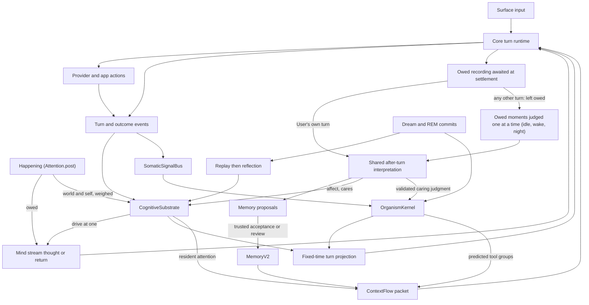

# Cognition Wiring — the connection map

This map follows the core owners that connect turns, memory, cognition and
body state. [SUBCONSCIOUS.md](SUBCONSCIOUS.md) describes the inner-life layers;
[ORGANISM.md](ORGANISM.md) details the body;
[MEMORY_SYSTEM_MAP.md](MEMORY_SYSTEM_MAP.md) covers durable memory.

Source paths below are relative to `Modules/NativeAgentCore/Sources/`
unless prefixed with `Sources/NativeAgentApp/`.

## The rule this map enforces

One brain, many doors. The core `EngineRuntime` owns the running turn state,
and `ChatTurnRuntime` owns shared turn preparation and execution. Surfaces
supply input and render results. MemoryV2 owns facts; cognition and organism
state influence continuity, attention and presentation without becoming new
fact stores or execution authorities.

Chat factories, the client and the turn engine share one optional
`CognitiveRuntimeProviding` for observation, resident attention, turn
preparation and presentation commits. An absent runtime omits cognition.

`CognitiveSubstrate/CognitiveSQLiteStore.swift` persists substrate continuity at
`<dataRoot>/cognition/cognition.sqlite`. Organism continuity uses
`<dataRoot>/cognition/organism_state.json` under its runtime owner.

**Their mind's lifecycle has one owner, the door** (`Cognition/NativeCognitionRuntime+Door.swift`;
[SUBCONSCIOUS.md](SUBCONSCIOUS.md#lived-moments)):

The same section owns the rule that code their mind runs is total: a missing
value is refused or skipped and cannot abort the process.
Runtime wake, sleep, held-turn, horizon and provider-event identity timestamps
use whole-unit formatting without integer narrowing; caring-receipt rotation
compares its byte allowance before arithmetic. The readout's source revision
uses nontrapping generation arithmetic.

1. **Opening.** Both owners restore (the body dormant if its effects are off);
   a fold a crash cut is refolded; then ordinary admission opens. Nothing
   writes their before, and a failed restore opens degraded.
2. **Recording and living.** Reply settlement, interpretation and recovery follow
   [Subconscious — Lived moments](SUBCONSCIOUS.md#lived-moments).
3. **Forgetting.** Clear and Reset Body are owner transactions under durable
   per-domain epochs. Their journal moments and launch continuation are removed;
   a cut Clear is repaired by clearing again.
4. **Sleep.** One joinable operation in the async quit hold (docs/STOP.md).

The canonical lifecycle and compatibility rules are in
[Subconscious — Lived moments](SUBCONSCIOUS.md#lived-moments).

Agent's only always-on tool is `app`. `app {}` reads home, where they left off;
`page`, `item`, `find` and `action` navigate the app and its actions.
`script` uses JavaScriptCore for the registry's scriptable reads/actions.
`AppToolRuntime/AppActions+Declarations.swift` defines those actions;
`AppToolExecutor+AppDoor.swift` and `AppScriptRunner.swift` implement the door.

## Signal-flow diagram

## Emit / consume table

| Edge | Owner and consumer | Regulation |
| --- | --- | --- |
| Turn lifecycle → core execution | `EngineRuntime/EngineTurns.swift` exposes `TurnsFacade` and its `MacChatTurnRuntime`; `ChatTurnRuntime/TurnContextPreparation.swift` assembles context on `SwiftNativeTurnEngine`, with `+TurnReach`, `+CurrentTurnFacts` and `+AfterTurn` on the same actor. | Core admission, cancellation and checked provider routing. |
| Happening → attention | Every source posts through `Experiences/Attention.swift`; committed readback precedes intake. `Cognition/NativeCognitionRuntime+Attention.swift` opens owed ones in `Agents/MindStream.swift` and admits serial weigh/land/record/claim batches. | Complete retained weigh/ignition/return records own membership. Missing provenance refuses a claim with repair owed; failed thoughts retain their drive and payload through the same admission ([Subconscious](SUBCONSCIOUS.md#attention)). |
| Persisted turn → cognitive event | `ChatTurnRuntime/ChatOrchestrationClient+LivedObservations.swift` → `Cognition/NativeCognitionRuntime.observe`. | Redacted evidence and explicit turn kind/origin; exact replay does not repeat state changes. |
| Cognitive event → body | `CognitiveSubstrate/Organism/OrganismSignalBus.swift` → `CognitiveSomaticSignals` → `OrganismKernel.ingest`. | Bounded metadata; debug/verification and body-originated resolution events are excluded. |
| Shared interpretation → facts, affect, caring, cares, promises and settlements | `MemoryV2/MemoryV2+AdaptivePromoter.swift` calls `ChatTurnRuntime/MindMemoryManager.swift`; callbacks installed by `NativeCognitionRuntime.refreshConfiguration` finish cognition processing and apply cares (`CognitiveSubstrate+Cares.swift`); `AdaptiveMemoryPromises.swift` files their promises and saved settlements through MY QUEUE. | [Turns that are not User's own defer interpretation; the recorded turn remains owed and is judged alone when they are idle](#shared-after-turn-interpretation). Lane switches, origin matching, candidate screening, proposal review, caring encounter admission, care provenance and carried queue steering still apply. |
| Turn start / a call's result → expected reads (Expansion) | `ChatTurnRuntime/ChatOrchestration+StreamingToolLoop.swift` asks before the opening model call; `ExpansionDispatcher.swift` is the outermost node of `makeGatedToolDispatchClient`. | Mind/authority practice, prediction, gated delivery and closure follow the [manifest contract](skill_manifest_spec.md#expansion-a-part-is-a-prediction). |
| Memory → selected context | `ContextFlow/NativeMemoryContextProjection.swift` → Context selector → prepared turn. | Record disclosure, lifecycle eligibility, selection and character budgets. |
| Body + substrate → capsule/posture | `NativeCognitionRuntime.prepareTurnProjection` → substrate frozen capsule preparation. | Body and horizon share one frozen value and instant; the preparing request survives for the successful delivery commit, even with an empty capsule. Unshown cues never count as presented. |
| Selected memory IDs → felt continuity | `ContextFlow/NativeContextMemoryProvenance.swift` → turn delivery accounting → assistant event `memoryRecordIds` → substrate. | Identity stays attached to the exact generation lease; missing mappings do not invent provenance. |
| Body posture → background work | `loopBudget` is always `normal`; `OrganismBehaviorPosture.directives` enters the turn's private runtime context. | Fatigue and pressure color presentation; the shared work-slot admission below is separate from body posture. |
| Dream/REM commit → replay and reflection | `Cognition/NativeCognitionRuntime+Organism.swift` handles `dreamCompleted`/`remIntegrated` and joins retained integration before checked reflection. An already-running pass settles before a fresh source read. | Actual integration completion ends the wait; no caller deadline or failure retry clock runs. A failed reading names its cause and waits for a source commit or explicit request. Later commits require another pass before reflection. Sleep joins retained integration. |

## Shared after-turn interpretation

Ordinary lived user turns defer their conversational affect interpretation in
`CognitiveSubstrate+Ingest.swift`. After the turn,
`AdaptiveMemoryPromoter` judges the recorded turn now or leaves it owed as
described below.
`MindMemoryJudgment.interpret` is asked at most once for
fact decisions, affect, caring, cares, optional promises and evidence-backed intention outcomes; a lived moment is
a care movement, not a separate section. The available reply supplies context; affect and
caring judge the incoming speaker's words. The English-only novelty gate
(`AfterTurnNoveltyGate`, its sentence shapes and 0.65 threshold) is deleted:
facts are asked of every turn with a reply.

**One moment, one judgment, stillest first.** Every moment is judged alone,
by one prompt (`Resources/prompts/turn-interpretation.md`, assembled by
`MindMemoryJudgment.prompt`). The judgment's unchanging text comes first, so
the provider caches it: the frame, the rules, the relay rules and the reply
shape (with the cares shape when cares are shown), then the form's own rules
(cares, a care wake's cares, or settlement alone). Everything about this
moment follows: the cares shown, the speaker, the facts switch, the exchange
time and zone, relay and caring eligibility, existing, pending and forgotten
memories, the prior exchange, prior encounters, the incoming words, the reply,
the work line and the settlement input. `MindMemoryJudgment.judgmentRoute`
inherits the bound call's model and provider when present, otherwise uses
Memory when configured, else Chat.

**Owed moments: User's at once, the rest when they are idle.** Durable recording is awaited at
transcript settlement before releasing the reply (sleep joins accepted
recordings; only interpretation rides the tail). User's own turn means no peer
`speaker`, not a `standingAgent`, and a session whose recorded kind is their
conversation (`SessionConversation.kind` through `conversationKind`, including
archived rows, has `isPersonConversation == true`). Their turns are judged at
once. Every other recorded turn is left owed: peer and standing-agent turns,
helper sessions and any other session not proven the person's. The agent's own
thoughts (the mind stream) remain excluded except for a
[thought about a care](SUBCONSCIOUS.md#a-thought-about-a-care): only its named
care, only the agent's side; that thought takes this same owed path.

A left-owed row stays `owed` (no new state, no queue); its `mind.why` outcome
is `deferred: not the person's turn; left owed, judged when they are idle`.
An owed row is eligible when live work releases the interpretation owner or the
last turn window closes (a turn's own promotion can finish while its window is
still open, so the closing edge drains too); no elapsed delay runs. The drain takes the oldest owed moment not in flight and not
already tried in this drain and judges it alone, with the same `interpret`
call (purpose `memory_held`). `replayRecorded` restores the saved speaker,
complete recorded carriers (`carriedSources`), answered decisions
(`elevatedSources`), envelope and origin before the same
`interpretMemoryManager` prepares its request and `AfterTurnContext`; the
context retains the saved event's source class and peer metadata. Trust is read
live from the complete current `carriedSources` record; missing provenance
leaves the row owed with its cause and repair lever. Old checkpoints never
substitute for the current record. Its meaning is written (`meant`) before any
apply, then folded. Refolding replays that recorded provenance through the same
care fold and its `PeerTrust` gate: an untrusted peer can move only an existing
care as `by: them`, never create a care or change a stance or gap. Its
`mind.why` outcome is `judged while they was idle`, or `left owed:` with the
actual failure.

The optional promises section uses that same parser and saved meaning.
The shared interpretation receives the person's recorded incoming
words, this turn's completed acts, whether their reply reached a person and open
moment handles, and returns `settled` beside memories and promises.
Settlement requires no extra model call. A turn left owed defers it with the
interpretation. Current replies require
the array, as do saved meanings. Missing outcomes and evidence have no default. Unavailable open
moments leave interpretation owed rather than supplying an empty list.
`AdaptiveMemoryPromoter.applyPromises` reads those saved settlements and matches
only remaining promise candidates against their fresh open carried Desk through
`capturePromises`, which receives no person words: restatements update their row,
bursts combine, and Desk housekeeping creates no work. Evidence-backed settlements
close unchanged moments through `MyQueue.finish`, without a card: done completes
the row and let-go cancels it. Recorded person words apply wherever spoken,
including groups and channels, without a conversation-kind read. The turn's own
successful non-preview dispatch receipts can prove completion across conversations;
their delivered reply can prove only a deed that is itself saying something to the
person, on a moment that ends once. Peer, self, page and assistant words grant no
person authority. The
[intention contract](INTENTIONS.md#promises-they-makes) owns the act bounds,
evidence checks and self-wake admission limit.
Retained judgments replay from canonical terminal evidence, and invalid
judgments or failed closures stay owed.
Canonical `DeskStep.promiseCaptures` identities survive closure and archive;
refolding reads them rather than recreating a landed source. Filing uses the turn's recorded
origin principal, session, envelope and exact carried/elevated steer, captured
at settlement as `queue.add` would have carried them. This remains their promise
even on an untrusted peer's turn; the step keeps that steer. Missing/malformed
promise sections differ: an absent model section or [] is empty; a malformed
present section refuses interpretation. Missing saved promises stay unavailable.
The Desk lock resolves selected ids against current carried rows; inferred work
has no count cap. The journal retains matching results before filing, and already
captured groups stay inert on partial replay. Any filing failure remains owed. The form is [Promises they makes](INTENTIONS.md#promises-they-makes).

Returned replies are validated and usable meanings persisted through `settle`,
even if Stop or sleep arrived as the call returned; unfinished provider work
is cancelled and stays owed. A missing, malformed or refused section leaves its row owed with the actual failure.
Dependency/basis changes admit another judgment; neither a single-item retry nor elapsed time consumes the obligation.
A failed call or meaning write likewise leaves its row owed.
Recovery uses the live observation tail, admitting each pass only while no live
observation is waiting (idle drains also require idle). A pass folds one
recorded meaning or judges one moment, continuing through due work while idle
until no pass progresses. A failed call, write or fold retries on the next drain;
a successful interpretation write advances into folding in the same drain.
A model wait retains its typed cause and dependency
in `lived_moments.parts_json`.
The ChatTurnRuntime memory manager forms the route key with MemoryV2's public,
length-delimited fingerprint function.
Cancellation leaves work due on the next drain and creates no dependency wait
or repair;
returned interpretation and matching judgments still settle into retained work.
Eligibility reads only the dependency named by the saved wait; a row without a
wait reads none. Application with no promises, saved settlements or retained
filing judgment never reads Desk recovery dependencies. Saved settlements need
no provider call or provider wait.
The preparation door throws its typed cause, and recall retains its actual
failure rather than classifying every error as storage. The remaining waits are:

| Model work waiting | What releases it |
|---|---|
| Provider interpretation or matching | A resolved route key changes, or the journal records another successful answer on that route. Missing route/answer evidence releases nothing. |
| Desk read before interpretation or promise matching | A live, base or archive file changes identity, size, modification time or access attributes. |
| Recorded input before interpretation | The row's input or meaning content changes. Journal access and unrelated appends are excluded. |
| Person profile before interpretation | `memory/profile.json` changes identity, size, modification time or access attributes, or its directory's access identity changes. |
| Classified memory storage/index preflight | The memory SQLite or WAL changes identity, size, modification time or access attributes, or its directory's access identity changes. SQLite locks have no wait. |
| Embedding preflight | The embedding owner's backend, model/dimensions, serving epoch, availability, load error or reload state changes. Usage timestamps and journal changes are excluded. |
| Trust-policy preflight | `trust/policy.json` changes identity, size, modification time or access attributes, or its directory's access identity changes. |

A cause without a readable repair basis states its actual failure and owes repair
without a wait. A wait is ignored once its remaining work needs no model call;
this also releases older local-write waits without a data rewrite.
Produced matching and interpretation judgments are kept
until their writes land. Local journal, Desk and fold writes with retained work
have no dependency wait: they retry once on the next drain without a model call.
Journal failure holds unpersisted work in memory and owes repair.
An owed moment's model call carries its recorded turn; explicit recall carries
its requesting turn.
Night joins any drain already in flight, then continues through that same
owner before the dream reads their day. Only the caller that starts a drain
cancels it and joins its settlement; joining another caller's flight leaves
that shared work running.
`mind.why` lane `interpretation` reports the outcome.
The retired held-file executor, separate drain result/row-presence flags,
per-pass judgment budget and lapse-derived deadline are removed.

Care selection, interpretation and provenance follow [Subconscious — Cares](SUBCONSCIOUS.md#cares).
`NativeCognitionRuntime.foldTurnMoment` folds the recorded interpretation into
`CognitiveSubstrate` and `OrganismKernel`; [Lived moments](SUBCONSCIOUS.md#lived-moments)
owns recorded folding and domain-specific forgetting.

Memory candidates are separately screened and staged by MemoryV2.
Its optional plan dates feed the horizon alongside Desk deferrals; identity,
display and compatibility follow [plan dates](MEMORY_SYSTEM_MAP.md#plan-dates).
Helper-owned turns use their own runner, and the agent's own work (`builder`, the mind stream among it) skips
resident memory interpretation except for the named-care reading of a
[thought about a care](SUBCONSCIOUS.md#a-thought-about-a-care) and the
settlement-alone judgment that any turn without an incoming message gets when it
completed an act while a MY QUEUE moment was open
([lived moments](SUBCONSCIOUS.md#lived-moments)): the same interpretation, keeping
only its `settled`. Peer speakers are named rather than treated
as the person; [session rows](session-conversations.md) decide ownership,
never ID prefixes. Unavailable interpretation and a successful abstention remain
different outcomes.

## Attention into circulation

What opens a thought (happenings, drive, ignition) is [Subconscious attention](SUBCONSCIOUS.md#attention). This section is the
resident attention read that context selection uses.

`CognitiveSubstrate+AttentionSignals.swift` publishes terms, the unresolved question
with its source completion window, memory-record activation and suppressed-memory
signatures. The organism publishes predicted tool groups; `NativeCognitionRuntime+Pursuit.swift`
adds resident Desk task/goal intent. Resident reads enforce the absolute completion window.

The hot `NativeCognitionRuntime.attentionSignals` read uses this published
resident value without waiting on the source actors or loading Desk files.
Desk store/file invalidations clear stale intent and refresh it off the hot
path. The turn engine decides whether resident work intent is relevant to the
current request before passing it to Context selection.

Resident-work context uses `MemoryRecordDisclosurePolicy.localPrivateSurfaces`,
the same disclosure owner as private memory and Studio context. Relevance never
admits private Desk facts to a shared Slack turn.
Selection and expansion reread the Desk owner and compare the projected source
hashes. Changed or removed work is withheld; unavailable or corrupt Desk reads
withhold resident-work atoms with a degraded-source receipt, including atoms in
retained generations.
Reconciliation retains resident-work rebuild inputs when the Desk is
unavailable, reports the failure and lets healthy independent projections
publish. Retained atoms still require the same checked read before use.
Resident-work lexical filtering excludes identities from the injected root's
live profile; its remaining stop words are explicitly English-only.

Studio pointers are also checked against their shelf, journal and canon owners
at selection and expansion. Unreadable sources keep their canonical bytes and
published rebuild inputs, but their pointers are withheld with unavailable
receipts. Healthy independent Studio sources continue to update and circulate.

Knowledge-graph relations obey the same rule: an unreadable canonical graph
retains its published rebuild inputs, carries the source-unavailable cause
through reconciliation and context health (including before any graph atoms
exist), and cannot end a turn merely because the graph read failed. Selection
and expansion reread the graph and compare source hashes before confirming
the supporting memories. Unavailable relations are withheld with a degraded-source
receipt; a successful checked rebuild clears the source fault, even if its
relations have not changed. The old log-only, ordinary no-change result is removed.

Attention affects selection within existing eligibility and budget rules.
It does not load tools, authorize actions or inject an entire backlog.

### Context budgets: selection-side and packet-side

`Context/ContextSelectionConfiguration.swift` bounds candidate counts, selected
atoms, per-source/per-kind selection and pointers.
`ChatSessionWork/ContextBudgetPolicy.swift` derives the turn's character
and memory-row allowances from the model admission held on that turn, through
`resolve(turn:dataRoot:)`. History renderers require that resolved budget;
preparation cannot select a route or supply a default window. The
[history contract](conversation-context-history.md) owns the admission boundary.
These are different limits and both apply.

Active ContextFlow turns carry memories in their packet. The independent
recall list is empty on that path. Unavailable recall is withheld and named in
the turn's context under the [recall-unavailability law](ANATOMY_OF_A_TURN.md#recall-unavailability);
other context preparation errors still fail the turn.
`app` action `context.expand` reads deeper into a pointer offered by the
prepared turn, under its generation lease and expansion bounds.

Memories reach the packet through one selector: only what the message
touches, ranked by relevance times reachability, the recently served resting
(relationships, lesson origins and kept moments compete like any memory). The law
and its numbers are in [MEMORY_SYSTEM_MAP.md](MEMORY_SYSTEM_MAP.md#recall-into-a-turn);
see [personality-ablation.md](personality-ablation.md) for the mechanism
checklist.

## The felt fingerprint — "How you feel:"

[Subconscious](SUBCONSCIOUS.md#what-reaches-the-model) owns frozen capsule
rendering and presentation cadence. Feeling is the first paragraph of every
enabled capsule with room to carry it; it includes mood, chemistry, the two
most charged reachable cares and the last recorded dream tone. Steady feeling
remains present, and described dimensional changes are named against the whole
frame of the last completed, saved reply. Text or a tool call alone cannot
advance that reference. Intentions and Sound have independent lanes after it,
followed by one continuity cue; reflection retains every eligible tail cue.
Phone telemetry and the instruction-bearing Body line are not injected.
Turn preparation reads Attention's recorded night admission and the diary's
retained published completion, including after relaunch and with neutral tone.
Missing evidence remains unknown. A matching readable completion answers despite
damaged sibling journals; with no match, journal failures name their paths and causes.
[Subconscious](SUBCONSCIOUS.md#what-reaches-the-model)
owns the reading's lifetime and evidence contract.
The typed frame reaches `context.snapshot.feelingFrame` in full, with its byte
count and described words. Doctor measures that field independently of the
bounded following cue; [Subconscious](SUBCONSCIOUS.md#what-reaches-the-model)
owns the measurement schema.

## Convergence (deliberate ownership)

`CognitiveSubstrate.canonicalAffectProjection` supplies social warmth and task
pressure to the same organism refresh. The kernel integrates those as warmth
and urgency before producing the fixed-time read. Other organism dimensions
retain their own evidence and dynamics.

`OrganismField` holds somatic associations; `ContinuityField` holds
attentional/felt continuity. Body resolutions return through
`drainFeltResolutionsIntoSubstrate`, and the adapter refuses to turn those
events back into body input.

Typed provider, memory, approval and notification beliefs retain evidence,
freshness and uncertainty. Domain owners decide what actually happened;
observing a belief cannot grant capability or turn transport acceptance into
delivery.

## Other continuity edges

| Edge | Owner | Boundary |
| --- | --- | --- |
| Open concerns → cares | `CognitiveSubstrate+Reflection.swift`, `CognitiveSubstrate+Cares.swift` | Reflection takeaways and `mind.pin_concern` go to the non-seed care the reflection or they names (a key it was shown; the care's own words), else grow one to hold `open`; no cosine places them; after-turn `closes` or the night settles it. Desk tasks do not feed their mind. |
| Cares → stance and capsule | `CognitiveSubstrate+Cares.swift`, `CognitiveSubstrate+CaresMind.swift` | One care holds the agent's stance, open question and story. A touched care can reach the turn; pressing cares feed the agent's intention and the hour; a judged movement that lifts a care's pressure up through its bar is a `self` happening, once per rise. |
| Away edge → their own time | `NativeCognitionRuntime+StudioWander.swift`, `MindStream.swift` | With My hour on, an observed active hour offers one `self` happening per local day. Its curiosity and same-class yield are weighed by their turn program; an ordinary thought carries its material and its journal actions. Desk reads that thought, and a returned wondering names it as its care source. No hour clock or separate model turn exists. |
| Cares → appraisal stakes | `CognitiveSubstrate+SemanticAppraisal.swift` | Event words must touch a live care: its cosine stands out past chance among the live cares (`caresStandingOut`, `VectorMath.chanceBar(.attention)`); life seeds use the same rule. The closest touched stance care supplies its signed real charge to the numeric worldview lens. A selected care cue includes that care's stance text when present. Base affect and tenderness retain their own laws. |
| Dated work → `toward` | `Cognition/NativeCognitionRuntime+Expectations.swift` → organism horizon ledger → capsule request. | Stated plans join Desk deferrals with writer-named memory dates; `MemoryDueDateStamp.dueAt(in:)` excludes old `write_extractor_v1` stamps without rewriting rows. Bounded dated sources; absence in any inventory supplies no terminal verdict. Due horizons become waiting without failure or relief. |
| Served memories → re-feeling | Assistant event `memoryRecordIds` → `CognitiveSubstrate+Affect.swift` `refelt`, through the felt node that names the record. | Bounded re-feeling, two per turn, per-node and per-record cooldown. |
| Felt day → dream → mood | `BackgroundWork/DreamBackgroundWork.swift` supplies felt summary/origins and the dream mood sink. | Existing substrate mood admission; durable dream evidence remains with the diary owner. |
| REM review → growth and pins | `DreamREMCycle/REMConsolidator.swift`, `REMGrowthWriter.swift`; turn engine reads `REMPinsReader`. | Reviewed application; canonical persona locking and bounded pinned input. |

## The subconscious loops — times, artifacts, re-entry

| Work | Trigger/owner | Result |
| --- | --- | --- |
| Owed moments | `DreamBackgroundWork.runDream` awaits `AdaptiveMemoryPromoter.drainOwedAtNight` before dreaming. | Due lived judgments settle through the moment owner before the dream reads the day. |
| Dream | Attention’s night sense → `MindStream.night` → dream owner; manual `mind.dream` reaches the same runner. [Subconscious](SUBCONSCIOUS.md#attention) owns admission. Dream calls carry the admitted parent and start date through `DreamBackgroundWork`. | `dream_diary/<start-date>.md`, receipts, mood and committed-dream somatic/reflection facts. |
| Care night | The diary's saved work delivers the exact shown night through `DreamBackgroundWork.passCaresNight`, independently of reflection delivery. | Care settlement and owner-review life cards; delivery failures remain pending on that dream. No automatic life-depth approval. |
| Practice | On the second meeting of hand work, a practice note rides their next call inside the turn ([Habits H3/H4](HABITS.md#h3--keep-what-repeats-not-what-happened-once)); no nightly compiler wake. | `practice.keep` records first/later meeting and whether the note was sent; existing compiled abilities retain replay-before-admission. |
| REM | Every night offers `REMConsolidator` its evidence; its own gate decides. A failed pass owes repair on `attention > night`. | REM proposals, reviewed growth and pins. |
| Microcycle | `NativeCognitionRuntime.scheduleDirtyMicrocycle` after admitted state changes. | Coalesced substrate processing and persistence. |
| Replay/reflection | Dream/REM commit signals; daily integrity applies to replay, without a reflection loop. | Replayed continuity and gated reflective work. |

Dream/REM carry typed reports through background processing; cognition returns `LoopTickOutcome` directly, bounded only for published status. `EngineDreams` constructs
external responses after commit signals, care processing and practice admission.
Replacement commits share PersistenceCore's durable byte writer; Dream/REM owners retain their encodings and commit order.
Dream input selects complete exchanges paired by `ConversationHistory`; `oversized_conversation_input` preserves the watermark.
Required surprise-read or assembly failure stops before generation and preserves the watermark.
Each returned dream first saves one `dream_diary/work/<section UUID>.json` record before
publication or the consumed cutoff commits. That record lists the exact diary publication,
lessons, reflection judgment input, care/self payload, dated mood, studio citations and
`dreamCompleted` input (original time and felt summary). Care evidence must be readable before
generation: cold/failed embeddings, unavailable saved mind, self or people evidence leave the
cutoff unchanged. Only an explicitly disabled inner life omits the care payload.

This is the dream settlement law: every owed step carries its input, each successful effect
checkpoints its own completion, and a switched-off owner, or one that finds nothing owed, records `skipped` with its reason.
Failure is a note for display and repair, never an admission gate for the next attempt.
Every admitted real pass retries every still-owed step, including force passes and passes with
no new material; Stop prevents the next effect and retains its input. Unreadable input names
its file and stays owed repair. There is no deadline that discards work if another tick never comes.
The record's pending inputs are the in-flight work; a record with no pending inputs is complete,
including previously completed records without the newly added steps. A settled target can be
replaced by force. An unrelated night's failed effect does not prevent a new dream; unavailable
journal discovery or publication blocks generation, preserving the recoverable diary write.

Through `settle`, the diary owner publishes the retained writing with an immutable `dream-id`
marker and cutoff, advances the consumption mark, then records publication done. Recovery uses
that same identity, preserving and reporting any conflicting external diary edit. Effect
checkpoints never rewrite diary bytes. The old mutable `dream-work` marker and historical
prose-to-mood adoption are removed; no missing historical payload is invented.

Reflection has separate judgment and integration steps. The substrate first persists its
provider receipt, including shown cares, provenance and epoch, without applying any care or mood
changes. The night then checkpoints that receipt before invoking integration. Recovery finds the
same judgment even when care embedding or disposition persistence failed, and retries effects
without another provider call. Both care judgments prepare before mutation; embedding failure
leaves care integration pending. Applied care values and their done receipt share a transaction;
subsequent care saves carry that receipt and all its affected cares. Reflection disposition
claims travel with every disposition write. A failed save retries the owner's resident values;
its old failure never gates a fresh attempt. Pre-Clear work cannot enter the new mind.
The night records integration done before acknowledging the substrate receipt; until that
acknowledgment, the receipt is excluded from memory/disk pruning and is fully restored.

Care delivery checks care and self persistence, saving resident care revisions even when a
retry's revision checks make the judgment inert. Approval inventory and card staging remain
checked. Captured reading time preserves newer self-knowledge on delayed delivery.
Dated mood retains its existing per-night disposition and residue claims, which prevent a
repeated nudge after a failed journal checkpoint. Studio citations use the section UUID for
idempotent receipt delivery; lesson receipts describe attempts independently of saved lessons.

The journal retains its original completion input after terminal delivery for
sleep-history reads; its `dreamCompleted` step prevents redelivery.
`dreamCompleted` is a saved step, delivered even after recovered publication with no new diary
entry. An enabled body saves the section UUID with repair and wakefulness reset, then the night
records done; retry observes that owner claim and saves without applying the signal again.
A disabled body records the step skipped. Bounded replay uses the same
completion path; replay stays with its existing owner until actual integration settles.
Missing delivery ports are unavailable, never successful no-ops. Preview neither retries nor saves work.
REM prepares per-date normalized entry text and exact claim sources once; admitted passages set evidence dates.
Claim decoding checks each entire section. A malformed claim names its section and line; no partial claims
from that section reach REM, while readable siblings remain usable. REM reads all active dated
entries, retains damaged entries past archival age for repair, and reports `dream_evidence_unavailable`
with the exact gaps after processing readable evidence. Section identity markers never enter model input.
An unavailable-evidence failure releases its own weekly exclusion claim when no proposals were saved;
once proposals are durable, retries stage those same proposal IDs.
Quotes require claim-bound sources; failed binding supplies no support. Diary-wide source lines do not establish lineage.
Dream diary entries encode modification time as `modified_at`. Nightly discovery recognizes
`YYYY-MM-DD.md`; the live archive collision writer's `YYYY-MM-DD_<UUID>.md` retains the same day.
Each further dream in that file begins `## Dreamt again — <time>`.
REM counts current `exchange:` and `message:` references as supporting experiences;
Generated transcript recollections have no reader; dreams read original conversation rows.
Retained claim references stay intact. A claim's `gentle` and `about_owner`
judgments are kept beside it; no owner offers them.
Manual REM completion requires a boolean `ok` and nonnegative integer
`proposalsGenerated` / `archivedEntries`; strings are not completion evidence.

### REM proposal replacement evidence

`REMProposalRow.replaced` retains the displaced content and its source when a
proposal is made. REM binds the exact words to a standalone `GROWTH.md`
paragraph or a named dream entry; standing lessons retain the exact
`memory:<id>` correction they will graduate. A missing field in an old record,
null, empty content or an unverified alternative reads **not recorded**, never
"replaced nothing". Approval review, replay lineage and growth-week detail
show it; replay reads this history from the proposal owner rather than keeping
another copy. Unreadable or missing proposal history stays unavailable.
This is retained review evidence, not a new splice or undo operation: approval
still appends to GROWTH and standing approval graduates the exact reviewed source
content only while it remains active and recall-eligible, checked inside MemoryStorage's
write transaction. An already graduated matching source is an inert recovery.
If the source changes after GROWTH lands, the lesson stays and graduation remains
owed through the unresolved approval application; newer words are not graduated.
The retained identity and words support the existing `memory.rewrite` restore
flow, under its normal disclosure and write gates; dream/GROWTH source quotes
are not deleted by approval. Legacy imports are not backfilled from today's
content. Replaced content stays outside the lesson written into GROWTH and pins.

`REMGrowthWriter` matches exact standalone paragraphs for append, pins and eviction, joining evicted lessons only across whitespace;
authored text ends the slice, and retained-passage history names the contiguous removal.
REM pins require a complete strict proposal read and, when approved rows exist, a successfully
read current `GROWTH.md`. Unreadable base/feed or missing/unreadable GROWTH leaves the prior index
intact and reports failure; it establishes neither live lessons nor removed lessons.
An empty approved set needs no document read and publishes an empty index.
If a turn cannot read that index, it withholds the pins and names the gap with
repair owed under the [recall-unavailability law](ANATOMY_OF_A_TURN.md#recall-unavailability).
Dream/REM clients use their injected root and resolve ordinary calls at completion.
Default cycles and shared background clients use the resident provider assembly's alternate-root refusal; standalone runners may inject an explicit client and model-override router.

### Shared work-slot admission

They stays active while the Mac is on; fatigue and heat color presentation.
`runReflectionIfDue` claims the persisted two-hour `BackgroundWorkLease` window
of the Desk day (`background_lease.json`) before substrate planning; a claimed
window skips the pass. Only the holder's newest unused claim is released; spent
windows remain claimed.
`NativeCognitionRuntime+Reflection.swift` and `BackgroundWorkLease.swift` own this gate.
`runManualReflection` bypasses the shared slot; both paths retain
[Subconscious admission](SUBCONSCIOUS.md#between-turns).

## Authority stays with the action owners

Feeling, attention and reflection cannot enlarge action authority.
Reflection resolves the saved Memory and mind group; there is no startup
route-seeding callable or competing configuration write.
`TrustCenter/SecurityCenter.swift` applies checked Full Mac authority and
retains owner confirmation for macOS privacy permission resets.
`TrustCenter/PeerTurnEffectPolicy.swift` applies the
[peer-turn authority contract](TOOL_LOADING.md#authority-and-receipts).
A cognitive suggestion is not an approval.
