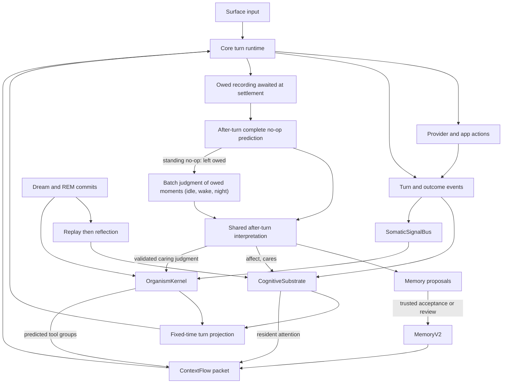

# Cognition Wiring — the connection map

This map follows the core owners that connect turns, memory, cognition and
body state. [SUBCONSCIOUS.md](SUBCONSCIOUS.md) describes the inner-life layers;
[ORGANISM.md](ORGANISM.md) details the body;
[MEMORY_SYSTEM_MAP.md](MEMORY_SYSTEM_MAP.md) covers durable memory.

Source paths below are relative to `Modules/NativeAgentCore/Sources/`
unless prefixed with `Sources/NativeAgentApp/`.

## The rule this map enforces

One brain, many doors. The core `EngineRuntime` owns the running turn state,
and `ChatTurnRuntime` owns shared turn preparation and execution. Surfaces
supply input and render results. MemoryV2 owns facts; cognition and organism
state influence continuity, attention and presentation without becoming new
fact stores or execution authorities.

Chat factories, the client and the turn engine share one optional
`CognitiveRuntimeProviding` for observation, resident attention, turn
preparation and presentation commits. An absent runtime omits cognition.

`CognitiveSubstrate/CognitiveSQLiteStore.swift` persists substrate continuity at
`<dataRoot>/cognition/cognition.sqlite`. Organism continuity uses
`<dataRoot>/cognition/organism_state.json` under its runtime owner.

**Their mind's lifecycle has one owner, the door** (`Cognition/NativeCognitionRuntime+Door.swift`;
[SUBCONSCIOUS.md](SUBCONSCIOUS.md#lived-moments)):

The same section owns the rule that code their mind runs is total: a missing
value is refused or skipped and cannot abort the process.
Runtime wake, sleep, held-turn, horizon and provider-event identity timestamps
use whole-unit formatting without integer narrowing; caring-receipt rotation
compares its byte allowance before arithmetic. The readout's source revision
uses nontrapping generation arithmetic.

1. **Opening.** Both owners restore (the body dormant if its effects are off);
   a fold a crash cut is refolded; then ordinary admission opens. Nothing
   writes their before, and a failed restore opens degraded.
2. **Recording and living.** Reply settlement, interpretation and recovery follow
   [Subconscious — Lived moments](SUBCONSCIOUS.md#lived-moments).
3. **Forgetting.** Clear and Reset Body are owner transactions under durable
   per-domain epochs. Their journal moments and launch continuation are removed;
   a cut Clear is repaired by clearing again.
4. **Sleep.** One joinable operation in the async quit hold (docs/STOP.md).

The canonical lifecycle and compatibility rules are in
[Subconscious — Lived moments](SUBCONSCIOUS.md#lived-moments).

Agent's only always-on tool is `app`. `app {}` reads home, where they left off;
`page`, `item`, `find` and `action` navigate the app and its actions.
`script` uses JavaScriptCore for the registry's scriptable reads/actions.
`AppToolRuntime/AppActions+Declarations.swift` defines those actions;
`AppToolExecutor+AppDoor.swift` and `AppScriptRunner.swift` implement the door.

## Signal-flow diagram

## Emit / consume table

| Edge | Owner and consumer | Regulation |
| --- | --- | --- |
| Turn lifecycle → core execution | `EngineRuntime/EngineTurns.swift` exposes `TurnsFacade` and its `MacChatTurnRuntime`; `ChatTurnRuntime/TurnContextPreparation.swift` assembles context on `SwiftNativeTurnEngine`, with `+TurnReach`, `+CurrentTurnFacts` and `+AfterTurn` on the same actor. | Core admission, cancellation and checked provider routing. |
| Persisted turn → cognitive event | `ChatTurnRuntime/ChatOrchestrationClient+LivedObservations.swift` → `Cognition/NativeCognitionRuntime.observe`. | Redacted evidence and explicit turn kind/origin; exact replay does not repeat state changes. |
| Cognitive event → body | `CognitiveSubstrate/Organism/OrganismSignalBus.swift` → `CognitiveSomaticSignals` → `OrganismKernel.ingest`. | Bounded metadata; debug/verification and body-originated resolution events are excluded. |
| Shared interpretation → facts, affect, caring, cares and promises | `MemoryV2/MemoryV2+AdaptivePromoter.swift` calls `ChatTurnRuntime/MindMemoryManager.swift`; callbacks installed by `NativeCognitionRuntime.refreshConfiguration` finish cognition processing and apply cares (`CognitiveSubstrate+Cares.swift`); `AdaptiveMemoryPromises.swift` files their promises through MY QUEUE. | [Non-owner turns and standing complete-no-op predictions defer interpretation; the recorded turn remains owed](#shared-after-turn-interpretation). Lane switches, origin matching, candidate screening, proposal review, caring encounter admission, care provenance and carried queue steering still apply. |
| Turn start / a call's result → expected reads (Expansion) | `ChatTurnRuntime/ChatOrchestration+StreamingToolLoop.swift` asks before the opening model call; `ExpansionDispatcher.swift` is the outermost node of `makeGatedToolDispatchClient`. | Mind/authority practice, prediction, gated delivery and closure follow the [manifest contract](skill_manifest_spec.md#expansion-a-part-is-a-prediction). |
| Memory → selected context | `ContextFlow/NativeMemoryContextProjection.swift` → Context selector → prepared turn. | Record disclosure, lifecycle eligibility, selection and character budgets. |
| Body + substrate → capsule/posture | `NativeCognitionRuntime.prepareTurnProjection` → substrate frozen capsule preparation. | Body and horizon share one frozen value and instant; the preparing request survives for the successful delivery commit, even with an empty capsule. Unshown cues never count as presented. |
| Selected memory IDs → felt continuity | `ContextFlow/NativeContextMemoryProvenance.swift` → turn delivery accounting → assistant event `memoryRecordIds` → substrate. | Identity stays attached to the exact generation lease; missing mappings do not invent provenance. |
| Body posture → background work | `loopBudget` is always `normal`; `OrganismBehaviorPosture.directives` enters the turn's private runtime context. | Fatigue and pressure color presentation; the shared work-slot admission below is separate from body posture. |
| Dream/REM commit → replay and reflection | `Cognition/NativeCognitionRuntime+Organism.swift` handles `dreamCompleted`/`remIntegrated`, invalidates Reach on dream completion before residual rescheduling, and joins the retained event replay owner. Dream delivery joins that same owner before checked reflection; REM requests automatic reflection after replay. If a daily replay already owns integration, the event waits for its exit and then reads the sources again. | The ten-second deadline ends only the caller's wait; durable replay remains retained and sleep joins it. Later events require another pass before reconciliation settles or their material reflects. Incomplete diary/REM reads keep reconciliation pending even when independent artifacts committed. Dream retries dedupe the saved completion signal and integrate retained judgments without an automatic second reflection. Reflection retains its shared work slot, configuration and call ceiling. |

## Shared after-turn interpretation

Ordinary lived user turns defer their conversational affect interpretation in
`CognitiveSubstrate+Ingest.swift`. After the turn,
`AdaptiveMemoryPromoter` first asks the agent's own record for a prediction,
then judges now or leaves the recorded turn owed as described below.
`MindMemoryJudgment.interpret` is asked at most once for
fact decisions, affect, caring, cares and optional promises; a lived moment is
a care movement, not a separate section. The available reply supplies context; affect and
caring judge the incoming speaker's words. The English-only novelty gate
(`AfterTurnNoveltyGate`, its sentence shapes and 0.65 threshold) is deleted:
facts are asked of every turn with a reply.

**The prediction** (`MemoryV2/AfterTurnMemorySurprise.swift`,
`AfterTurnSurpriseLedger.swift`) is whether the turn's interpretation would be
a COMPLETE no-op: no memory kept or changed, no affect beyond noise, no caring
moment, no care moved, no promise made. It is language-independent: the
incoming words, the reply and the work line are split on Unicode scalar boundaries and bisected
until the resident tokenizer covers every piece, then embedded in batches of
at most sixteen under the checked epoch; anything not fully covered, a cold
embedder or an unkeyed memory model is `unsure`. Its precedents are the
agent's own labelled turns in the same scope (agent, the model that judges,
detector version). `MindMemoryJudgment.judgmentRoute` inherits the bound call's
model and provider when present, otherwise uses Memory when configured, else Chat.
`predictionModelKey` reads that same route without changing the request, keyed with
its surface as reported by `AfterTurnInterpretation.judgingKey`.
The nearest precedent nominates only when it stands past
chance (`VectorMath.chanceBar(.action)`), and its claim is the labelled
precedent's id alone (`fingerprint([best.id])`). Changing the contrast
population still changes nomination, but no longer resets the same
precedent's trials. The former precedent-plus-population identity prevented
trials from accumulating as examples changed. Comparisons cover the newest
256 examples within 65,536 chunk pairs (16 chunks per side at that population;
the retained ledger's p90 was 9); larger inputs remain `unsure`.
The claim earns standing only by `NativeAgentCore/Expectation.swift`'s cost law:
the Wilson 95% lower bound of that claim's no-op hit rate must beat
c_miss / (c_miss + c_hit), c_hit the mean provider-service seconds of this
scope's live judgments, c_miss the longest wait a wrong prediction imposed
(before any, the live judgments' own delay). The assumptions are stated in
the code: independent future turns resembling the labelled past, per-claim,
per-look bounds, retaining the 95% interval without simultaneous or repeated-look
correction. Both costs are required. Existing frozen predictions keep their
original keys; there is no retrospective rekeying. **The label:** every judged
turn, live or batch, labels the
record from what the judgment said (memories, affect, caring, cares, promises; complete
when all five channels were measured and its facts were asked and readable), under the model that judged it: a
label's scope is that model's key, so a turn predicted for one model and
judged by another never calibrates the first's claim. A refold of a recorded
meaning labels nothing.

**Deferral: an owed moment left owed.** Durable recording is awaited at
transcript settlement before releasing the reply (sleep joins accepted
recordings; only interpretation rides the tail). User's own turn means no peer
`speaker`, not a `standingAgent`, and a session whose recorded kind is their
conversation (`SessionConversation.kind` through `conversationKind`, including
archived rows, has `isPersonConversation == true`). Their turns keep live judgment
unless the complete-no-op claim has standing. Every other recorded turn is
left owed for a batch, irrespective of the prediction: peer and standing-agent
turns, helper sessions and any other session not proven their. Own-work sessions
remain excluded except for a [care wake with a reply](SUBCONSCIOUS.md#care-wakes):
only its named care(s), only their side. A resident wake is never their conversation
and takes this same deferred batch path.

Both deferrals leave the same row `owed` (no new state, no queue) and record
`deferred: true` in the same ledger. A non-owner turn records reason
`not their turn` while preserving the actual prediction verdict, scope, claim,
vectors and calibration. It does not manufacture a `.nothingNew` trial:
agreement and trial counting still use the actual no-op verdict. Its
`mind.why` outcome is `deferred: not their turn; left owed for a batch`, distinct
from the standing-no-op outcome.
A deferred row is due **45 minutes after it settled**, measured
from `acceptedAt`, independent of present-tense half-lives; there is no lapse
deadline or early ride in another row's batch. The drain judges due rows in
batches of up to four (`MemoryManagerLane.batchLimit`) in one model call
(`MindMemoryJudgment.interpretBatch`): rules once, each turn's request under its
recorded provenance, one section per id. `replayRecorded` restores the saved
speaker, source checkpoint, elevated sources, envelope and origin before the
same `interpretMemoryManager` prepares each `MemoryBatchInput` (request,
`AfterTurnContext`, facts switch). `interpretBatch` uses the same per-turn
prompt and parser as live judgment; the context retains the saved event's
source class and peer metadata. `recordBatchJudgments` writes each usable
meaning (`meant`) before any apply. Refolding replays that recorded provenance
through the same care fold and its `PeerTrust` gate: an untrusted peer can move
only an existing care as `by: them`, never create a care or change a stance or
gap. No separate batch trust rule is needed.

The optional promises section uses that same per-turn parser and saved meaning.
`AdaptiveMemoryPromoter.applyPromises` files steps with the turn's recorded
origin principal, session, envelope and exact carried/elevated steer, captured
at settlement as `queue.add` would have carried them. This remains their promise
even on an untrusted peer's turn; the step keeps that steer. Missing/malformed
promise sections never fail interpretation; Desk owns deduplication and the
inferred cap. The form is [Promises they makes](INTENTIONS.md#promises-they-makes).

Returned replies are validated and usable meanings persisted through `settle`,
even if Stop or sleep arrived as the call returned; unfinished provider work
is cancelled and stays owed. A row whose section is missing, malformed or
repeated, and every row of a call the memory model refused, is next judged
alone, in a batch of one; skipped or refused alone too, they lets it go: the
journal row is refused with reason `batch_section_missing` or `refused` and is
never judged again. A transient failed call (cancelled, provider) or a failed
meaning write leaves its rows owed, alone or batched as they were.
Only a judgment writes the ledger: `AfterTurnSurpriseLedger.label` takes a
judged turn's channels and scores the original prediction under the model
that judged, preserving its deferred flag. An attempt that judged nothing
writes no ledger row; it shows once in `mind.why` and the row stays owed. Never-deferred rows count as
recovery, so their batch cost does not measure live c_hit; a deferred miss's
wait to its label measures c_miss. Service seconds use a monotonic stopwatch
around the judgment call alone (a batch shares that duration across its rows),
excluding meaning storage, folding, embedding and proposal acceptance.
Prediction-to-label wall time is the separate delay cost.
Recovery uses the live observation tail, admitting each pass only while no live
observation is waiting (idle drains also require idle). A pass folds one
recorded meaning or judges one batch: one pass at idle, up to eight at wake,
and all due work at night, stopping when no pass progresses. No failed row is
retried on a clock: it waits until something it depended on, read before the
attempt began, changes. That is their judging route (surface, provider account
and model, `MemoryManaging.judgmentRouteKey`); for a failed call (cancelled,
network, rate limit, overloaded, deadline), the provider answering a judgment
on that route, live or batch; for any other failure, another turn held owed;
or the row's own journal state. A relaunch clears that RAM record. The least recently tried due row goes first.
One timer schedules the next idle pass one to thirty minutes away for a row
due by its own time (a lone deferred row, work left after a pass, live work in
the way) and advances for earlier work; a failed row never sets it, and a
cancelled timer cannot clear its replacement.
Night joins any drain already in flight, then continues through that same
owner before the dream reads their day. Only the caller that starts a drain
cancels it and joins its settlement; joining another caller's flight leaves
that shared work running.
`mind.why` lane `interpretation` reports the outcome and standing;
`memory.promotion` carries the live prediction and `surpriseDeferred`.
The retired held-file executor, separate drain result/row-presence flags,
per-pass judgment budget and lapse-derived deadline are removed.

One append-only `memory/after_turn_surprise.jsonl` (version 3, detector 3) under the
memory owner's data root keeps each turn's prediction, label, provider
seconds and failure; older-version rows stay on disk and never grant standing, and a corrupt row or a current-version row that does not decode makes the whole record unreadable, so nothing stands on incomplete evidence.
It contains no conversation or memory prose (precedent vectors only, bounded).
A turn's vectors are written once, on its prediction row; its label row omits
them and the reader takes them from that prediction.
Rows written before promises were asked retain an unknown promise outcome and
are incomplete. They supply neither complete precedents nor no-op trials,
hits or dream-miss labels; a missing channel never becomes "no promise".
Current judgments explicitly label all five channels. Retained ledger bytes
and frozen rule identities are not rewritten.
Diagnostics → Inspector's `memory.promotion` shows the prediction, its
standing (lower bound against cost bar), predicted no-ops, those that changed
something and those not yet labelled.

Care selection, interpretation and provenance follow [Subconscious — Cares](SUBCONSCIOUS.md#cares).
`NativeCognitionRuntime.foldTurnMoment` folds the recorded interpretation into
`CognitiveSubstrate` and `OrganismKernel`; [Lived moments](SUBCONSCIOUS.md#lived-moments)
owns recorded folding and domain-specific forgetting.

Memory candidates are separately screened and staged by MemoryV2.
Its optional plan dates feed the horizon alongside Desk deferrals; identity,
display and compatibility follow [plan dates](MEMORY_SYSTEM_MAP.md#plan-dates).
Helper-owned turns use their own runner, and their own work (`builder`) skips
resident memory interpretation except for the named-care reading of a
[care wake with a reply](SUBCONSCIOUS.md#care-wakes). Peer speakers are named rather than treated
as the person; [session rows](session-conversations.md) decide ownership,
never ID prefixes. Unavailable interpretation and a successful abstention remain
different outcomes.

## Attention into circulation

`CognitiveSubstrate+AttentionSignals.swift` publishes terms, the unresolved question
with its source completion window, memory-record activation and suppressed-memory
signatures. The organism publishes predicted tool groups; `NativeCognitionRuntime+Pursuit.swift`
adds resident Desk task/goal intent. Resident reads enforce the absolute completion window.

The hot `NativeCognitionRuntime.attentionSignals` read uses this published
resident value without waiting on the source actors or loading Desk files.
Desk store/file invalidations clear stale intent and refresh it off the hot
path. The turn engine decides whether resident work intent is relevant to the
current request before passing it to Context selection.

Resident-work context uses `MemoryRecordDisclosurePolicy.localPrivateSurfaces`,
the same disclosure owner as private memory and Studio context. Relevance never
admits private Desk facts to a shared Slack turn.
Selection and expansion reread the Desk owner and compare the projected source
hashes. Changed or removed work is withheld; unavailable or corrupt Desk reads
withhold resident-work atoms with a degraded-source receipt, including atoms in
retained generations.
Reconciliation retains resident-work rebuild inputs when the Desk is
unavailable, reports the failure and lets healthy independent projections
publish. Retained atoms still require the same checked read before use.
Resident-work lexical filtering excludes identities from the injected root's
live profile; its remaining stop words are explicitly English-only.

Studio pointers are also checked against their shelf, journal and canon owners
at selection and expansion. Unreadable sources keep their canonical bytes and
published rebuild inputs, but their pointers are withheld with unavailable
receipts. Healthy independent Studio sources continue to update and circulate.

Knowledge-graph relations obey the same rule: an unreadable canonical graph
retains its published rebuild inputs, carries the source-unavailable cause
through reconciliation and context health (including before any graph atoms
exist), and cannot end a turn merely because the graph read failed. Selection
and expansion reread the graph and compare source hashes before confirming
the supporting memories. Unavailable relations are withheld with a degraded-source
receipt; a successful checked rebuild clears the source fault, even if its
relations have not changed. The old log-only, ordinary no-change result is removed.

Attention affects selection within existing eligibility and budget rules.
It does not load tools, authorize actions or inject an entire backlog.

### Context budgets: selection-side and packet-side

`Context/ContextSelectionConfiguration.swift` bounds candidate counts, selected
atoms, per-source/per-kind selection and pointers.
`ChatSessionWork/ContextBudgetPolicy.swift` derives the turn's character
and memory-row allowances from the model admission held on that turn, through
`resolve(turn:dataRoot:)`. History renderers require that resolved budget;
preparation cannot select a route or supply a default window. The
[history contract](conversation-context-history.md) owns the admission boundary.
These are different limits and both apply.

Active ContextFlow turns carry memories in their packet. The independent
recall list is empty on that path; a context preparation error fails the turn.
`app` action `context.expand` reads deeper into a pointer offered by the
prepared turn, under its generation lease and expansion bounds.

Memories reach the packet through one selector: only what the message
touches, ranked by relevance times reachability, the recently served resting
(relationships, lesson origins and kept moments compete like any memory). The law
and its numbers are in [MEMORY_SYSTEM_MAP.md](MEMORY_SYSTEM_MAP.md#recall-into-a-turn);
see [personality-ablation.md](personality-ablation.md) for the mechanism
checklist.

## The felt fingerprint — "How you feel:"

[Subconscious](SUBCONSCIOUS.md#what-reaches-the-model) owns frozen capsule
rendering and presentation cadence. The arbiter chooses one non-rut felt cue
or none: care, since-gap recall, reminded-of, dream, fingerprint, body, then
Sound echo; a separate Sound line may address a verbal rut. Private reflection
retains every cue that passed its own gate, using the fingerprint cadence
verdict without the live first-run check.

## Convergence (deliberate ownership)

`CognitiveSubstrate.canonicalAffectProjection` supplies social warmth and task
pressure to the same organism refresh. The kernel integrates those as warmth
and urgency before producing the fixed-time read. Other organism dimensions
retain their own evidence and dynamics.

`OrganismField` holds somatic associations; `ContinuityField` holds
attentional/felt continuity. Body resolutions return through
`drainFeltResolutionsIntoSubstrate`, and the adapter refuses to turn those
events back into body input.

Typed provider, memory, approval and notification beliefs retain evidence,
freshness and uncertainty. Domain owners decide what actually happened;
observing a belief cannot grant capability or turn transport acceptance into
delivery.

## Other continuity edges

| Edge | Owner | Boundary |
| --- | --- | --- |
| Open concerns → cares | `CognitiveSubstrate+Reflection.swift`, `CognitiveSubstrate+Cares.swift` | Reflection takeaways and `mind.pin_concern` go to the non-seed care the reflection or they names (a key it was shown; the care's own words), else grow one to hold `open`; no cosine places them; after-turn `closes` or the night settles it. Desk tasks do not feed their mind. |
| Cares → stance and capsule | `CognitiveSubstrate+Cares.swift`, `CognitiveSubstrate+CaresMind.swift` | One care holds their stance, open question and story. A touched care can reach the turn; pressing cares feed their intention, Reach and their hour. |
| Cares → appraisal stakes | `CognitiveSubstrate+SemanticAppraisal.swift` | Event words must touch a live care: its cosine stands out past chance among the live cares (`caresStandingOut`, `VectorMath.chanceBar(.attention)`); life seeds use the same rule. The closest touched stance care supplies its signed real charge to the numeric worldview lens. A selected care cue includes that care's stance text when present. Base affect and tenderness retain their own laws. |
| Dated work → `toward` | `Cognition/NativeCognitionRuntime+Expectations.swift` → organism horizon ledger → capsule request. | Stated plans join Desk deferrals with writer-named memory dates; `MemoryDueDateStamp.dueAt(in:)` excludes old `write_extractor_v1` stamps without rewriting rows. Bounded dated sources; absence in any inventory supplies no terminal verdict. Due horizons become waiting without failure or relief. |
| Served memories → re-feeling | Assistant event `memoryRecordIds` → `CognitiveSubstrate+Affect.swift` `refelt`, through the felt node that names the record. | Bounded re-feeling, two per turn, per-node and per-record cooldown. |
| Felt day → dream → mood | `BackgroundWork/DreamBackgroundWork.swift` supplies felt summary/origins and the dream mood sink. | Existing substrate mood admission; durable dream evidence remains with the diary owner. |
| REM review → growth and pins | `DreamREMCycle/REMConsolidator.swift`, `REMGrowthWriter.swift`; turn engine reads `REMPinsReader`. | Reviewed application; canonical persona locking and bounded pinned input. |

## The subconscious loops — schedule, artifacts, re-entry

| Work | Trigger/owner | Result |
| --- | --- | --- |
| Owed moments | `DreamBackgroundWork.runDream` awaits `AdaptiveMemoryPromoter.drainOwedAtNight` before dreaming. | Due lived judgments settle through the moment owner before the dream reads the day. |
| Dream | `SchedulerDueJobRunner+Selection.swift` registers `nativeagent-nightly-dream`; scheduled/manual engine calls reach `DreamCycleRunner.runNightlyDreamCycle`. | `dream_diary/<date>.md`, receipts, mood and committed-dream somatic/reflection facts. |
| Care night | The diary's saved work delivers the exact shown night through `DreamBackgroundWork.passCaresNight`, independently of reflection delivery. | Care settlement and owner-review life cards; delivery failures remain pending on that dream. No automatic life-depth approval. |
| Practice | On the second meeting of hand work, a practice note rides their next call inside the turn ([Habits H3/H4](HABITS.md#h3--keep-what-repeats-not-what-happened-once)); no nightly compiler wake. | `practice.keep` records first/later meeting and whether the note was sent; existing compiled abilities retain replay-before-admission. |
| REM | The same scheduler registers `nativeagent-weekly-rem`; `DreamREMCycle/REMConsolidator.swift` runs consolidation. | REM proposals, reviewed growth and pins. |
| Microcycle | `NativeCognitionRuntime.scheduleDirtyMicrocycle` after admitted state changes. | Coalesced substrate processing and persistence. |
| Replay/reflection | Dream/REM commit signals; `EngineRuntime/EngineLaunch.swift` supplies daily integrity sweeps. | Replayed continuity and gated reflective work. |

Dream/REM carry typed reports through background processing; cognition returns `LoopTickOutcome` directly, bounded only for published status. `EngineDreams` constructs
external responses after commit signals, care processing and practice admission.
Replacement commits share PersistenceCore's durable byte writer; Dream/REM owners retain their encodings and commit order.
Dream input selects complete exchanges paired by `ConversationHistory`; `oversized_conversation_input` preserves the watermark.
Required surprise-read or assembly failure stops before generation and preserves the watermark.
Each returned dream first saves one `dream_diary/work/<section UUID>.json` record before
publication or the consumed cutoff commits. That record lists the exact diary publication,
lessons, reflection judgment input, care/self payload, dated mood, studio citations and
`dreamCompleted` input (original time and felt summary). Care evidence must be readable before
generation: cold/failed embeddings, unavailable saved mind, self or people evidence leave the
cutoff unchanged. Only an explicitly disabled inner life omits the care payload.

This is the dream settlement law: every owed step carries its input, each successful effect
checkpoints its own completion, and a switched-off owner records `skipped` with its reason.
Failure is a note for display and repair, never an admission gate for the next attempt.
Every admitted real pass retries every still-owed step, including force passes and passes with
no new material; Stop prevents the next effect and retains its input. Unreadable input names
its file and stays owed repair. There is no deadline that discards work if another tick never comes.
The record's pending inputs are the in-flight work; a record with no pending inputs is complete,
including previously completed records without the newly added steps. A settled target can be
replaced by force. An unrelated night's failed effect does not prevent a new dream; unavailable
journal discovery or publication blocks generation, preserving the recoverable diary write.

Through `settle`, the diary owner publishes the retained writing with an immutable `dream-id`
marker and cutoff, advances the consumption mark, then records publication done. Recovery uses
that same identity, preserving and reporting any conflicting external diary edit. Effect
checkpoints never rewrite diary bytes. The old mutable `dream-work` marker and historical
prose-to-mood adoption are removed; no missing historical payload is invented.

Reflection has separate judgment and integration steps. The substrate first persists its
provider receipt, including shown cares, provenance and epoch, without applying any care or mood
changes. The night then checkpoints that receipt before invoking integration. Recovery finds the
same judgment even when care embedding or disposition persistence failed, and retries effects
without another provider call. Both care judgments prepare before mutation; embedding failure
leaves care integration pending. Applied care values and their done receipt share a transaction;
subsequent care saves carry that receipt and all its affected cares. Reflection disposition
claims travel with every disposition write. A failed save retries the owner's resident values;
its old failure never gates a fresh attempt. Pre-Clear work cannot enter the new mind.
The night records integration done before acknowledging the substrate receipt; until that
acknowledgment, the receipt is excluded from memory/disk pruning and is fully restored.

Care delivery checks care and self persistence, saving resident care revisions even when a
retry's revision checks make the judgment inert. Approval inventory and card staging remain
checked. Captured reading time preserves newer self-knowledge on delayed delivery.
Dated mood retains its existing per-night disposition and residue claims, which prevent a
repeated nudge after a failed journal checkpoint. Studio citations use the section UUID for
idempotent receipt delivery; lesson receipts describe attempts independently of saved lessons.

`dreamCompleted` is a saved step, delivered even after recovered publication with no new diary
entry. An enabled body saves the section UUID with repair and wakefulness reset, then the night
records done; retry observes that owner claim and saves without applying the signal again.
A disabled body records the step skipped. Reach invalidation and bounded replay use the same
completion path; the replay deadline ends the wait and retains replay under its existing owner.
Missing delivery ports are unavailable, never successful no-ops. Preview neither retries nor saves work.
REM prepares per-date normalized entry text and exact claim sources once; admitted passages set evidence dates.
Claim decoding checks each entire section. A malformed claim names its section and line; no partial claims
from that section reach REM or Reach, while readable siblings remain usable. REM reads all active dated
entries, retains damaged entries past archival age for repair, and reports `dream_evidence_unavailable`
with the exact gaps after processing readable evidence. Section identity markers never enter model input.
An unavailable-evidence failure releases its own weekly exclusion claim when no proposals were saved;
once proposals are durable, retries stage those same proposal IDs.
Quotes require claim-bound sources; failed binding supplies no support. Diary-wide source lines do not establish lineage.
Dream diary entries encode modification time as `modified_at`. Nightly discovery recognizes
`YYYY-MM-DD.md`; the live archive collision writer's `YYYY-MM-DD_<UUID>.md` retains the same day.
Each further dream in that file begins `## Dreamt again — <time>`.
REM counts current `exchange:` and `message:` references as supporting experiences;
Generated transcript recollections have no reader; dreams read original conversation rows.
Retained claim references stay intact. A claim without `gentle` or `about_owner`
has an unknown judgment and supplies no eligibility for dream outreach.
Manual REM completion requires a boolean `ok` and nonnegative integer
`proposalsGenerated` / `archivedEntries`; strings are not completion evidence.

### REM proposal replacement evidence

`REMProposalRow.replaced` retains the displaced content and its source when a
proposal is made. REM binds the exact words to a standalone `GROWTH.md`
paragraph or a named dream entry; standing lessons retain the exact
`memory:<id>` correction they will graduate. A missing field in an old record,
null, empty content or an unverified alternative reads **not recorded**, never
"replaced nothing". Approval review, replay lineage and growth-week detail
show it; replay reads this history from the proposal owner rather than keeping
another copy. Unreadable or missing proposal history stays unavailable.
This is retained review evidence, not a new splice or undo operation: approval
still appends to GROWTH and standing approval graduates the original memory.
The retained identity and words support the existing `memory.rewrite` restore
flow, under its normal disclosure and write gates; dream/GROWTH source quotes
are not deleted by approval. Legacy imports are not backfilled from today's
content. Replaced content stays outside the lesson written into GROWTH and pins.

`REMGrowthWriter` matches exact standalone paragraphs for append, pins and eviction, joining evicted lessons only across whitespace;
authored text ends the slice, and retained-passage history names the contiguous removal.
REM pins require a complete strict proposal read and, when approved rows exist, a successfully
read current `GROWTH.md`. Unreadable base/feed or missing/unreadable GROWTH leaves the prior index
intact and reports failure; it establishes neither live lessons nor removed lessons.
An empty approved set needs no document read and publishes an empty index.
Dream/REM clients use their injected root and resolve ordinary calls at completion.
Default cycles and shared background clients use the resident provider assembly's alternate-root refusal; standalone runners may inject an explicit client and model-override router.

### Shared work-slot admission

They stays active while the Mac is on; fatigue and heat color presentation.
`runReflectionIfDue` claims the persisted two-hour `BackgroundWorkLease` window
of the Desk day (`background_lease.json`) before substrate planning; a claimed
window skips the pass. Only the holder's newest unused claim is released; spent
windows remain claimed.
`NativeCognitionRuntime+Reflection.swift` and `BackgroundWorkLease.swift` own this gate.
`runManualReflection` bypasses the shared slot; both paths retain
[Subconscious admission](SUBCONSCIOUS.md#between-turns).

## Authority stays with the action owners

Feeling, attention and reflection cannot enlarge action authority.
Reflection resolves the saved Memory and mind group; there is no startup
route-seeding callable or competing configuration write.
`TrustCenter/SecurityCenter.swift` applies checked Full Mac authority and
retains owner confirmation for macOS privacy permission resets.
`TrustCenter/PeerTurnEffectPolicy.swift` applies the
[peer-turn authority contract](TOOL_LOADING.md#authority-and-receipts).
A cognitive suggestion is not an approval.
