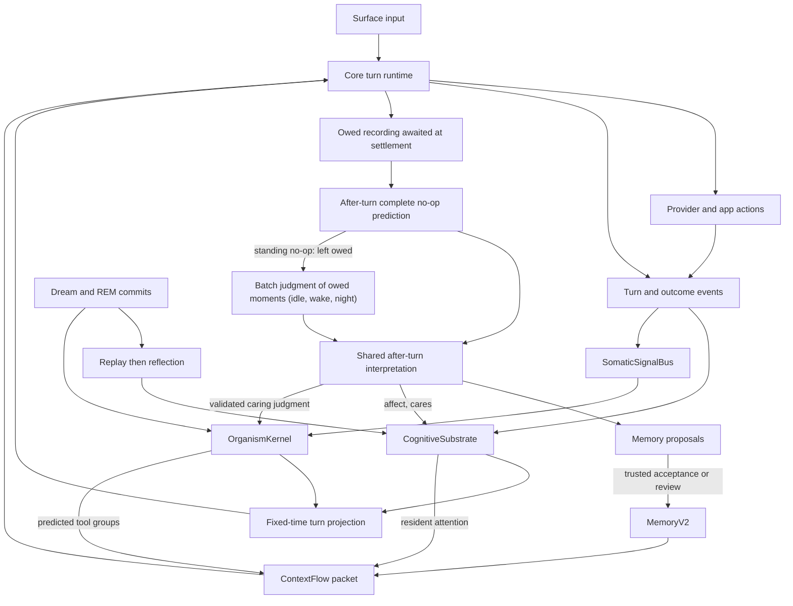

# Cognition Wiring — the connection map

This map follows the core owners that connect turns, memory, cognition and
body state. [SUBCONSCIOUS.md](SUBCONSCIOUS.md) describes the inner-life layers;
[ORGANISM.md](ORGANISM.md) details the body;
[MEMORY_SYSTEM_MAP.md](MEMORY_SYSTEM_MAP.md) covers durable memory.

Source paths below are relative to `Modules/NativeAgentCore/Sources/`
unless prefixed with `Sources/NativeAgentApp/`.

## The rule this map enforces

One brain, many doors. The core `EngineRuntime` owns the running turn state,
and `ChatTurnRuntime` owns shared turn preparation and execution. Surfaces
supply input and render results. MemoryV2 owns facts; cognition and organism
state influence continuity, attention and presentation without becoming new
fact stores or execution authorities.

Chat factories, the client and the turn engine share one optional
`CognitiveRuntimeProviding` for observation, resident attention, turn
preparation and presentation commits. An absent runtime omits cognition.

`CognitiveSubstrate/CognitiveSQLiteStore.swift` persists substrate continuity at
`<dataRoot>/cognition/cognition.sqlite`. Organism continuity uses
`<dataRoot>/cognition/organism_state.json` under its runtime owner.

**Their mind's lifecycle has one owner, the door** (`Cognition/NativeCognitionRuntime+Door.swift`;
[SUBCONSCIOUS.md](SUBCONSCIOUS.md#lived-moments)):

The same section owns the rule that code their mind runs is total: a missing
value is refused or skipped and cannot abort the process.
Runtime wake, sleep, held-turn, horizon and provider-event identity timestamps
use whole-unit formatting without integer narrowing; caring-receipt rotation
compares its byte allowance before arithmetic. The readout's source revision
uses nontrapping generation arithmetic.

1. **Opening.** Both owners restore (the body dormant if its effects are off);
   a fold a crash cut is refolded; then ordinary admission opens. Nothing
   writes their before, and a failed restore opens degraded.
2. **Recording and living.** Reply settlement, interpretation and recovery follow
   [Subconscious — Lived moments](SUBCONSCIOUS.md#lived-moments).
3. **Forgetting.** Clear and Reset Body are owner transactions under durable
   per-domain epochs. Their journal moments and launch continuation are removed;
   a cut Clear is repaired by clearing again.
4. **Sleep.** One joinable operation in the async quit hold (docs/STOP.md).

The canonical lifecycle and compatibility rules are in
[Subconscious — Lived moments](SUBCONSCIOUS.md#lived-moments).

Agent's only always-on tool is `app`. `app {}` reads home, where they left off;
`page`, `item`, `find` and `action` navigate the app and its actions.
`script` uses JavaScriptCore for the registry's scriptable reads/actions.
`AppToolRuntime/AppActions+Declarations.swift` defines those actions;
`AppToolExecutor+AppDoor.swift` and `AppScriptRunner.swift` implement the door.

## Signal-flow diagram

## Emit / consume table

| Edge | Owner and consumer | Regulation |
| --- | --- | --- |
| Turn lifecycle → core execution | `EngineRuntime/EngineTurns.swift` exposes `TurnsFacade` and its `MacChatTurnRuntime`; `ChatTurnRuntime/TurnContextPreparation.swift` assembles context on `SwiftNativeTurnEngine`, with `+TurnReach`, `+CurrentTurnFacts` and `+AfterTurn` on the same actor. | Core admission, cancellation and checked provider routing. |
| Persisted turn → cognitive event | `ChatTurnRuntime/ChatOrchestrationClient+LivedObservations.swift` → `Cognition/NativeCognitionRuntime.observe`. | Redacted evidence and explicit turn kind/origin; exact replay does not repeat state changes. |
| Cognitive event → body | `CognitiveSubstrate/Organism/OrganismSignalBus.swift` → `CognitiveSomaticSignals` → `OrganismKernel.ingest`. | Bounded metadata; debug/verification and body-originated resolution events are excluded. |
| Shared interpretation → facts, affect, caring and cares | `MemoryV2/MemoryV2+AdaptivePromoter.swift` calls `ChatTurnRuntime/MindMemoryManager.swift`; callbacks installed by `NativeCognitionRuntime.refreshConfiguration` finish cognition processing and apply cares (`CognitiveSubstrate+Cares.swift`). | [Learned complete-no-op prediction may defer interpretation; the recorded turn remains owed](#shared-after-turn-interpretation). Lane switches, origin matching, candidate screening, proposal review, caring encounter admission and care provenance still apply. |
| A call's result → follow-up reads (Expansion) | `ChatTurnRuntime/ExpansionDispatcher.swift`: outermost node of `makeGatedToolDispatchClient`. | Prediction, delivery and closure follow the [manifest contract](skill_manifest_spec.md#expansion-a-part-is-a-prediction). |
| Memory → selected context | `ContextFlow/NativeMemoryContextProjection.swift` → Context selector → prepared turn. | Record disclosure, lifecycle eligibility, selection and character budgets. |
| Body + substrate → capsule/posture | `NativeCognitionRuntime.prepareTurnProjection` → substrate frozen capsule preparation. | Body and horizon share one frozen value and instant; the preparing request survives for the successful delivery commit, even with an empty capsule. Unshown cues never count as presented. |
| Selected memory IDs → felt continuity | `ContextFlow/NativeContextMemoryProvenance.swift` → turn delivery accounting → assistant event `memoryRecordIds` → substrate. | Identity stays attached to the exact generation lease; missing mappings do not invent provenance. |
| Body posture → background work | `loopBudget` is always `normal`; `OrganismBehaviorPosture.directives` enters the turn's private runtime context. | Fatigue and pressure color presentation; the shared work-slot admission below is separate from body posture. |
| Dream/REM commit → replay and reflection | `Cognition/NativeCognitionRuntime+Organism.swift` handles `dreamCompleted`/`remIntegrated`, invalidates Reach on dream completion before residual rescheduling, awaits replay, then schedules reflection. | Reach timing/source-read limits; replay deadline, reflection shared work slot, single-flight, configuration and call ceiling. |

## Shared after-turn interpretation

Ordinary lived user turns defer their conversational affect interpretation in
`CognitiveSubstrate+Ingest.swift`. After the turn,
`AdaptiveMemoryPromoter` first asks the agent's own record for a prediction,
then runs the pass. `MindMemoryJudgment.interpret` is asked at most once for
fact decisions, affect, caring and cares; a lived moment is a care movement,
not a separate section. The available reply supplies context; affect and
caring judge the incoming speaker's words. The English-only novelty gate
(`AfterTurnNoveltyGate`, its sentence shapes and 0.65 threshold) is deleted:
facts are asked of every turn with a reply.

**The prediction** (`MemoryV2/AfterTurnMemorySurprise.swift`,
`AfterTurnSurpriseLedger.swift`) is whether the turn's interpretation would be
a COMPLETE no-op: no memory kept or changed, no affect beyond noise, no caring
moment, no care moved. It is language-independent: the incoming words, the
reply and the work line are split on Unicode scalar boundaries and bisected
until the resident tokenizer covers every piece, then embedded in batches of
at most sixteen under the checked epoch; anything not fully covered, a cold
embedder or an unkeyed memory model is `unsure`. Its precedents are the
agent's own labelled turns in the same scope (agent, the model that judges,
detector version). `MindMemoryJudgment.judgmentRoute` inherits the bound call's
model and provider when present, otherwise uses Memory when configured, else Chat.
`predictionModelKey` reads that same route without changing the request, keyed with
its surface as reported by `AfterTurnInterpretation.judgingKey`.
The nearest precedent nominates only when it stands past
chance (`VectorMath.chanceBar(.action)`), and the frozen claim it makes
(precedent plus contrast population) earns standing only by the cost law:
the Wilson 95% lower bound of that claim's no-op hit rate must beat
c_miss / (c_miss + c_hit), c_hit the mean provider-service seconds of this
scope's live judgments, c_miss the longest wait a wrong prediction imposed
(before any, the live judgments' own delay). The assumptions are stated in
the code: independent future turns resembling the labelled past, per-claim,
per-look bounds. **The label:** every judged turn, live or batch, labels the
record from what the judgment said (memories, affect, caring, cares; complete
when its facts were asked and readable), under the model that judged it: a
label's scope is that model's key, so a turn predicted for one model and
judged by another never calibrates the first's claim. A refold of a recorded
meaning labels nothing.

**Deferral: an owed moment left owed.** A live turn the journal recorded,
with durable recording awaited at transcript settlement before releasing the
reply (sleep joins accepted recordings; only interpretation rides the tail),
predicted a complete no-op by a claim with standing, is not interpreted now:
its row stays `owed` (no new state, no queue) and the prediction is recorded
`deferred`. A deferred row is due **45 minutes after it settled**, measured
from `acceptedAt`, independent of present-tense half-lives; there is no lapse
deadline or early ride in another row's batch. The drain judges due rows in
batches of up to four (`MemoryManagerLane.batchLimit`) in one model call
(`MindMemoryJudgment.interpretBatch`): rules once, each turn's request under its
recorded provenance, one section per id. Each usable section becomes durable
meaning (`meant`) before any apply.
Returned replies are validated and usable meanings persisted through `settle`,
even if Stop or sleep arrived as the call returned; unfinished provider work
is cancelled and stays owed. Missing, malformed or repeated sections,
and failed meaning writes, leave their rows owed and backing off.
`AfterTurnSurpriseLedger.label` scores the original prediction under the model
that judged, preserving its deferred flag. Never-deferred rows count as
recovery, so their batch cost does not measure live c_hit; a deferred miss's
wait to its label measures c_miss. Service seconds use a monotonic stopwatch
around the judgment call alone (a batch shares that duration across its rows),
excluding meaning storage, folding, embedding and proposal acceptance.
Prediction-to-label wall time is the separate delay cost.
Recovery uses the live observation tail, admitting each pass only while no live
observation is waiting (idle drains also require idle). A pass folds one
recorded meaning or judges one batch: one pass at idle, up to eight at wake,
and all due work at night, stopping when no pass progresses. Unfinished rows
back off from one minute, doubling to six hours with a capped exponent;
the least recently tried due row goes first. One timer schedules the next
idle pass one to thirty minutes away, including a lone deferred row, and
advances for earlier work; a cancelled timer cannot clear its replacement.
Night joins any drain already in flight, then continues through that same
owner before the dream reads their day. Only the caller that starts a drain
cancels it and joins its settlement; joining another caller's flight leaves
that shared work running.
`mind.why` lane `interpretation` reports the outcome and standing;
`memory.promotion` carries the live prediction and `surpriseDeferred`.
The retired held-file executor, separate drain result/row-presence flags,
per-pass judgment budget and lapse-derived deadline are removed.

One append-only `memory/after_turn_surprise.jsonl` (version 3) under the
memory owner's data root keeps each turn's prediction, label, provider
seconds and failure; older-version rows stay on disk and never grant standing, and a corrupt row or a current-version row that does not decode makes the whole record unreadable, so nothing stands on incomplete evidence.
It contains no conversation or memory prose (precedent vectors only, bounded).
Diagnostics → Inspector's `memory.promotion` shows the prediction, its
standing (lower bound against cost bar), predicted no-ops, those that changed
something and those not yet labelled.

Care selection, interpretation and provenance follow [Subconscious — Cares](SUBCONSCIOUS.md#cares).
`NativeCognitionRuntime.foldTurnMoment` folds the recorded interpretation into
`CognitiveSubstrate` and `OrganismKernel`; [Lived moments](SUBCONSCIOUS.md#lived-moments)
owns recorded folding and domain-specific forgetting.

Memory candidates are separately screened and staged by MemoryV2.
Its optional plan dates feed the horizon alongside Desk deferrals; identity,
display and compatibility follow [plan dates](MEMORY_SYSTEM_MAP.md#plan-dates).
Helper-owned turns use their own runner, and their own work (`builder`) skips
resident memory interpretation. Peer speakers are named rather than treated
as the person; [session rows](session-conversations.md) decide ownership,
never ID prefixes. Unavailable interpretation and a successful abstention remain
different outcomes.

## Attention into circulation

`CognitiveSubstrate+AttentionSignals.swift` publishes terms, the unresolved question
with its source completion window, memory-record activation and suppressed-memory
signatures. The organism publishes predicted tool groups; `NativeCognitionRuntime+Pursuit.swift`
adds resident Desk task/goal intent. Resident reads enforce the absolute completion window.

The hot `NativeCognitionRuntime.attentionSignals` read uses this published
resident value without waiting on the source actors or loading Desk files.
Desk store/file invalidations clear stale intent and refresh it off the hot
path. The turn engine decides whether resident work intent is relevant to the
current request before passing it to Context selection.

Resident-work context uses `MemoryRecordDisclosurePolicy.localPrivateSurfaces`,
the same disclosure owner as private memory and Studio context. Relevance never
admits private Desk or Workshop facts to a shared Slack turn.
Selection and expansion reread the Desk and Workshop owners and compare the
projected source hashes. Changed or removed work is withheld; unavailable or
corrupt execution reads withhold resident-work atoms with a degraded-source
receipt, including atoms in retained generations.
Reconciliation retains resident-work rebuild inputs when either owner is
unavailable, reports the failure and lets healthy independent projections
publish. Retained atoms still require the same checked read before use.
Resident-work lexical filtering excludes identities from the injected root's
live profile; its remaining stop words are explicitly English-only.

Studio pointers are also checked against their shelf, journal and canon owners
at selection and expansion. Unreadable sources keep their canonical bytes and
published rebuild inputs, but their pointers are withheld with unavailable
receipts. Healthy independent Studio sources continue to update and circulate.

Attention affects selection within existing eligibility and budget rules.
It does not load tools, authorize actions or inject an entire backlog.

### Context budgets: selection-side and packet-side

`Context/ContextSelectionConfiguration.swift` bounds candidate counts, selected
atoms, per-source/per-kind selection and pointers.
`ChatSessionWork/ContextBudgetPolicy.swift` derives the turn's character
and memory-row allowances from the admitted model window. These are different
limits and both apply.

Active ContextFlow turns carry memories in their packet. The independent
recall list is empty on that path; a context preparation error fails the turn.
`app` action `context.expand` reads deeper into a pointer offered by the
prepared turn, under its generation lease and expansion bounds.

Memories reach the packet through one selector: only what the message
touches, ranked by relevance times reachability, the recently served resting
(relationships, lesson origins and kept moments compete like any memory). The law
and its numbers are in [MEMORY_SYSTEM_MAP.md](MEMORY_SYSTEM_MAP.md#recall-into-a-turn);
see [personality-ablation.md](personality-ablation.md) for the mechanism
checklist.

## The felt fingerprint — "How you feel:"

[Subconscious](SUBCONSCIOUS.md#what-reaches-the-model) owns frozen capsule
rendering and presentation cadence. The arbiter chooses one non-rut felt cue
or none: care, since-gap recall, reminded-of, dream, fingerprint, body, then
Sound echo; a separate Sound line may address a verbal rut. Private reflection
retains every cue that passed its own gate, using the fingerprint cadence
verdict without the live first-run check.

## Convergence (deliberate ownership)

`CognitiveSubstrate.canonicalAffectProjection` supplies social warmth and task
pressure to the same organism refresh. The kernel integrates those as warmth
and urgency before producing the fixed-time read. Other organism dimensions
retain their own evidence and dynamics.

`OrganismField` holds somatic associations; `ContinuityField` holds
attentional/felt continuity. Body resolutions return through
`drainFeltResolutionsIntoSubstrate`, and the adapter refuses to turn those
events back into body input.

Typed provider, memory, approval and notification beliefs retain evidence,
freshness and uncertainty. Domain owners decide what actually happened;
observing a belief cannot grant capability or turn transport acceptance into
delivery.

## Other continuity edges

| Edge | Owner | Boundary |
| --- | --- | --- |
| Open concerns → cares | `CognitiveSubstrate+Reflection.swift`, `CognitiveSubstrate+Cares.swift` | Reflection takeaways and `mind.pin_concern` go to the non-seed care the reflection or they names (a key it was shown; the care's own words), else grow one to hold `open`; no cosine places them; after-turn `closes` or the night settles it. Desk tasks do not feed their mind. |
| Cares → stance and capsule | `CognitiveSubstrate+Cares.swift`, `CognitiveSubstrate+CaresMind.swift` | One care holds their stance, open question and story. A touched care can reach the turn; pressing cares feed their intention, Reach and their hour. |
| Cares → appraisal stakes | `CognitiveSubstrate+SemanticAppraisal.swift` | Event words must touch a live care: its cosine stands out past chance among the live cares (`caresStandingOut`, `VectorMath.chanceBar(.attention)`); life seeds use the same rule. The closest touched stance care supplies its signed real charge to the numeric worldview lens. A selected care cue includes that care's stance text when present. Base affect and tenderness retain their own laws. |
| Dated work → `toward` | `Cognition/NativeCognitionRuntime+Expectations.swift` → organism horizon ledger → capsule request. | Stated plans join Desk deferrals with writer-named memory dates; `MemoryDueDateStamp.dueAt(in:)` excludes old `write_extractor_v1` stamps without rewriting rows. Bounded dated sources; an incomplete source read cannot prove disappearance. |
| Served memories → re-feeling | Assistant event `memoryRecordIds` → `CognitiveSubstrate+Affect.swift` `refelt`, through the felt node that names the record. | Bounded re-feeling, two per turn, per-node and per-record cooldown. |
| Felt day → dream → mood | `BackgroundWork/DreamBackgroundWork.swift` supplies felt summary/origins and the dream mood sink. | Existing substrate mood admission; durable dream evidence remains with the diary owner. |
| REM review → growth and pins | `DreamREMCycle/REMConsolidator.swift`, `REMGrowthWriter.swift`; turn engine reads `REMPinsReader`. | Reviewed application; canonical persona locking and bounded pinned input. |

## The subconscious loops — schedule, artifacts, re-entry

| Work | Trigger/owner | Result |
| --- | --- | --- |
| Owed moments | `DreamBackgroundWork.runDream` awaits `AdaptiveMemoryPromoter.drainOwedAtNight` before dreaming. | Due lived judgments settle through the moment owner before the dream reads the day. |
| Dream | `SchedulerDueJobRunner+Selection.swift` registers `nativeagent-nightly-dream`; scheduled/manual engine calls reach `DreamCycleRunner.runNightlyDreamCycle`. | `dream_diary/<date>.md`, receipts, mood and committed-dream somatic/reflection facts. |
| Care night | After the committed dream signal, `DreamBackgroundWork.passCaresNight` applies approved life cards and runs the substrate's care pass. | Care settlement and owner-review life cards; no automatic life-depth approval. |
| Practice | After background dream processing returns committed, `EngineDreams` wakes `EnginePractice`. | Per-agent recorded examples, their keep decision, exact tape replay and gated ability admission; `practice.night` trace. |
| REM | The same scheduler registers `nativeagent-weekly-rem`; `DreamREMCycle/REMConsolidator.swift` runs consolidation. | REM proposals, reviewed growth and pins. |
| Microcycle | `NativeCognitionRuntime.scheduleDirtyMicrocycle` after admitted state changes. | Coalesced substrate processing and persistence. |
| Replay/reflection | Dream/REM commit signals; `EngineRuntime/EngineLaunch.swift` supplies daily integrity sweeps. | Replayed continuity and gated reflective work. |

Dream/REM carry typed reports through background processing; cognition returns `LoopTickOutcome` directly, bounded only for published status. `EngineDreams` constructs
external responses after commit signals, care processing and practice admission.
Replacement commits share PersistenceCore's durable byte writer; Dream/REM owners retain their encodings and commit order.
Dream input selects complete exchanges paired by `ChatSessionRecollections`; `oversized_conversation_input` preserves the watermark.
REM prepares per-date normalized entry text, exact claim sources and legacy eligibility once; admitted passages set evidence dates.
Modern quotes require bound sources; failed binding is not legacy provenance. Legacy quotes must match the diary.
`REMGrowthWriter` matches exact standalone paragraphs for append, pins and eviction, joining evicted lessons only across whitespace;
authored text ends the slice, and retained-passage history names the contiguous removal.
REM pins require a complete strict proposal read; unreadable base/feed leaves the prior index intact and reports failure.
Dream/REM clients use their injected root and resolve ordinary calls at completion.
Default cycles and shared background clients use the resident provider assembly's alternate-root refusal; standalone runners may inject an explicit client and model-override router.

### Shared work-slot admission

They stays active while the Mac is on; fatigue and heat color presentation.
`runReflectionIfDue` claims Workshop's persisted two-hour `BackgroundWorkLease`
window before substrate planning; a claimed window skips the pass. Only the
holder's newest unused claim is released; spent windows remain claimed.
`NativeCognitionRuntime+Reflection.swift` and `BackgroundWorkLease.swift` own this gate.
`runManualReflection` bypasses the shared slot; both paths retain
[Subconscious admission](SUBCONSCIOUS.md#between-turns).

## Authority stays with the action owners

Feeling, attention and reflection cannot enlarge action authority.
Reflection resolves the saved Memory and mind group; there is no startup
route-seeding callable or competing configuration write.
`TrustCenter/SecurityCenter.swift` applies checked Full Mac authority and
retains owner confirmation for macOS privacy permission resets.
`TrustCenter/PeerTurnEffectPolicy.swift` applies the
[peer-turn authority contract](TOOL_LOADING.md#authority-and-receipts).
A cognitive suggestion is not an approval.
