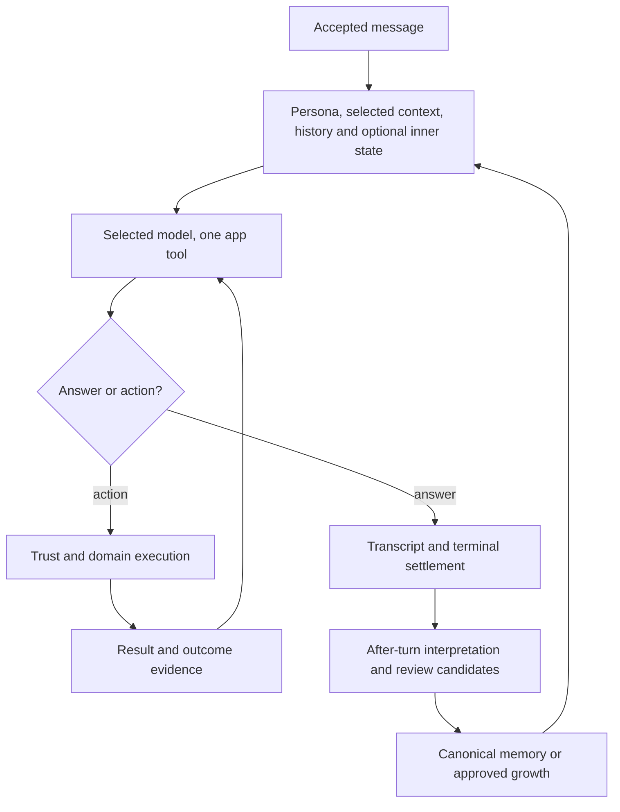

# NativeAgent Internal Workings

NativeAgent is one Mac-owned runtime. `NativeAgentEngine` in `EngineRuntime` assembles clients, stores and app ports.
Launch joins seed installation and housekeeping after recovery, before constructing the engine.
`ChatTurnRuntime` owns the turn engine. Conversation surfaces share that core
while retaining their own admission and delivery boundaries.
Background notifications call the supplied `AttentionRouter` directly; Trust's
checked connector statuses use the same supplied connector platform.
Needs-you counts and kinds derive from `DeskFacade`'s retained overview and are
unavailable when any overview source is unavailable; AppModel stores no copies.

The agent reaches the system through one always-on `app` tool. `app {}` is
home—where they left off. Pages, home items, discovery, actions and scripts
reach the rest of the app. [Tool loading](TOOL_LOADING.md) defines that contract.

## The complete system in one flow

## What “Fluid Context” means across the system

The Context module compiles and selects derived material; it does not own the
underlying facts. `NativeContextFlowRuntime` coordinates publication and turn
preparation. An immutable generation holds typed atoms; the bounded RAM arena
holds budget/eviction descriptors, lexical indexes and required-document mirrors.

Persona, MemoryV2, Desk and skills retain their own authority. Conversation
history is read separately from the transcript store. The optional cognitive
capsule joins these inputs as advisory state. The turn engine assembles the
provider request from them.

## 1. Anatomy of resident context and a turn

A turn combines a checked provider route, selected Context atoms, bounded
history and optional inner state. The resident turn part decides the work;
see [Anatomy of a Turn](ANATOMY_OF_A_TURN.md) for its execution and settlement
from the request and actual tool activity. The prepared Context turn leases
one generation through the model/action loop; a later source
change belongs to a later generation.

Stable persona material leads the provider prefix, followed by cursor-pinned
history. `ConversationPrefixSeeding.seed` applies the
[sent-context contract](conversation-context-history.md) before provider dispatch.
The `app` schema stays fixed while action discovery travels in results.
Documents and skill bodies are retrieved when needed. There is no tool preload
or session tool-loading lifecycle.

See [Anatomy of a Turn](ANATOMY_OF_A_TURN.md) for admission, streaming,
dispatch and settlement, including
[prompt caching](ANATOMY_OF_A_TURN.md#how-prompt-caching-reduces-token-cost).

## 2. Anatomy of a memory

| Material | Owner |
|---|---|
| Identity and voice | Canonical persona documents |
| Durable facts, corrections and proposals | MemoryV2 |
| Exact conversation wording | Chat transcripts |
| Selected working context | Context projections |
| Felt state and posture | CognitiveSubstrate and Organism |

### How information enters MemoryV2

An explicit `memory.commit` action reaches the canonical memory write path.
After a conversation, the adaptive promoter keeps or stages candidates.

[Memory system map](MEMORY_SYSTEM_MAP.md) owns mutation and read contracts:
provenance, kinds, counted reads, trusted acceptance, untrusted review,
care movements, atomic replacement and rejection protection.

The current after-turn path uses one model interpretation for facts, cares
and semantic appraisal; routing follows [cognition wiring](COGNITION_WIRING.md#shared-after-turn-interpretation).
Before this pass the agent's own labelled record predicts whether the
interpretation would be a complete no-op; a turn predicted so with standing
is left owed and judged later with other owed turns in one batch call.
Details, the cost law and its assumptions are in
[cognition wiring](COGNITION_WIRING.md#shared-after-turn-interpretation).
Peer conversations identify their speaker so a peer's words are not
mistaken for facts about the human.

### When the work happens

After the assistant row is durable, its `AfterReply` follows the
[owed-recording contract](SUBCONSCIOUS.md#lived-moments), then releases private work.
A process exit can interrupt unfinished promotion without losing the already
written transcript.

### Acceptance, correction and recall

Canonical changes trigger derived-memory refreshes. The generated `USER.md`
is a projection of eligible active memories, not a place to repair facts by
hand; the generator excludes Workshop execution records by source.
Knowledge Graph and Context projections do not replace MemoryV2's authority.

Retirement and retention follow the [memory contract](MEMORY_SYSTEM_MAP.md#consolidation-and-hygiene).

Relevant memories can arrive through resident selection. `memory.recall`
supports deeper retrieval, while `chat.search` and `chat.message` recover
conversation wording. Skills are built-in guidance, read through `ability.read`; what they writes is a
ability, saved with `ability.save` and run as `authored.<id>`, with `ability.enable`,
`ability.resume` and `ability.rollback` in its one lifecycle; see the
[manifest spec](skill_manifest_spec.md). Skills are not factual memory and
grant no new authority.

Source owners: `MemoryV2/MemoryV2+AdaptivePromoter.swift`,
`AdaptiveMemoryPromoter+Recovery.swift`, `AdaptiveMemoryPromoter+Migrations.swift`,
`MemoryStorage+Projections.swift`,
`MemoryV2+Proposals.swift`, `MemoryV2+UserMDGen.swift`,
`MemoryV2+Recall.swift` and `ChatTurnRuntime/MindMemoryManager.swift`.
See [Memory system map](MEMORY_SYSTEM_MAP.md) for the store-level map.

## 3. Anatomy of a safe action

An `app` request resolves to an action in `AppActionRegistry.swift`.
Folded actions re-enter the dispatcher under their underlying identity so
saved Trust decisions and domain checks still bind. A page read or discovery
result grants no authority.

Full Mac gives the agent autonomy, including actions otherwise marked the owner's.
The Capabilities autonomy summary uses that same effective unattended-work
verdict; its saved autonomy switch remains labeled separately, including
when that switch is off under Full Mac.

Checked policy, explicit blocks, actual macOS grants and connector
authentication still govern execution. macOS privacy permission resets always
ask the owner. Peer turns follow the [authority contract](TOOL_LOADING.md#authority-and-receipts).

Approval-gated effects consume a durable single-use claim immediately before
dispatch. Replay validates the exact tool, input, surface and payload digest;
unavailable authority fails closed. An already-spent effect with an unknown
outcome is not automatically replayed.

Approval and execution are separate states. An approval authorizes its bound
request; it does not establish that the effect succeeded. Dispatch results and
the domain's verification evidence determine what can be reported. An
uncertain send or interrupted effect must not be presented as confirmed.

Source owners: `TrustCenter/SecurityCenter.swift`,
`TrustCenter/PeerTurnEffectPolicy.swift`,
`ApprovalTransactions/ApprovalTransactionCoordinator.swift` and
`AppToolRuntime/AppToolExecutor+AppDoor.swift`.

## 4. How a native agent grows without losing itself

Different kinds of growth return through different owners:

| Mechanism | Durable destination or influence |
|---|---|
| After-turn memory candidates | Kept MemoryV2 records with their source; an untrusted peer's reviewed |
| Cognitive capsule and organism posture | Optional advisory input to a turn |
| Dream synthesis | Dream diary |
| REM consolidation | Reviewable lessons targeting `GROWTH.md` |
| Skills | Built-in guidance, read through `ability.read` |
| Authored abilities | Kept executable parts exposed as `authored.<id>` |

Dream and REM use `DreamREMCycle`. REM stages growth proposals;
`ApprovalExecution` applies an approved lesson through
`REMGrowthWriter` and its prompt pin. A diary entry alone does not approve a
persona change.

Ability authoring follows `ability.save` → kept (theirs under Full Mac, else the
owner's card through `ability.enable`) → `authored.<id>`, subject to current authority. It adds
no second model-facing tool schema.

Cognitive state remains advisory; Context is derived. Neither replaces persona,
memory or permission stores. See [Cognition Wiring](COGNITION_WIRING.md),
[Organism](ORGANISM.md) and [Automated Systems](AUTOMATED_SYSTEMS.md).

## 5. One persistent mind, specialist hands

`agent.message` to a coding contact (Codex, Claude Code, OMP) connects the agent
to a specialist harness; on an install that set those lanes up, `codex.message`,
`omp.message` and home's `claude.say` are the same doors by their older names. The returned conversation identity
supports a contextual follow-up using `conversation_mode=resume` and
`conversation_id`; unrelated work uses a new conversation.

`BuilderWorktreeAllocator` binds a builder conversation to its checkout.
Resuming that conversation reuses the assignment rather than silently
switching projects. The bridge retains job and completion evidence; a
specialist's answer does not by itself verify the work.

Desk tracks work and execution references. Delegation does not replace the
canonical persona, MemoryV2 or Trust owners.

Source owners: `ChatToolRuntime/SwiftToolDispatcher+CodexBridgeTools.swift`,
`SwiftToolDispatcher+ClaudeBridgeTools.swift`,
`SwiftToolDispatcher+OMPBridgeTools.swift` and `BuilderWorktreeAllocator.swift`.
See [Agent conversations](agent-communication.md).

## 6. One agent across every surface

Readout preparation binds the existing or newly created part-face owner
directly. Today binds source bounds and returned faces without forced unwraps;
missing permission, secret-metadata or Desk-overview evidence uses the existing
unavailable projection. A bodyless root refreshes no absent cognition owner;
phone reply recovery reports an absent delivery owner as a failure.

The Mac app hosts the engine. Mac chat and detached windows present its
sessions; Telegram, Slack and local bridges adapt their incoming messages and
outgoing replies to the shared conversation runtime. Their origin and
conversation identities remain attached to the work.
Slack DMs keep their own bindings: an allowlisted sender alone does not prove
ownership and never moves the shared owner conversation anchor.

Inline requests and trigger cards retain an outstanding knock in the inbox's
existing held-delivery state. Inserting the card and getting a transport to
accept its knock are separate commits. Failed knocks stay available to the
held-delivery release path after refresh or relaunch; only acceptance retires
that transport, without inserting another card.

Telegram downloads and transcribes media inside the destination's tracked
turn. Its poller continues admitting Stop and approval controls while media
is being prepared; Stop cancels preparation and settles that update. Shutdown
returns an interrupted, unstarted media update to pending for recovery in
the conversation pinned when it was admitted.

Approval transactions own receipts and reporting turns for current and legacy
Telegram cards. Telegram acknowledges decisions and carries replies through
its send driver; already-produced legacy answers retain transport recovery
without a second model-turn runner or continuation queue.

The mobile companion uses DeviceSync. The Mac verifies signed incoming
commands, executes them and publishes progress, results and snapshots.
Processed-message IDs and completion markers prevent already-executed
commands from being dispatched again after a restart. The phone does not
become the execution or memory owner.

Source owners: `EngineRuntime/NativeAgentEngine.swift`,
`DeviceSync/MacSyncEngine+Inbox.swift` and
`DeviceSync/State/ICloudSyncStatePaths.swift`.
See [Mobile companion](mobile_companion.md).

## 7. Why the owners remain separate

| Question | Authority |
|---|---|
| Who is the agent? | Persona |
| What is durably known? | MemoryV2 |
| What was said? | Transcript store |
| What matters to this turn? | Context selection and turn assembly |
| Which provider/model runs? | ProviderRouting |
| May this action run? | TrustCenter and the domain's gates |
| Did it take effect? | The executing domain's evidence |
| What work remains? | Desk |
| What runs in the background? | BackgroundLoopLifetimes and its registered owners |

One shared engine coordinates these owners. It does not turn a projection,
approval or transport acknowledgment into a different kind of truth.

## Reading path

Source paths above are under `Modules/NativeAgentCore/Sources/`.

- [Anatomy of a Turn](ANATOMY_OF_A_TURN.md)
- [Tool loading](TOOL_LOADING.md)
- [Memory system map](MEMORY_SYSTEM_MAP.md)
- [Automated systems](AUTOMATED_SYSTEMS.md)
- [Architecture Blueprint](ARCHITECTURE_BLUEPRINT.md)
