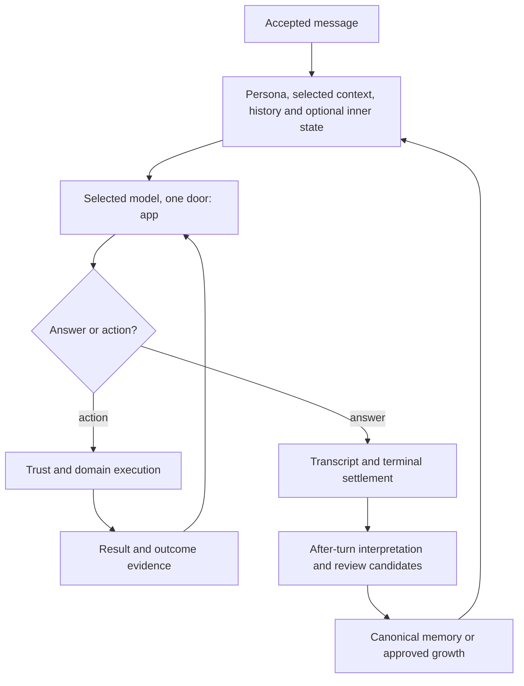

# NativeAgent Internal Workings

NativeAgent is one Mac-owned runtime. `NativeAgentEngine` in `EngineRuntime` assembles clients, stores and app ports.
Launch attempts each operation owner's recovery, then joins seed installation and
housekeeping before constructing the engine. A Mac-control or browser recovery
failure leaves that owner's new effects unavailable, with its cause and repair;
chat, phone ingress, looks and unrelated surfaces still start. Mac-control's
`MacControlOperationStore.begin` and browser's `commitStart` each read their
owner's path-scoped recovery state before admitting a new effect. No completed
recovery means unavailable, never permission to act. Repair the named evidence,
reconcile unknown effects by observation, then restart to recover. Doctor's
`live.mac_operation_recovery` and `live.browser_operation_recovery` read these
same owners; reading Doctor never runs recovery.
The typed browser status projection preserves `recoveryIssue`, `admissionIssues`
and named `unavailableRuns` through the runtime readout to `browser.status`.
`ChatTurnRuntime` owns the turn engine. Conversation surfaces share that core
while retaining their own admission and delivery boundaries.

Cross-conversation continuity belongs to the current turn. The person's local
chat/iPhone arrival and their own unsteered turn in their direct app/iPhone
conversation may read other rooms under Remember across conversations. A peer
origin, bridge door or carried steering peer, including an elevated peer, never
admits private cross-room words. Remote strangers receive no person's acts.
The session index's strict `continuityParticipant` still binds implicit previous
conversation recall; a mixed row does not decide who is speaking on this turn.
No saved participant rows are rewritten.

The life packet names up to four recorded acts since this conversation's last
accepted reply. A complete empty selection emits neither heading nor disclaimer;
real gaps and exhausted read bounds remain visible. Closing dispatch evidence
attests native acts on the mind stream without requiring a nonexistent heard
record. Elsewhere carries its recent full-word windows and up to five compact
conversation lines from the preceding 24 hours, newest first: last message time,
who spoke it, its opening words capped at 600 characters and the exact conversation read. The recent-word
windows forget a conversation once they answers here; this line is what they still holds of it. Helpers and their own
work join the day; a contact send counts with its attested reply or the delivery
owner's positive acceptance for that exact send, including retained delivered/read
exchanges after a newer send starts. Delivered one-way notes count without an
answer; person-authored sends do not. The mind stream is read through its thought
owner. Own-work words require self-authored, unsteered provenance. Peer turns get day door/time metadata
without those words. A remote stranger receives no elsewhere feed. Effected
acts read from their last reply here; exact experience IDs already in the life packet
are omitted. This read runs ahead of every first word: each recently modified other
transcript is read back in 64 KiB chunks from captured EOF only until a chunk holds an
eligible message or lies wholly before the day, because imported replies can be appended
with older timestamps. It rides the moment block, never a summary cached across turns.
Later breaths carry only their new step window and recheck turn provenance.
The [turn anatomy](ANATOMY_OF_A_TURN.md#4-the-provider-request-is-assembled)
owns the source and disclosure details.

Background notifications call the supplied `AttentionRouter` directly; Trust's
checked connector statuses use the same supplied connector platform.
Needs-you counts and kinds derive from `DeskFacade`'s retained overview and are
unavailable when any overview source is unavailable; AppModel stores no copies.
The Mac draws attention and status through selections of `CountsFace` at
`.counts`. Approvals own their checked records and array comparisons on an
actor; inbox readings and panel freshness also have actor owners. Native
settings draw selections of `SettingsFace` at `.settings`; provider controls
and per-conversation context are separate selections. The
[stage-one feed contract](designs/separate-face.md#stage-one-counts-and-native-settings)
defines the projection boundary and retained operational ownership.
Helper schedules and reminder settings retain their source errors on the Desk;
unreadable settings cannot appear as reminders switched off. Contact snapshots
require their conversation, helper shelf and active-run sources to read.

Trust registers one native face on `engine.pages` at launch, invalidated by its
policy, integration, contact, backup and activity owners and their exact change
notifications. `EngineTrustFace` reads those checked owners; a source failure
occupies its own row while unrelated sources remain readable. The Mac page, in
Simple and Advanced, and the offscreen page host draw `FacePageView`; the door reads
the face's text instead of a separate Trust projection. Its first card, What I
may do, draws its locks from `PermissionLaw.verdict` at the saved posture (the
table `judge` reads for every call, read whole by kind of act) and lists the
levers by their declared names (`AppAction.Owner.person`), so no list of what
asks first is kept for the page. Deciders that answer from a call's own input
(the request's origin, `QuietSettings.usersCall`, `Parts.keepRefusal`) are not
drawn as locks; the fold names their kinds in one sentence.
The privacy inventory uses `TrustFacade.privacyMap`, sampled initially and on
explicit Refresh, with its reading time shown instead of rescanning the data
root on every receipt.

Faced pages own their subtitles, including an absent line. Configured own-page
tabs retain an unavailable label when their owner is missing. Door reads
return a structured unavailable issue when a required face has not published.
Mac card text separates collection, per-card presentation and structured remedies.
Provider pickers carry only their used model identity and label fields.
The Simple shell's offscreen first read awaits contact-owner observation, including
its read failure, without polling. Browser authentication awaits the system
session's callback or cancellation and releases its callback registration and
session together. Sparkle information probes await their update-cycle event;
caller cancellation releases observation while Sparkle retains execution.
Delivery launch, network and configuration failures are recorded through the
experience owner with their cause; they leave the original delivery obligations
owed. A later owner event can reopen observation.
The Mac-assistant owner publishes watch content and availability only when
they change; a new sampling timestamp alone changes neither its retained
reading nor `watchesDidChange`. Each status caller still receives its own reading.

Page read callbacks are sendable async operations. `PartFaces.readOffMain`
invokes every registered native and packet reader on the concurrent executor,
including the agent's own notebook pages. Readers
copy observable in-memory values in short main-actor hops, then read stores,
decode, sort, parse times and shape facts, rows, keys and levers off main.
`LatestRead` admission and retained snapshots remain with their engine owners.
`PartFaces` is not observable. Accepted page snapshots and the authored-page
catalog enter its ordered off-main drain, which posts finished `FaceValue`s to
`engine.face`; the Mac reads only the keys it draws through `appModel.face.slot`.
Registration, source admission, catalog claims and snapshot comparison belong to
the `PartFaces` actor. Direct engine page discovery and body lookup await that
owner; native command ports retain their own isolation. Page construction, store
reads and feed delivery run off main. Captures await
the page owner's drain and the feed's applied-frame acknowledgement before
mounting the page; cancellation ends that frame wait without taking a picture.
The phone still exports the owner's snapshots through `faces.json`, replacing
Memories with its separately disclosed projection. Its feed key is
`phone/memories`, distinct from the Mac's `memories`.
Row and section transformations copy their value before changing actions, controls
or rows, retaining fields they do not own. The missing-key-lever section keeps its
derived `stem:` id, folded presentation and absent footer. Phone file budgeting and
per-page decoding follow [the companion contract](mobile_companion.md#remote-actions-and-snapshots).

Documents use the same declared demand for every door. A native page keeps its body reader;
otherwise `PartFaces.body` resolves the item's current packet key, checks the drawn read call,
runs only a declared read through the app door, and freezes its result as `input.read` for the
selected pure projection. Pending or unconfirmed reads retain the owner's structured
continuation and remedy; only complete read evidence permits unwrapping the result.
Agent calls retain their originating `Turn`; signed phone reads
carry their verified device and iOS surface. Inline document bodies need no fetch. A failed
read or projection keeps its cause and runs no alternate reader. The grammar and compatibility
note are specified in [the face contract](skill_manifest_spec.md#calling-a-part-and-projecting-its-face).
The page session holds read identity (key, drawn call and native owner revision) and evidence above cells; views draw the answer
through the shared read-only TextKit component. Quiet capture starts no document demand.
Native documents use the passive `native-document` seed over title, format and opening/length
metadata, with the body retained by its native read. Run detail on Mac, phone and the agent's
door reads the same complete saved ledger record. Helpers' brief sections hold document keys and their definition update stamps;
their registered body reads the helper owner's checked definitions. Context disclosure reads
its saved record only while open; the receipt feed contains summary rows and their turn id alone.
The disclosure's held identity changes with that turn, and Copy uses the document's displayed characters.
Packet admission begins before reading the source and spans projection, including
read failures. Only accepted publication replaces the retained source and face;
equal source epochs may carry changed selection or clock facts. A later-started
read that publishes prevents an older completion or failure from replacing it.
A reading drawn from a source epoch older than the page's publication returns to
its caller as that caller's own coherent reading and publishes nothing; it never
retires a newer read still in flight and is never error content on the page.
The old direct packet invocation on main is removed. Home's owner reads retained
`AgentWorld` parts and computes Desk parking off main; its source-watch setup
also leaves main. Desk builds its complete
revision off main before publication. Today, Inbox, Trust, Memories,
Settings, Personality, Providers, Connectors (accounts, Telegram, phone and agents),
Capabilities and Diagnostics follow the same boundary. Capabilities' catalog,
chat tools, actions and checks are shaped after copying their owners' values.
Memory owner resolution for the app door's action index, list, rewrite, pin and
rewrite preview leaves main through concurrent helpers; no synchronous executor
initialization resolves the memory store. Settings copies registry descriptors,
in-memory preference values and platform extras into Sendable value snapshots;
no settings host or registry closure leaves that hop. Its typed stored readers
read checked Trust, memory policy, dream gates and embeddings through their
owners with the data root off main. The same readers serve setting.get and
write readback. Notifications, search, status and platform rows are built off main.
Memory's facade resolves its embedding source lazily on snapshot reads and writes,
so initializing that source no longer depends on a settings-host read.
Memory's embedding snapshot checks saved configuration and installed models off main; Settings
observes source and runtime changes at those same owners without another cache.
An unchanged face retains its published snapshot, including its source epoch;
changing a part invalidates its drawing input without first blanking the page.
Today registers a pushed page: `PartFaces.refresh` returns its admitted snapshot
without invoking a packet reader. `TodayReadout` reads independent sources on
its actor and pushes the assembled packet through `sourceChanged`. Its pending
set coalesces changes behind the current read, without a timer. Equal source
readings retain a ready packet without assembly.
Each intentions reading also replaces one event deadline at its earliest next
occurrence; expiry invalidates intentions alone, without polling.
The persona's published display name invalidates trials alone when it changes.
Per-conversation evidence survives
unrelated transcript writes, and contact names join that evidence without
rereading transcripts. The mounted view, text reader and offscreen renderer
consume the posted face; until its first post they show the reading line.
Home's projection actor reuses each section's facts and row keys from the exact
retained source readings it consumed. Thoughts and owed happenings compare their
content; each open repair row compares its experience before redoing its words.
An unrelated experience write therefore does not reparse an unchanged thought's
time or rebuild an unchanged repair. Queue verdicts and trial levers still read
the current time, and places read current layout, badges and browser connection.
Source failures and never-read gaps remain explicit. Source reads and Home
refreshes begin on invalidation; an edge during a read owes one subsequent read
when it completes. Home's retained-world
hold and release run with its off-main source-watch lifetime.
Malformed saved repair calls and transcript tool-input JSON name their read
failure in the rendered row. Missing input stays absent and cannot supply an
execution verdict. MY QUEUE reads only `desk/my-queue-carried.json`;
an absent ledger starts empty without consulting retired arrivals.

`Parts.prepareFace` is the one producer of masked projection input. It retains
the latest raw/masked content for at most 64 root/part keys, reusing only equal
content, including unchanged subtrees of a changed packet. `ToolsFacade.face`
prepares before acquiring the app door; direct `Parts.face` callers enter the
same producer with their existing invocation. Only that producer constructs
`NativeAgentSecretRedactor.FaceInput`, after total recursive masking and the
object/4 MiB check. Projection admission consumes that value without encoding
and scanning it again; ordinary calls still validate raw input. Eviction only
costs another mask, never permits unmasked input. ASCII text without any
credential-pattern introducer skips ICU; non-ASCII text retains full recognition.
Audit token and JWT expressions are compiled once, and secret detection uses
match presence rather than generating and comparing digest replacements.
Authored presentation words read their own `copy/<key>` face slot, including
its first arrival. Adding another key does not invalidate existing words.
Make titles use `make-title/<revision>/<file path>` slots, one per preview.
The engine retains the projection owners; previews carry only their feed key.
The transcript observes the copy slots its builder uses, including cached
groups, and an arriving copy invalidates its unchanged-input shortcut.
Agent and phone textual reads consume the engine owner's result directly.
Main chat's document reads rows, cards, other-room exchanges, streaming identity
and clearance in `ChatTranscriptRoom`, separate from the sidebar, header and
composer. Its streaming identity reads one stable observable slot in `TurnsFacade`;
the slot directory is unobserved, and empty slots stay attached for the next turn.
The shared streaming-id dictionary is removed; starting or finishing another
conversation's stream does not invalidate this read. Sidebar, header and composer
changes do not become transcript inputs. The session index is operational state,
without an observable array. Off-main projection posts one finished row at
`FaceKey.session(id)` and identity-only sections at `.sessions`; only changed
values reach the feed. First load and failure recovery publish availability
at `.sessionNavigation`. An unread room observes its own transcript slot's revision,
so its first read wakes it even when the committed conversation is empty.
The action-search catalog watches its source files and
part/helper changes, never general UserDefaults changes: preferences are not
inputs to its action text.

Mood tint reads the substrate's current felt nodes directly, using the same
selection, echo collapse and compact cap as the inner-state face. It no longer
constructs an inner-state capsule, workspace, peer or persona reading for a
warmth sample, and holds no second history or warmth cache.

The person's Trust rows enter through `PartFaces.act` and `ToolsFacade.personTap`.
Person changes use the
existing policy, integration, contact and activity mutation owners; controls
that can grant more access carry `Control.confirm`. The agent's held Turn goes
through the existing `setting.set` door checks; it is never turned into a
person action. Foreground permission acquisition, Chrome setup, the app picker
and the freeform workbench use the existing Mac adapters. Phone face actions
cannot open those controls. The existing phone Trust editor and
`trust_policy.json` publication stay in place until the phone face migration.
Desk registers once on `engine.pages` as the agent's part `native-desk` over
the Desk packet. `deskPacket()` reads `DeskFacade.loadPage()` and gives measured
facts: board items with what groups them (activity, deferral, the local day
each closed, whether it is the body's upkeep (`BodyQueue.project`), the
`DeskParking` verdict Home shares), live activity, the overview's and work
lines' rows, timers, the wander hour, the selected item and named source gaps,
plus a key for every row that leads or acts. An item read of the page
(`app {page:"desk", item}`) is the page's registered item reader: the same part drawn from a packet opened on that item
(`deskPacket(opening:)`), leaving the window's selection as it is. Grouping, project rows, titles,
details, tones and every Desk word are the part's. The packet's epoch is the
board revision; a selection or a clock edge changes facts at that same revision
and still draws through the page's read admission. The person's levers are the
stem's: the Reminders section (Nag me,
Snooze or Wake up, presets, per-project and per-item switches) is a page lever,
drawn first; Veto is a key lever on each pursuit's row and on the selected
item's Veto row. Board publication and selected-item changes refresh the page
through the page port. A successful in-place Desk open requests a scroll to the
top so its selected details are shown; ordinary page arrivals keep the reader's
place. Selection holds only the handle on `DeskFacade`; details resolve against
its retained board. Mac navigation, slash previews, offscreen capture and the
door all read that page, and phone snapshots include it in
`faces.json`. Desk's old phone snapshot files remain until the companion
transition. Each row action and lever carries its door call (`desk.close`,
`desk.defer`, `desk.nag`, `desk.remind`, `desk.veto`, `desk.refresh`), and a tap
runs it through the person's door (`PartFaces.act`); Veto is the person's lever
verb. Editors, the palette, research, the clipboard, inspecting a run and
returning to the board are Mac-only links (`page:desk/<place>`, doors `mac`)
that `FacePageView` hands to the mounted Desk view; absent mounted faces refuse
those requests. Offscreen capture installs no editor port. No second board
projection or write owner is introduced.

A piece is a Make ref laid on a Desk item: a `url` reference addressed
`make:<ref>` (`DeskPiece`, `Desk/DeskRef.swift`), so every build decodes it as
a url reference and the record shape is unchanged. `desk.add_ref` refuses a
`make:` address whose Make ref holds no version. The packet reads the Make
shelf (`MakeStudio.Shelf`, the index the Work pane's Make view draws), starting
it the first time the Desk holds a piece, and gives each board item its
pieces (Make ref, title, what it is, version count, newest time) and the
selected item its pieces with a text piece's words, or a table's rows, columns
and first rows (`DeskPieceShelf`, `EngineRuntime/DeskFaceItem.swift`). The part
draws them first as **On the table** and, in the opened item, as each piece's
words or a `leaf` block (key `piece:<refId>`, `ref` the Make ref, `revision` the
version, `alt` the Make ref and the `make.read`/`make.add` calls, and for a table
its size and first rows; a text piece's section footer says the same).
Mockups, pages and pictures share `beside:"pieces"` and stand as columns
(`FaceColumns`); documents and tables follow at full width. `FacePageView` draws
those leaves through the Make pane's granted preview (`PageMakePreview`,
`WorkPaneMakeView.swift`), on its selection path too; other doors read the
`alt`. A CSV or TSV version there is `MakeSheetView`: a changed cell sends the
whole table to the body's `save_sheet` Desk command, which checks the changed
version is a table, the name its type and the words within
`MakePreviewFace.wordsLimit`, then runs `make.add` as the
person's tap (`ToolsFacade.personTap` with `personEditOf`, carried as
`Turn.personEditOf`); `MakeStudio.add` appends it only while that version is
the newest and records `personEditOf` on the new version. A piece's rows open it
in the Work pane's Make view (`pane.show`, Mac). What the Make shelf publishes
refreshes the Desk page (`EnginePages.swift`), so a new version shows without
another write.

## Built-in browser operation ownership

`SwiftNativeBrowserClient` owns the current run array and transition outbox.
Launch recovers interrupted browser operations before engine construction and
ingress; an unreadable document or failed receipt projection refuses browser
starts with the recovery cause and repair while the app starts. Recovery keeps
unknown external outcomes unknown and never reopens a URL. The app-wide
interrupted-operation alert and its launch-abort callback are removed.

Browser previews validate and return proposed runs in memory, before any run,
receipt, trace or retention command. Every claimed page effect includes its
preflight read in the completion/settlement boundary. The canonical reader checks
run identity, required fields, current status vocabulary, timestamps, transition
counters and each outbox snapshot before any mutation or projection. A damaged
row reads as a named unavailable run; valid siblings still read, recover and
project. Mutations splice each damaged row's original JSON bytes unchanged and
retention never evicts it. A damaged row without explicit terminal status, a
parseable completion timestamp and an unambiguous identity keeps browser starts
unavailable: it cannot establish that its effect ended. A damaged terminal run
remains individually unavailable without blocking unrelated starts. Matching
motor and approval-reconciliation reads throw its named cause rather than
treating it as missing or terminal. Whole-document decoding/I/O failure stays
owner-wide unavailable. An unmatched read cannot infer absence from an
unidentified damaged row. Only a missing run file starts empty. Pre-outbox
translation, the old terminal spelling and persisted-preview
cancellation/retention are removed.

The visible WebKit adapter holds navigation, snapshot, JavaScript and DOM
callbacks until WebKit completes, its content process terminates, the window
closes or the caller cancels. It imposes no native callback deadline; shared
route and DOM-script deadlines remain separate contracts. A parking wake
without a callback result is an interruption, never evidence of completion.
An interruption ends that wait once and retires the affected view. This is not proof that a dispatched effect
was stopped: its outcome remains unknown. Late callbacks cannot change that
settlement or release a later owner; there is no automatic replay or page reload.
A later explicit navigation establishes a new page.

Browser IPC admits connections and Doctor reports readiness only after checked,
private `browser_ipc.json` publication. Publication failure closes the listener
and retains the cause for Doctor. Browser approval adapters return the actual
run to the existing checked approval settlement owner; malformed approvals throw
after their failure annotation is attempted. A failed annotation retains the
outcome for receipt-only repair and reports both the outcome and save failure.

## Shared runtime projections

Inbox registers one `engine.pages` face at launch. `InboxFace` reads
`ForPerson.at(root).matters()`, applies the owner's `isRow` and `reading`,
and groups active matters into requests, failures and unread-first news.
Earlier is an archived-in-the-last-day count; missing or unreadable settlement
times are named and excluded from the count. The epoch is the read-start moment
in wall-clock milliseconds because the reading exposes no record position.
One cancellable subscription to `ForPerson.changes()` refreshes the face;
`InboxFacade` holds the subscription lifetime, with no file watch or poll.
PartFaces' LatestRead remains the only publication gate.

Mac Activity's Inbox/Approvals and inbox/approval work details draw
`FacePageView(page: "inbox")`. The door's list read reaches the generic face
hook; individual note reads retain the existing Inbox detail owner. Notifications
projects preferences and trigger settings, with a pointer to the Inbox face
instead of a second card list. Earlier opens the existing preferences history;
the chat capsule retains its detail instrument and native transaction adapter.
Person actions call the existing Inbox host or ApprovalsFacade/ApprovalExecution;
agent actions call the existing `inbox.*` actions with the original turn. An
approval without readable details or awaiting the agent's own decision cannot
be decided by a person face action. At the phone's door the face actor carries
the paired device the router verified (`Actor.person(door:device:)`), so a phone
approval resolves through ApprovalExecution with `signedIOS` provenance, as the
signed approval card does; without a verified device it is refused, and no
identity is synthesized. `inbox.json` and
`approvals.json` publication remains for existing phone builds; `faces.json`
carries the Inbox face through the existing face publication path.

Diagnostics is the agent's part `native-diagnostics` drawn over
`diagnosticsPacket()`. The packet reads DoctorFacade, the run ledger, transcripts
and the actor-owned `LivingStatusOwner` reading: each check with its status, the Doctor's bucket
for it, whether it is adverse and safely repairable; loop verdicts, the watchdog,
this Mac, living status, the last 8 loaded activity events and the first 15 runs,
each status with its bucket. Its keys let the Health checks row run, repair and
report while no run is in flight, a repairable check offer Repair, a check lead
to its remedy's page, and a run open its details. The part words, groups and
orders them, what needs attention first and healthy groups folded under one row; verdicts, thresholds and repair eligibility stay the Doctor's, and
each action calls its Doctor verb (`doctor.run`, `doctor.repair {check_id}`,
`doctor.support_report`) through the door. The
page has no levers. The same part's `run` words the Desk and Activity status checks
and the Doctor-ask, storage and Speech Recognition cards.

Living-status counting, snapshot construction, refresh coalescing and `LatestRead`
publication run on `LivingStatusOwner`. Cognition, ForPerson and exact file edges
refresh it without a debounce clock; its change stream lives within launch work
and refreshes the Diagnostics packet. Failures retain the last snapshot with
their named causes. Desk, diary and persona remain the canonical input owners.

Inspector reads `InspectorFace` slots keyed by live cutoff or replay day. It
selects membership, availability and individual cards separately. `TurnInspectorFeed` is
the actor owning the trace cursor, grouping, redacted cards, replay and phone
summary encoding. Clear filters evidence on that owner; replay's requested and
loaded dates travel with its reading state. Face keys identify the content
selection, so remounting reuses its slots; mount identities only govern requests.
Replay state and its `LatestRead` gate belong to the selected persisted day.
Source edges request one follow-up read while busy, with no debounce sleep.
Failed reads preserve evidence and their cause; an unfinished read stays
visibly reading until completion or
cancellation. Doctor commands read observation state directly from the actor.

Model pickers advertise models and think/fast capabilities only from the selected
account's checked catalog. A saved unknown model stays visible as unverified,
with no invented capabilities; a missing catalog does not produce compiled or
provider-neutral replacement choices. Empty capability metadata offers no
controls and never invents a high think level or borrows another account's row.
An account projection or adoption inventory error is reported with its cause.
Session context usage distinguishes an absent initial provider receipt (a named
transcript estimate) from a damaged receipt or transcript, which is unavailable.
After a turn, an unavailable session index keeps the prior display with its
refresh error; checked persona-document reads retain their own error independently
of the reply that already landed.

The Personality page is the agent's part `native-personality`, drawn over the
packet `personalityPacket` reads: PersonaFacade's checked profile and documents (and
whether identity is initialized), the resident self-reading and CognitionViewFacade's
diary, each failed read a named unavailable fact. Its page levers are the stem's:
My minds (ProviderRouting's checked catalog and the Memory and mind choice) and
Reset identity when an identity exists. Source-file changes and the account-model refresh notification reread
it even when no view is mounted. The resident's bootstrap and configuration events also
refresh self-reading availability. The read-start moment is its epoch; PartFaces'
LatestRead owns publication. Mac FacePageView and the door's generic face text read the
same page. The model choice calls the existing Memory and mind group setter. Links retain the document/starter editor, minds
picker, Dreams and confirmed reset as destinations, and proposal review remains
in its approval card. No persona write or reset mechanism changes.

Shared `FaceView` draws pages through `FaceDoor.act/open`. Mac `AlivePageKit` supplies
`FaceStyle` for glass cards and opaque accessibility/capture surfaces. Main windows,
quiet captures and each transcript attachment host supply it explicitly, including
attachments in detached conversations in both Mac window implementations. The shared
default draws no card surface. Phone `AlivePage` supplies list density and native
inset-grouped sections. `FacePageSession` holds
non-secret field drafts, folds and selection above recycled rows. `FaceView` owns
row, control and action-button focus together, so a removed focused row transfers
keyboard focus to the next surviving row in the old order, or the last row if none
follows. The shared row owns keyboard navigation, its context menu and accessibility
actions; the phone adds native swipes to that same row. The fixed shared card
background and phone's whole-face list
row are removed. These changes do not add a wire kind or alter page calls.

A page of the agent's own is an active part whose face is `{projection:true,
page:"<id>"}`; `engine.pages` retains its catalog claim and snapshot from the
part's notebook. The Mac draws `.page(id)` from the face feed, and `faces.json`
carries it to the phone. The agent's layout
places it: `rail` and `more` take a `page:<id>` block, kept on read when the id is
one `AppDoorNames.ownPageRefusal` allows and written through `layout.write` only
while an active part has that face page. The Mac draws the block as a tab of the
rail's agent place (`ShellSurface.agent`), titled by the face (its id until the
face names one), and the selection holds `page:<id>` beside
`SidebarItem.ownPage`, so the main pane, `page.show` and `page.screenshot` draw
`FacePageView(page:)`; the iPhone's More draws it as a row pushing
`MobileFacePage` while `faces.json` holds it. A placed page that is not
published shows that it is waiting; an inventory failure carries its cause.
The rail reads the `catalog/own-pages` slot and only the placed pages' title
slots. A completed inventory removing an authored page publishes an explicit
unavailable face; clearing a claim conflict refreshes the still-existing stem
page. Inventory completion also invalidates the engine's action index.
The door lists the agent's own pages among its pages,
and `app {page:"<id>"}` reads the snapshot's text, levers first.

The agent's reading of a page in the layout ends with one "How this page
changes" line, read from `PartFaces.drawer(page:)`, the registration the page
already has: a lever page (`watch(page:paths:read:)`: Trust, Settings,
Providers, Connectors, Capabilities, Inbox, Helpers) is drawn by the stem in
Swift, and the line names the settings and actions on the page as what they can
change there; a packet page, a claimed page of their own or a pushed page (Today)
names the part that draws it with `ability.read` / `ability.save`. Both name
`layout.read` / `layout.write` for where the page sits and its tabs' order. A
page whose drawer is not known yet (unregistered, unpublished, or a failed
claim) gets no line. Chat and door-only pages are read elsewhere and carry none.

`ShellAskBar` sits under `ShellPlacePage`'s page, every place but Chat, in
Simple and Advanced. Return sends through `startActiveChatTurn`, the composer's
send, with the subject as words at the front: `About <page title>
(page:<page>): <words>`, or, when the page's face says what it has open
(`PartFace.opened`, read from the `.page(<page>)` slot's drawn face),
`About <page title> · <opened.title> (<opened.link>): <words>`. Which page shows
comes from `ApplicationLifetime.visiblePageInput`, the window's scene report; what
it has open comes only from the page's own face, never from its rows or the
window's memory. The scene names a tab's parent page (the tab lives in that
page's own stored selection, not in the scene), so a tab's message names the
parent. `opened` is used only when its link parses as a `FaceLink` to the
showing page, with an item free of whitespace; every title is one line of at
most 80 characters (`PartFace.oneLine`). A whole control phrase
(`UserMessageIntentSignals.isControlHandoff` or `isTakeOver`, in the shared
module so the window and the body read one match) is sent exactly as typed, with
no subject. A page reading whose face has `opened` says `Open now: <link> ·
<title>` under its title, the link first. Its draft is an edit draft per page;
at Return the words leave it for the page's one record, `AppModel.askBar`,
beside the drafts: while it holds them Return does nothing, acceptance replaces
them with the sent record, and a refusal puts them back in the draft with the
reason. The line above it says only what is true whichever turn the words
became, from the conversation's `TurnFace`: an actionable approval, else a
running turn's `WorkPaneFace.stepsLine` words, else "Sent."; it never reports
how a turn ended. It opens the conversation with `MacFaceLinks.follow`. An
offscreen read (`quietOffscreenRead`) draws no bar.

Persona reads return authored contents as written, including GROWTH; they never
filter old-format rows or recreate authored documents. Ordinary persona tool
replacement, section append and editor saves require a checked existing UTF-8
document under its write lock before backup or mutation. A missing or unreadable
document fails with its full path and repair remedy; only explicit setup or
the compiler's missing-only genesis below creates it. The recovery copy retains the exact
bytes of that checked read. REM lesson
approval requires a checked existing GROWTH read under its write lock; a missing or
unreadable document fails application with its path and repair remedy, before
writing the lesson or marking the proposal approved. The compiler requires SOUL,
VOICE, USER, GROWTH and AGENTS; absent custom overrides explicitly inherit the
canonical document, while only MEMORY and surface guidance may be absent.
Onboarding seeds the five required documents in its completion transaction.
Before reading a required canonical document, every compile and context snapshot
asks PersonaEngine to create that named document only if its entry is checked
absent. Genesis requires completed onboarding and a checked saved profile,
rechecks absence under the completion and document locks, and uses the same
template owner as onboarding. It needs no Doctor Repair press. Missing USER.md
uses the saved userName when present; with no supplied name its genesis is the
blank User header. A malformed userName fails USER genesis. Existing entries,
including unreadable files and dangling links, are preserved and fail with their
own path and repair. Listing remains read-only; Doctor uses the same compiler.
`NativeAgentPublicSafety.hasCompletedOnboarding` owns completion for resident
admission, setup and USER generation: pending completion/reset blocks it, and
only the completion sentinel proves it. It is also the one fact that the agent
exists: before it holds, no scheduled pass that needs the agent starts; the mind
itself still starts at launch, a known gap ([Automated Systems §2](AUTOMATED_SYSTEMS.md)). The sentinel travels in local/off-disk
backups and production exports with the identity data. Restore replaces only
captured paths, so an uncaptured sentinel leaves live completion evidence
unchanged; absence never invents completion. Profile reads/ordinary updates
require the saved identity; explicit onboarding or missing-profile repair supplies
genesis inputs. PersonaSelection alone chooses a custom directory. Name
presentation uses PersonaFacade's checked identity state, never memory or picker
text. Until that read succeeds, the name is blank and the error stays separate;
no loading/failure sentence is published as a name. Widget publication waits
for an available name while other work-status effects continue. Synchronous
notification name reads also return no label on failure, retaining their cause
in the diagnostic log. Saved instruction keys in older profiles remain opaque
preserved bytes;
persona documents alone supply those instructions. A committed document save
invalidates context even if readback fails; activity bookkeeping has its own
owed repair and cannot turn the saved edit into an unsuccessful append.
Identity form saves carry the field's original document content into the same
document lock. A changed saved document refuses with `persona_document_conflict`;
the form retains the draft and reads the saved version for comparison. Later
keystrokes survive a successful save through field-revision settlement. USER
remains MemoryV2-owned. Unchanged document and profile writes do not touch disk.

The agent reaches the system through its one always-on door, `app`. `app {}` is
home—where they left off. Pages, home items, discovery, actions and scripts
reach the rest of the app. [One door](ONE_DOOR.md) defines that contract.

## The complete system in one flow

## What “Fluid Context” means across the system

The Context module compiles and selects derived material; it does not own the
underlying facts. `NativeContextFlowRuntime` coordinates publication and turn
preparation. An immutable generation holds typed atoms; the bounded RAM arena
holds budget/eviction descriptors, lexical indexes and required-document mirrors.

Context configuration supplies defaults only for absent settings: mode `active` and a 96 MiB
arena. A present invalid `contextFlowMode`, `NATIVE_AGENT_CONTEXT_FLOW_MODE` or
`contextFlowRAMMiB` is unavailable with its startup cause; it never selects
another mode or budget. Saved values are checked even under an environment
override or public onboarding's temporary `off`. Turn admission, embedding
tickets, mode status and bridge health preserve that failure. Enabling inner
life initializes only an absent mode; it does not replace invalid saved bytes.
Settings shows an invalid saved mode as unavailable. A mode write whose checked
status has no effective mode reports that cause through the Settings warning or
the setting action's unavailable error; it never labels or returns a default mode.

Settings registers one native face on `engine.pages`. It reads
`QuietSettings.settings(forPage:host:)` through the mounted settings host in one
short main-actor snapshot, then projects each row's declared kind, value, choices
and owner note off main. File-backed rows carry typed owner reads rather than
host references; a failed row keeps its unavailable detail and readable siblings.
Platform extras likewise copy plain values before shaping their rows off main. The read-start
wall-clock milliseconds are its source epoch. A control's `set` calls that
registry row's existing writer and reads it back; the Mac and authenticated
phone face gestures enter with owner authority. Agent face actions use
`setting.set` with their actual turn and its existing Trust admission, including
the inner-life recovery button. Platform update, reference and
clipboard actions remain with their Mac owners. Cognition, Mac access and
memory status read their existing runtime owners. Settings watches its owner
files and notifications at launch, independent of page visibility. Registry
rows declare their defaults keys; only changes to those preferences wake the
face. App-lifetime observation carries updater, shortcut, app health and memory
runtime changes, and cognition's change stream carries inner-life status.
Registry page reads enumerate peer consent rows only for Trust,
so unreadable contacts cannot block an unrelated Settings page. The Mac and door draw/read
the same face; the existing phone settings request remains in production until
the companion switches to `faces.json["settings"]`.

A failed source compilation excludes that source's old atoms from new selection
and expansion while independent healthy sources remain usable. Discovery,
registry, health persistence or publication failures keep new turn preparation
unavailable until reconciliation succeeds. Already leased generations retain
their own immutable snapshot. Feedback restore or reduction failure remains
unavailable; an empty learned history cannot stand in for a failed read.
Committed reconciliation retains each source failure's identity even before its
first stored row exists. The same checked failure snapshot accompanies selection
receipts and the turn's ambient reads; an empty ambient result with unavailable
sources neither reports `no_match` nor settles recollection repair debt.

Unavailable turn recall is withheld and named while the rest of the working set
is prepared, under the [recall-unavailability law](ANATOMY_OF_A_TURN.md#recall-unavailability).
This does not change required context publication or configuration failures.

Persona, MemoryV2, Desk and skills retain their own authority. Conversation
history is read separately from the transcript store. The optional cognitive
capsule joins these inputs as advisory state. The turn engine assembles the
provider request from them.

Context and history preparation read the model admission held on their turn;
fresh ephemeral work admits it before preparation and retains that same turn
through execution. History renderers require a checked resolved budget, with no
optional-window entry. Missing admission or window stops preparation. See the
[history contract](conversation-context-history.md).

Provider admission uses the selected account's checked catalog and explicit
provider/model/control tuple. A required failed or stale catalog refresh,
unknown window or unsupported explicit control refuses the dependent operation.
A catalog/control failure leaves only the surfaces using that provider tuple
unavailable, with their cause; independent healthy provider groups still route.
Saving a group validates that group's resulting tuple before publishing intent.
Work and Memory and mind inherit Chat only when no override is saved. A partial
or conflicting override is unavailable for the whole group, naming its saved
keys and the Providers repair controls; a caller-supplied model cannot bypass
that refusal. Effort-only and tier-only rows inherit Chat's other fields and
validate the retained control. Account-only changes preserve the saved model;
an incompatible model requires an explicit combined account/model choice.
Picker persistence keeps one forward intent. Failed projection writes never
restore previous choices: readback reports the intent's state and the committed,
pending or unknown projections. The existing reconciler completes retained intent
on a later checked read or reports the actual conflict; no arrival is promised.

**Model lists.** **What an account offers to choose from is what its provider
listed, and nothing else. The build's own rows are contracts: they say how to
run a model and are never offered as a provider's list. When a provider cannot
be reached, the account says so plainly and offers nothing in its place.** **A model has one effective contract. Its identity is the same whichever
spelling names it. Its limits are the tightest that the build and the provider
state. What a person chose is what is sent. A refresh that could not ask says
so.** Membership and contract are separate. Membership comes from the provider's
list endpoint, bound to the credential that fetched it: Anthropic (key and Claude
sign-in, `GET /v1/models`, every page followed), OpenAI (`GET /v1/models`, chat
ids only), xAI (`GET /v1/language-models`) and Meta (`GET /v1/models`, Muse ids
without Contributor), each in `<dataRoot>/providers/<route>-models-cache.json`
through the same `ModelCatalogCache` OpenRouter and Moonshot use
(`FirstPartyModelDiscovery`). Every listed id keeps the spelling its provider
issued. A saved pick and a listed id are compared as one model, whichever
spelling names it: the same id, or the same id with a trailing date
(`-20251001`, `-2026-04-23`); two different dates are two snapshots. That one
comparison (`RouteList.row(for:)`) is every "which row is this model" answer on
these routes: retirement, `routeCarries`, a saved pick's known absence, its
contract, effort, Fast and output ceiling, its context window
(`verifiedContextLength`, `catalogContextLength`), and a picker row looked up by
validation or reconstruction (`pickerRow`). The routing snapshot and dispatch run
the pick under the spelling the provider listed: the pick itself when listed
exactly, else the listed spelling of the same model. The list handed to pickers
and pages shows a model once: one listed under its plain id and a dated id is
one row under the plain id, and the dated row appears too only when it is a
saved choice, so the selection is visible and exact; two dates with no plain id
are two rows (`RouteList.choices(keeping:)`). Membership keeps every spelling.
An account's `models_note` is text shown beside its list; whether it has choices
is whether it has a list to choose from, never whether a note is present. A
model's controls (Think levels and default, Fast,
endpoint, how effort is written) come from the shipped row of the same model;
else what the list states (Anthropic's effort levels, adaptive thinking and image
input; xAI's effort levels and default); else the nearest shipped sibling of the
same line and variant at or below its version by numeric comparison; else
minimal controls: no think level sent (`default`, which every serializer omits)
and Fast off. Its limits (window, output ceiling) resolve field by field: from
whichever of its row and the list states them (Anthropic's window and output
ceiling, xAI's window), the tighter when both do; a model with no shipped row
borrows its sibling's window. A model whose window neither states, as on a route
whose provider lists ids only (OpenAI, Meta) with no row or sibling for it, is
not offered: the account's `models_note` counts such models in one sentence, and
a saved pick of one is retired through the existing retired-pick path, which
says the provider lists it but this build does not know how to run it. A
borrowed or minimal contract carries a `controls_note` on its row. The last
complete list for the current credential is the list until a newer complete
list replaces it: a failed refresh changes only its freshness, and the account's
`models_note` says the provider could not be asked, when the list shown was
fetched, and to refresh. With no complete list for this credential (never
fetched, could not be reached, incomplete) the build's rows stand where the
list is missing, so every reader of a model's contract, controls, window, ceiling
or name finds its row as before, but each such row carries `offered: false` (with
`offer_note` "Saved. Anthropic has not listed it yet."), and the `models_note`
says why in one sentence: "Anthropic has not been asked for its models yet.",
"Anthropic could not be reached: <reason>. Refresh to try again." or "Anthropic
answered with an incomplete list. Refresh to try again." Only choosing looks at
the flag. One function, `ModelSlot.mayHold`, answers "may this slot hold this
model": its row is offered, or it is the model already in that slot (saved there
or inherited into it, an account default inherited by Chat included), so
re-saving the slot's model with other Think or Fast always passes. Every place
that accepts a model choice asks it and refuses with "No models to choose yet: "
and the account's sentence: the selection check every save passes through,
routing reconstruction, the Providers and minds pickers, the default-model
setting and the account editor, the agent's `provider.set_default_model`,
`providers.*_model` and `chat.model`, Telegram's model menu and the image-model
card. Pickers and menus list offered rows only, plus the slot's current model
shown selected with its note; a picker with nothing offered says the account's
sentence; a picker over several accounts (the composer, the image-model card)
has no entries from an account that offers nothing. The phone and the agent's
`provider.*` results carry the flag. A model the provider drops leaves once a
complete list says so; an empty or failed list retires nothing. The cache keeps what the provider stated so a
later build resolves the contract again. One request's output allowance is
min(what is left of a run's budget, the model's effective ceiling and the
transport's own cap), from `FirstPartyExecutionControls.budgetedOutputTokens`,
which every adapter that writes an output-cap field reads (OpenAI's Chat
Completions and Responses, Anthropic by key and by Claude sign-in, Kimi Code and
Meta); xAI, Moonshot, OpenRouter, ChatGPT and Codex write no cap, so the
provider's own ceiling stands while the routing stream holds the run's aggregate
budget. An explicit Think level the model's row offers is sent as written (xAI's
`none` included); "use the provider's default" and a model with one level send no
field, and the word `default` is never sent. **Refresh** (`provider.refresh`)
asks every connected route again, names each list it could not fetch, and never
answers ok when one failed; a ChatGPT sign-in adopted from the Codex command-line
tool cannot be asked by the app, and its refresh says so and to sign in with
ChatGPT in the app for a list the app refreshes. A connection check publishes the
list it fetched; a saved key or finished sign-in asks at once; launch, entering
Providers and setup's "Read accounts again" start asking each connected route
with no complete list for its current credential, through the one fetch owner,
as the catalog's one refresh in flight (`startAskingMissingModelLists`, which
`provider.cancel_refresh` stops): the read returns at once, the account says
"Asking Anthropic for its models…", and the page reads again when the answer
lands or the ask is cancelled; file events and writes only read again. Routes
with no list endpoint to ask (Kimi Code; the ChatGPT and Codex account lists;
Moonshot and OpenRouter, with their own catalogs) offer their rows as before.
This replaces the lists typed into the build for Anthropic, OpenAI, xAI and
Meta, and the earlier rules that a failed fetch offers the build's rows as the
list ("Showing the models this build knows"), that a model with no known window
gets the route's smallest shipped window, and that a dated snapshot is folded
into its undated id.

Fetched catalog bytes carry `credential_binding` (an API key's fingerprint, or a
sign-in's account identity so renewing its token keeps the list), checked against
the current credential on every passive/routing/availability read as well as fetch
publication. A sign-in renews before any credential lock is taken. Unbound or mismatched bytes stay historical and unavailable until
an explicit refresh succeeds. A settings refresh publishes one catalog operation's
result and cause, without a second cache-mode call after failure. Its refresh
owners run on `ModelCatalogRefreshActor`, away from the main actor: credential
locks and reads and durable cache commits stay there; asynchronous provider
fetching and response decoding also remain off the main actor.
`LatestRead` still orders publication per cache path, and only a committed probe
write advances its write boundary. Coalescing and credential rechecks share
that same owner.
OpenAI public controls use the route's effective row (listed for the key, else shipped); Codex and ChatGPT controls use
the selected sign-in's matched account catalog. Builder bridge tools use the
command CLI's sign-in; runtime adapters retain their exact admitted sign-in path.
Meta (`meta`) is an API-key route whose Standard-mode list comes from Meta, with
its shipped contracts in `FirstPartyModelCatalog`, using the shared `AnthropicTransport` Messages path at
`https://api.meta.ai/v1/messages` with Bearer auth, as Kimi Code does. Its checked
key comes only from `providers/meta.json` and that file's Mac Keychain reference. The authenticated
`GET /v1/models` connection probe shares the API-key receipt owner and publishes
the Muse list it fetched (see [model lists](#model-lists)). No Muse Code credential source is consulted.
History is client-side: text, native calls and results use the shared Messages
encoding and SSE decoder. Meta enables the adapter's existing thinking ledger:
completed thinking and redacted_thinking blocks bind to confirmed tool-call IDs
and replay before the assistant's text and calls. Each entry carries a digest
of the request that produced it (model, system text, tools and every message,
cache markers excluded); it replays only where the request up to its assistant
message has that digest. Anywhere else the entry is forgotten, so a block once
left out never returns. The ledger holds at most 512
tool-call IDs in memory; missing or evicted entries add no thinking blocks.
Kimi Code does not enable replay. No Meta replay store or Responses control
profile is added.
The catalog exposes the Messages contract's low/medium/high/xhigh efforts,
sent as `output_config.effort` with adaptive thinking. First-party strict tools
and conversation cache markers are omitted, as on Kimi Code. System markers
use Meta's supported five-minute TTL; automatic prefix caching also works
without a marker. Receipts read `usage.cache_read_input_tokens` when reported.
Moonshot rows with no declared adapter reasoning contract keep unknown controls
and carry `controls_note`; they do not advertise a synthetic `none` effort.
OpenRouter's current catalog supplies its per-model `reasoning.supported_efforts`
and `default_effort` through cache, picker, routing and transport admission.
The explicit `default` choice permits provider-default execution without a
reasoning field, including models with no effort selector. Explicit efforts
travel unchanged and are checked against that model's declared list.
Mandatory reasoning excludes `none`. An unavailable
catalog or unknown control evidence requires a Providers refresh.
Credentials stay bound to the runtime's data root; unreadable credentials keep
their cause rather than becoming an ordinary signed-out state. With CLI adoption
allowed and the app-owned credential absent, a present Codex CLI credential stays
selected even if unreadable or malformed: the checked reader reports its path
and repair, preserving the bytes. A valid file without `tokens.access_token`
(including Codex CLI API-key mode) has no ChatGPT session to adopt; it is not a
credential-read error. Credential reads follow symlinks to regular files, and
atomic token writes replace the resolved target, preserving the link. A dangling
or unreadable link reports its own read failure. Sign-out reports completed app
credential removal even when the independent shared CLI session cannot be read,
and names that inspection failure separately.
Introspection reads the admitted turn provider identity and reports unavailable if it is
missing; model spelling cannot establish the transport or account.
Native OAuth connection checks bind their receipt to the outgoing Authorization
header at the transport send, including a renewed attempt after 401. A model
call is the same check: the shared client fingerprints the credential its
request carried (bearer token or `x-api-key`) at the same send, and when the
provider answers it saves an `ok` receipt for that fingerprint unless one from
the last hour already proves it; a call the path classifies `authExpired` saves
the rejected receipt. A caller that brings its own sent-credential evidence (the
connection check) records its own verdict, and previews record nothing. The
write runs off the turn; a failed write is one log line. A Codex CLI call
builds no request of NativeAgent's: its receipt binds to the account token
handed to the CLI (the one preparation wrote to the child's copy, or the CLI's
own file it reads in place), not to a credential seen on the wire. Readiness
fingerprints the account file, so a sign-in saved after that copy is neither
proven nor rejected by the call. API-key
drafts never publish a saved-credential receipt. A check without a fingerprint
cannot establish saved-account health. A failed connection attempt reports its
cause even when admission or refresh prevented any request; credential matching
gates only successful verification, never the failure verdict. Image generation, read-aloud and
tail fitting propagate their credential or routing owner's checked read failure.
The saved connection-check owner reads and merges only the
`llm.provider_status.v2` envelope. Every new check uses the row codec before
saving; each `byProvider` row is decoded independently on read. A malformed
row remains a named failure for that provider while sibling checks can be saved,
preserving unrelated rows as JSON values. A fresh check replaces only its own
row and the latest-check copy; damage in that copy cannot gate sibling rows.
A check that tested no credential (no native probe, or no saved key) never
replaces a row that did.
Unreadable envelope bytes block the merge. A confirmed missing file alone starts
an empty history. Saved-account checks propagate receipt-write failures to the
caller; draft-key checks return their probe result without writing verification.
No file timestamp can bind a check to a key.
Provider preference responses use the saved `SurfacePreference` vocabulary:
`surface`, `model`, `reasoningEffort`, `serviceTier`. Current phone selection
uses `configure_surface_selection` with its complete tuple. The older
`configure_provider`, `set_active_provider` and `set_surface_model` readers
remain pending inspection of retained transaction bytes in the previous
iCloud container; unavailable archive bytes cannot establish that no caller
remains. Sealed credential setup stays separate from model selection.

Anthropic and xAI own flat token sets; their readers and refresh writers use
that format directly. xAI's flat secret fields live in its referenced Keychain
object. ChatGPT's current grant remains under `tokens`, with its persisted
expiry on the enclosing object. `anthropic_mcp`, `xai-oauth`, `grok-oauth`,
`x-ai-oauth`, `xai-grok-oauth` and the provider ID `kimi` have no routing aliases
or catalog rows; Anthropic setup uses direct OAuth or an API key, with no
Claude MCP process panel or local CLI-presence probe.

Every OAuth token response crosses `OAuthGrantOperations.validateTokenResponse`
before any credential update: ChatGPT, Anthropic and xAI sign-in/refresh, and
Keyring browser/device sign-in and renewal. Access tokens and refresh tokens
must be nonempty strings without whitespace or control characters.
ChatGPT, Anthropic and xAI initial grants require refresh authority to maintain
their ongoing sessions; a generic Keyring initial grant may omit it and is then
nonrenewable. Every refresh response may omit or return null for `refresh_token`, retaining the
existing saved refresh token; a supplied empty or whitespace token is malformed.
`expires_in` is optional: omission or null means no stated expiry; a supplied value must
be a positive finite number or numeric string. The preceding access token's expiry is cleared
when none is supplied; undated Anthropic and Keyring access is used until rejected.
The network response is validated for the grant's tokens and lifetime, not against
the saved-file metadata schema (for example, `scope` and `account_id` are not
required credential fields in a token response).
Device authorization requires a positive code lifetime as protocol metadata;
the server's `expired_token` response settles expiry. Polls follow the server's
interval and `slow_down` pacing only while authorization remains pending;
transport and HTTP failures surface without a retry loop. Malformed token data reports `.malformedResponse`
with its retry remedy and leaves the saved grant unchanged. This is the token
response contract in [RFC 6749 §§5.1 and 6](https://www.rfc-editor.org/rfc/rfc6749.html#section-5.1).
xAI persistence
failures read back the committed reference, report that state or its read failure, and retain
Keychain items without restoring old metadata. Previous-item cleanup follows
successful checks of both the new metadata and its referenced Keychain bytes.

## 1. Anatomy of resident context and a turn

A turn combines a checked provider route, selected Context atoms, bounded
history and optional inner state. The resident turn part decides the work;
see [Anatomy of a Turn](ANATOMY_OF_A_TURN.md) for its execution and settlement
from the request and actual tool activity. The prepared Context turn leases
one generation through the model/action loop; a later source
change belongs to a later generation.

Stable persona material leads the provider prefix, followed by the conversation
verbatim, each exchange with its time; older rows are reached through leads and
`context.expand`. Quiet never ends what they holds. A conversation is held whole
until the request reaches the input budget; then the oldest whole turns go in
half-budget jumps. The input budget is min(model window minus response allowance,
200,000 tokens). History fitting uses the input budget; refusal and result
pointers use model window minus response allowance, the physical limit.
The turn's public context block leads the current user message
and is sent once. Checkpoints stay anchored to the transcript's start;
transcript rows remain saved. `ConversationPrefixSeeding.seed` applies the
[sent-context contract](conversation-context-history.md) before provider dispatch.
The resident turn's replay metadata write and context/prefix diagnostics run
beside dispatch and join before tool reads or turn settlement; the in-memory
seed alone supplies the request. Exact-source/version idle turn programs
retain their opened JavaScript body and realm; each call replaces frozen
input and uses the requesting turn's journal and host reach.
The `app` schema stays fixed while action discovery travels in results.
Documents and skill bodies are retrieved when needed. There is no tool preload
or session tool-loading lifecycle.

Turn preparation reuses pure decoded/rendered history only when its input
bytes match; transcript reads, replay admission and live contacts still belong
to the current turn. The [turn timeline](ANATOMY_OF_A_TURN.md#measuring-the-work-before-the-model)
defines the bounded memos and distinguishes route dispatch from the later
URLSession send attempt.

See [Anatomy of a Turn](ANATOMY_OF_A_TURN.md) for admission, streaming,
dispatch and settlement, including
[prompt caching](ANATOMY_OF_A_TURN.md#how-prompt-caching-reduces-token-cost).
Live delivery belongs to the session's `SessionTurnDelivery` owner, which attaches
the mounted or resident surface recipient on every structured turn, including
approval follow-ups and restart/Desk/queued continuations. Callers may add a
progress observer; they no longer supply the required delivery sink. An unavailable
recipient leaves transcript settlement intact.

## 2. Anatomy of a memory

| Material | Owner |
|---|---|
| Identity and voice | Canonical persona documents |
| Durable facts, corrections and proposals | MemoryV2 |
| Exact conversation wording | Chat transcripts |
| Selected working context | Context projections |
| Felt state and posture | CognitiveSubstrate and Organism |

### How information enters MemoryV2

An explicit `memory.commit` action reaches the canonical memory write path.
After a conversation, the adaptive promoter keeps or stages candidates.

[Memory system map](MEMORY_SYSTEM_MAP.md) owns mutation and read contracts:
provenance, kinds, counted reads, trusted acceptance, untrusted review,
care movements, atomic replacement and rejection protection.

The Memories page is the agent's part `native-memories`, drawn over the packet
`EngineRuntime/MemoriesFace.swift` reads through `MemoryFacade` (`memoriesPacket`):
kept memories with their pin, lifecycle, times and the provenance the memory owners
derive, the waiting and rejected proposals, the active search, status failures and
the total, and the Misses (corrections by lesson, this week against last, read from
`MemoryRecoveryReadout.misses`; an unreadable ledger is a named unavailable fact, never zero),
each failed read a named unavailable fact, plus the keys its rows may carry.
The packet is assembled off the main actor; its storage reads suspend main,
which only reads or publishes facade state. Kept and searched rows share one
live trust read per packet, including root names, through the
[memory read contract](MEMORY_SYSTEM_MAP.md). No read clock enters the facts
or levers but each memory's span (`when`: today, this ISO week as Misses
counts weeks, or earlier, from the time its row is ordered by), which changes
only when the day turns: an unchanged packet keeps the existing face and publishes no change.
`MemoryFacade` resolves its memory owner through one `@concurrent` async boundary:
symlink identity checks and store opening run off main for its reads and actions,
including Today's kind-filtered moments read. That read retains the memory owner's
full list policy; facade snapshot publication stays on main through `LatestRead`.
`EnginePages` watches the canonical SQLite database/WAL and memory profile from launch,
independently of mounted views. Wording, ordering (pinned first, newest), provenance
phrases and sections are the part's: a readout (how many I remember, the store's
total or unknown, with pinned and this-week counts of the memories read), Waiting for
you, the search field and what it found, Pinned, What I've kept grouped under Today,
This week and Earlier (one row each with its count, memories nested newest first, each
memory's provenance in a few words as its value and the full sentence in its detail),
then Things I let go and Misses. Forget on every `memory:<id>` and Keep / Don't keep
on every `proposal:<id>` are the person's key levers: the stem composes them, every
door draws them after the agent's actions on those rows, and they stand as the stem's
own rows when the face does not draw. Mac `FacePageView`, the door's
`PartFaceSnapshot.text(door: true)`, and the phone's `faces.json` publication consume
the page. The read uses its start time as the epoch because the facade exposes no store
revision; `PartFaces` owns publication through `LatestRead`. Reading with an active
query re-ranks the search owner's current query without setting it again or
crediting recall hits; clearing or changing it fences an older refresh. **Check
again** also retries a failed search. Rows and levers carry their door calls:
`memory.pin`, `memory.rewrite {pinned:false}`, `memory.forget`, `memory.review`,
`memories.search` (the search field's value) and `memories.refresh`. Mac navigation
retains native destinations for the graph canvas, full text and correction draft (whose
Forget… is the same key lever through `pages.act`), and upkeep. `/memory` supplies the existing
search owner a query.
The Mac continues writing the existing phone memory snapshots during the
phone's transition to the shared face. Before encoding `memories.json`, its
writer applies canonical `ios` disclosure and temporal eligibility and withholds
rows with secret-bearing wire fields. The record fields installed phones read
remain unchanged; see [memory disclosure](MEMORY_SYSTEM_MAP.md#recall-into-a-turn).

The current after-turn path uses one model interpretation for facts, cares
and semantic appraisal; routing follows [cognition wiring](COGNITION_WIRING.md#shared-after-turn-interpretation).
Every moment is judged alone. User's own turns are judged at once; every other
recorded turn is left owed and judged when they are idle. The judgment's
unchanging text comes first, so the provider caches it.
Details are in
[cognition wiring](COGNITION_WIRING.md#shared-after-turn-interpretation).
Peer conversations identify their speaker so a peer's words are not
mistaken for facts about the human.

### When the work happens

After the assistant row is durable, its `AfterReply` follows the
[owed-recording contract](SUBCONSCIOUS.md#lived-moments), then releases private work.
A process exit can interrupt unfinished promotion without losing the already
written transcript.

### Acceptance, correction and recall

Canonical changes trigger derived-memory refreshes. The generated `USER.md`
is a projection of eligible active memories, not a place to repair facts by
hand.
Knowledge Graph and Context projections do not replace MemoryV2's authority.

Retirement and retention follow the [memory contract](MEMORY_SYSTEM_MAP.md#consolidation-and-hygiene).

Relevant memories can arrive through resident selection. `memory.recall`
supports deeper retrieval, while `chat.search` and `chat.message` recover
conversation wording. Skills are built-in guidance, read through `ability.read`; what they writes is a
ability, saved with `ability.save` and run as `authored.<id>`, with `ability.enable`,
`ability.resume`, `ability.disable` and `ability.drop` in its one lifecycle; see the
[manifest spec](skill_manifest_spec.md). Skills are not factual memory and
grant no new authority.

Source owners: `MemoryV2/MemoryV2+AdaptivePromoter.swift`,
`AdaptiveMemoryPromoter+Recovery.swift`,
`MemoryStorage+Projections.swift`,
`MemoryV2+Proposals.swift`, `MemoryV2+UserMDGen.swift`,
`MemoryV2+Recall.swift` and `ChatTurnRuntime/MindMemoryManager.swift`.
See [Memory system map](MEMORY_SYSTEM_MAP.md) for the store-level map.

## 3. Anatomy of a safe action

An `app` request resolves to an action in `AppActionRegistry.swift`.
Folded actions re-enter the dispatcher under their underlying identity so
saved Trust decisions and domain checks still bind. A page read or discovery
result grants no authority.

Full Mac gives the agent autonomy, including actions otherwise marked the owner's.
The Capabilities autonomy summary uses that same effective unattended-work
verdict; its saved autonomy switch remains labeled separately, including
when that switch is off under Full Mac.

Checked policy, explicit blocks, actual macOS grants and connector
authentication still govern execution. macOS privacy permission resets always
ask the owner. Peer turns follow the [authority contract](ONE_DOOR.md#authority-and-receipts).

Approval-gated effects consume a durable single-use claim immediately before
dispatch. Replay validates the exact tool, input, surface and payload digest;
unavailable authority fails closed. An already-spent effect with an unknown
outcome is not automatically replayed.

Approval and execution are separate states. An approval authorizes its bound
request; it does not establish that the effect succeeded. Dispatch results and
the domain's verification evidence determine what can be reported. An
uncertain send or interrupted effect must not be presented as confirmed.

Source owners: `TrustCenter/SecurityCenter.swift`,
`TrustCenter/PeerTurnEffectPolicy.swift`,
`ApprovalTransactions/ApprovalTransactionCoordinator.swift` and
`AppToolRuntime/AppToolExecutor+AppDoor.swift`.

## 4. How a native agent grows without losing itself

Different kinds of growth return through different owners:

| Mechanism | Durable destination or influence |
|---|---|
| After-turn memory candidates | Kept MemoryV2 records with their source; an untrusted peer's reviewed |
| Cognitive capsule and organism posture | Optional advisory input to a turn |
| Dream synthesis | Dream diary |
| REM consolidation | Reviewable lessons targeting `GROWTH.md` |
| Skills | Built-in guidance, read through `ability.read` |
| Authored abilities | Kept executable parts exposed as `authored.<id>` |

Dream and REM use `DreamREMCycle`. REM stages growth proposals;
`ApprovalExecution` applies an approved lesson through
`REMGrowthWriter` and its prompt pin. A diary entry alone does not approve a
persona change.
Proposals retain source-bound displaced words for review; old records say
"not recorded". [Cognition wiring](COGNITION_WIRING.md#rem-proposal-replacement-evidence)
owns the retained-evidence contract.

Ability authoring follows `ability.save` → kept (theirs under Full Mac, else the
owner's card through `ability.enable`) → `authored.<id>`, subject to current authority. It adds
no second model-facing tool schema.

Cognitive state remains advisory; Context is derived. Neither replaces persona,
memory or permission stores. See [Cognition Wiring](COGNITION_WIRING.md),
[Organism](ORGANISM.md) and [Automated Systems](AUTOMATED_SYSTEMS.md).

## 5. One persistent mind, specialist hands

One door reaches each other agent: a contact. `agent.message` talks with it;
`agent.job` gives it a job, which runs through that agent's own headless door
(Codex `app-server`, Claude Code `-p` stream-json, ACP or A2A) and comes back
as the agent's own deliverable. `where: <repo>` makes `BuilderWorktreeAllocator`
cut one worktree for the job; the agent applies or discards its diff. The
organ's answer does not by itself verify the work: the job's `done` check does.
`agent: "self"` on the same socket starts a line of them: a turn of theirs in its
own work conversation with their tools, Trust and present, and their written
`instructions` in place of their persona when they gives some. Several lines at
once run side by side, each ending as news where it started
([Jobs](agent-communication.md#jobs)).

Desk tracks work; a job that carries a Desk item is its movement
([Desk](DESK.md)). Delegation does not replace the canonical persona, MemoryV2
or Trust owners.

Source owners: `AgentConversations/AgentJob*.swift`, `AgentConversations/JobDoor*.swift` and
`AgentConversations/BuilderWorktreeAllocator.swift`.
See [Agent conversations](agent-communication.md).

## 6. One agent across every surface

Readout preparation binds the existing or newly created part-face owner
directly. Today binds source bounds and returned faces without forced unwraps;
missing permission, secret-metadata or Desk-overview evidence uses the existing
unavailable projection. A bodyless root refreshes no absent cognition owner;
phone reply recovery reports an absent delivery owner as a failure.

The Mac app hosts the engine. Mac chat and detached windows present its
sessions; Telegram, Slack and local bridges adapt their incoming messages and
outgoing replies to the shared conversation runtime. Their origin and
conversation identities remain attached to the work.
Slack DMs keep their own bindings: an allowlisted sender alone does not prove
ownership and never moves the shared owner conversation anchor.

Anything for them is one experience addressed to `person` (`Experiences/ForPerson.swift`, step 4 Build 4c). Its face is a
`PartFace.Row` (title, detail, symbol, tone, link, actions) plus the words text doors read; an ask owes their `decide`;
each of the person's doors owes `deliver:<door>` (`phone`, `mac`, `telegram:<chat>[:<thread>]`, `slack:<channel>[:<ts>]`,
`conversation:<session>`), declared at birth (`Matter.born`, the one birth shape). Their reading is the matter's
progress (`read`) or outcome (archived, dismissed; an owner's `resolved`). `ForPerson` holds every matter addressed to
them in memory: one record read at launch (`ExperienceStore.addressed(to:)` plus the open ones), then fed by its own
writes and by `written(addressedTo:)`. Both carry the committed `updatedAt` and meet at the owner's equality check;
identical matters emit no change (the [unchanged experience law](EXPERIENCE.md#delivery-and-face)).
The inbox (`ForPerson.inbox()`), held deliveries (`owed()`) and the phone's
`inbox.json` are readings of it; no file holds them and no turn queries the record for them. The inbox is a reading,
never a copy of a conversation: a matter is a row when it asks them, went wrong, or has no thread.

The person's doors (`Door.person`): their phone always, the Telegram or Slack thread it came from, and the Mac, which is let go at
send time when their own input does not show them there, so walking up later never alerts again. Two facts replace
importance: an ask needs their answer, and a matter that went wrong breaks their quiet hours.
An explicit pinned door also goes now for their own act: positive local Mac provenance
(no peer origin or agent, explicitly not remote) needs neither a conversation nor request text.
Otherwise it requires a nonempty current request on a verified direct person conversation,
with the owner-turn stamp's ingress proof (signed phone or verified Telegram owner).
Hidden synthetic input, peer, own-work, missing and unreadable provenance keep the
quiet-hours hold; a pinned door alone proves no request from them.
Routine success reaches no door (`.inbox`). `AttentionRouter.tell` files a matter through ForPerson and sends what is
owed; `watch()` sends whatever a change leaves owed, so an owner below the router only tells ForPerson with its doors.
A quiet-hours hold is accepted, recorded work, not a failed send: the door remains `owed`, and its result projects `deferred`.
Mac and phone notification calls return `status:held`, `ok:true`, `effects:occurred`, `recorded:true`, no error or failure code,
and `posted:false` / `delivered:false`. `deferredUntil` and the reply's words name the end read from the same checked
`TurnQuietHoursWindow` policy that arms release, and warn that sending again would notify twice. Trigger notices, Desk decisions
and nags, clock deliveries and the lower-level Mac notify adapter retain that meaning; a hold never proves transport acceptance.
The matter's id is `notificationId`; putting away an inbox matter cancels its owed doors. Absent preferences or
an unset window means no hold. Unreadable or unresolvable policy never supplies a made-up release time: its named failure
remains repairable and the saved matter stays owed.
`desk_notify` observes ForPerson changes and arms its event deadline at quiet end, independently of whether any Desk item is due.
Its pass releases owed doors before reading the Desk proposal. On relaunch, ForPerson reloads open experiences; the delivery
watch and startup pass release them outside quiet hours, or the deadline is rearmed inside them. No separate held queue or saved
release-time copy exists. Rejected doors await launch, network or configuration events; unknown sends await their own receipt.
Each send reserves the door under an attempt and marks it started before the transport runs, then records accepted,
rejected (tried again on launch, network return or a door configured) or outcome_unknown (never resent); a
preference that closes a door lets it go. A door's own receipt (the phone's signed receipt, a Telegram prompt's
message) is accepted whenever it lands. The phone carries `ForPerson.phoneEvent(id)`, the matter's canonical event id.
An answer anywhere closes it everywhere: once `decide` settles, every door still owed lets go. An ask's Telegram
door is its prompt with answer buttons; a conversation door is delivered by its owner (the chat card), never the
router. Putting a matter away lets go what it still owes; an approval or interaction is declined through its
resolve first.

Mac fire-and-forget posts retain the OS verdict under the original occurrence.
The `mac.notify` platform callback uses the calling turn's verified session to bind banner replies.
Observation waits for actual OS completion, cancellation or shutdown, with no elapsed-time verdict.
A missing callback stays waiting and can be cancelled. OS acceptance and durable receipt settlement are separate facts:
a failed settlement preserves the completed OS effect and reports its cause without inviting another send.
Shutdown closes admission and cancels observers; eventual OS callbacks retain settlement.
Every door requires a valid committed person-facing payload. Delivery-watch failures record their actual cause and unknown effects
through the experience owner; a quiet or empty pass cannot stand in for repair.
Memory-review crossings retain a source-cycle identity; the same native ledger
owns acceptance. A below-threshold source supersedes its unsent reminder; no
producer flag is spent merely because a reminder was offered.

Telegram downloads and transcribes media inside the destination's tracked
turn. Its poller continues admitting Stop and approval controls while media
is being prepared; Stop cancels preparation and settles that update. Shutdown
returns an interrupted, unstarted media update to pending for recovery in
the conversation pinned when it was admitted.

Approval transactions own decision receipts and reporting turns for Telegram
cards. Telegram acknowledges decisions; reporting answers use the session's
update-delivery journal and send driver. There is no approval-specific answer
transport, continuation payload or retry path. Failure notices use that same
journal: confirmed notices settle as failed-before-answer, uncertain sends stay
unconfirmed, and recovery retains the notice instead of sending a second one.

The mobile companion uses DeviceSync. The Mac verifies signed incoming
commands, executes them and publishes progress, results and snapshots.
Processed-message IDs and completion markers prevent already-executed
commands from being dispatched again after a restart. The phone does not
become the execution or memory owner.

Source owners: `EngineRuntime/NativeAgentEngine.swift`,
`DeviceSync/MacSyncEngine+Inbox.swift` and
`DeviceSync/State/ICloudSyncStatePaths.swift`.
See [Mobile companion](mobile_companion.md).

## 7. Why the owners remain separate

| Question | Authority |
|---|---|
| Who is the agent? | Persona |
| What is durably known? | MemoryV2 |
| What was said? | Transcript store |
| What matters to this turn? | Context selection and turn assembly |
| Which provider/model runs? | ProviderRouting |
| May this action run? | TrustCenter and the domain's gates |
| Did it take effect? | The executing domain's evidence |
| What work remains? | Desk |
| What runs in the background? | BackgroundLoopLifetimes and its registered owners |

One shared engine coordinates these owners. It does not turn a projection,
approval or transport acknowledgment into a different kind of truth.

## Reading path

Source paths above are under `Modules/NativeAgentCore/Sources/`.

- [Anatomy of a Turn](ANATOMY_OF_A_TURN.md)
- [One door](ONE_DOOR.md)
- [Memory system map](MEMORY_SYSTEM_MAP.md)
- [Automated systems](AUTOMATED_SYSTEMS.md)
- [Architecture Blueprint](ARCHITECTURE_BLUEPRINT.md)
